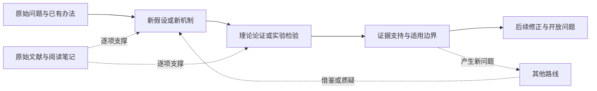

# 智能问题演进史：研究与维护方案

2026-10-23，作者确认将已有智能探索路线整理为长期维护的研究工程，并启动第一轮。研究不设成本或 token 上限；按可审阅的阶段交付推进。2026-10-25完成[第二轮三个样板](./intelligence-history/round-two/README.md)：25个指定主张审校节点，附原文定位、文献笔记及可编辑图。第一轮保留为[候选基线](./intelligence-history/README.md)。[第三轮A批](./intelligence-history/round-three-a/README.md)于2026-10-27完成[指定范围验收](./intelligence-history/round-three-a/validation.md)：34节点、41份来源阅读记录、109条定位主张、33条关系、三张问题卡、两组版本对照及Baird六状态复现。[第三轮B批](./intelligence-history/round-three-b/README.md)于2026-10-27完成指定范围验收（25节点、29来源、73主张、20关系、三张问题卡、两项A批回访和一项合成方法核验）；C—E批于2026-10-27完成[联合验收](./intelligence-history/cde-validation.md)：10条路线、66条节点记录、67条来源、129条主张、51条关系、9张问题卡、9项回访和三项合成核验。现已建立[20路线统一入口](./intelligence-history/index.html)、[覆盖与缺口表](./intelligence-history/coverage.md)及[共同问题索引](./intelligence-history/questions-index.md)；第四轮于2026-10-28启动，第一阶段「比较框架与证据审计」已完成[指定范围验收](./intelligence-history/round-four/validation.md)，形成[首篇综合工作台](./intelligence-history/round-four/index.html)。第二阶段[系统边界与发展](./intelligence-history/round-four/boundaries/index.html)已完成指定范围验收；第三阶段[意义与意识解释](./intelligence-history/round-four/meaning/index.html)亦已完成指定范围验收；综合修订与网站本地集成已完成[指定范围验收](./intelligence-history/round-four/integration/validation.md)。

## 研究目标

围绕“智能是什么”，追踪人们怎样提出问题、设计解释或方法、取得证据、发现限制，再形成新的分支。时间线是进入研究的入口；文献笔记、证据记录和可编辑数据共同构成长期资产。

已有 [20 个路线家族](../src/data/intelligenceRoutes.ts)、6 个问题层次和 8 条分歧轴作为首轮导航。它们是当前组织视角，可以随研究拆分、合并和改名，不视为已获公认的学科分类。一项事件可以属于多条路线；路线内部必须保留独立分支。例如控制论、强化学习与主动推断的共同归类不代表它们构成单一继承链。

## 每个历史节点研究什么

基本单位是“问题发生转折的事件”。论文、专著、实验、反例、复现、争论和测量标准的变化都可以形成事件。一篇文献可以支持多个事件，一个事件也可以由多份文献支持。

| 字段 | 要回答的问题 |
| --- | --- |
| 历史背景与时间 | 何时发生？当时有哪些任务、工具与约束？采用哪个版本的日期？ |
| 原始问题 | 研究者想解释什么、解决什么？已有办法的困难是什么？ |
| 核心变化 | 引入了什么假设、机制、表示、论证或实验设计？ |
| 原理重建 | 用一个小例子解释直觉，再展开必要的公式、推导或论证。 |
| 证据与边界 | 原文支持哪些结论？数据、对照、假设与反例分别是什么？ |
| 后续变化 | 后来的工作继承、修改、质疑或重新发现了什么？ |
| 原文定位 | 文献身份、版本、章节、页码、公式或图表位置。 |
| 开放问题 | 什么仍未解决？怎样区分不同解释？ |

沿用 [research-learning](https://github.com/meiluosi/research-learning/blob/main/skills/research-learning/SKILL.md) 的原始设计 → 原理 → 设计边界 → 改进 → 验证主线，并与[本站文献解读规范](./rsi-reading-notebook.md)衔接。第一轮只填发现和初筛所需字段，不能自动视为已完成上述深读。

不同研究对象使用不同证据标准：

- 算法与形式理论：定义、假设、证明、复杂度、实验与消融。
- 心理测量：构念、效度、信度、测量不变性、样本与文化适用范围。
- 神经与行为科学：测量对象、实验操纵、混杂、相关与因果的区别。
- 哲学：概念、前提、推理、反例和回应；不虚构量化实验。
- 历史与跨文化文本：原典、编纂与译本、词义、语境和解释分歧；不把古典“心”“智”“慧”等同于现代 IQ 或机器学习能力。
- 物理与非经典计算：区分数学结果、物理假说、模型演示与生物证据。量子计算可行不等于量子意识成立。

## 四轮交付

| 轮次 | 工作 | 完成条件 |
| --- | --- | --- |
| 一：全景底稿 | 盘点已有资料；20 条路线的核心问题、候选节点、来源入口、检索词和缺口；可编辑总图 | 每条路线有可追踪来源的候选序列；状态诚实；数据能重建图；缺口能直接转成下一轮任务 |
| 二：三个样板 | 学习效率与泛化、控制论与强化学习、具身与生态三条路线深读；内部保留分支 | 每条先完成约 8–12 个关键节点，关键主张有原文定位，重要历史连线有证据；完成一轮增补与重生成 |
| 三：全面展开 | 按共同问题分批补齐其余路线，并返回早期路线补充反例和遗漏传统 | 每批同时交付路线图、文献笔记、主张台账、异议与资料缺口 |
| 四：综合研究 | 比较共同问题上的回答、解释冲突和未被区分的假设 | 形成跨路线综述、开放问题清单及值得开展的实验或论证方案 |

节点数是批次组织参考，不是文献上限或“穷尽历史”的声明。日期覆盖到近年也不代表截至该年已经检索完整。具体执行每轮重新确认范围与验收，不自动创建后台定时任务。

## 第三轮的分批推进

第三轮将第二轮的样板方法推广到其余17条路线，并持续回访三个样板。组织单位仍是问题转折：提出了什么问题，为什么原有方法不足，新机制解释了什么，证据支持到哪里，又引出了什么分歧。下表中A—E五批均已完成各自指定范围验收；分组只用于组织研究，不宣称路线之间存在历史继承。

| 批次 | 共同问题 | 展开的路线 | 重点产出 |
| --- | --- | --- | --- |
| A：表征与认知机制 | 表征、学习、推理和行动如何协作？ | 符号逻辑；连接主义；概率因果与世界模型；认知架构 | 补三个样板的历史断层；四条路线图；模型与表征、学习与泛化、主体与环境三张问题卡；一项正式复现。 |
| B：能力与评价 | 怎样判断一个系统有何种智能？判断依赖什么任务和资源？ | 行为表现；心理测量；理性与资源约束 | 区分表现、能力构念、适应与效率；逐项记录测量对象、效度、样本、环境和资源条件。 |
| C：生物与发展 | 智能如何在个体发展、神经机制和生命过程中形成？ | 神经科学；发展与开放式学习；生命、自维持与演化 | 区分神经证据、发展模型和演化解释；回访具身路线；记录相关、干预和机制证据的差别。 |
| D：社会与文化 | 智能如何依赖语言、他人、工具、制度与价值？ | 社会文化与语言；集体、分布式与延展心智；智慧、价值与跨文化 | 区分个体与集体的分析单位；核对文化与历史语境；比较协作、工具依赖、价值判断与认知构成。 |
| E：解释边界与根本分歧 | 信息、意义、意识与物理解释分别承担什么解释任务？ | 信息、压缩与物理；语义与心灵哲学；意识、情感与自我；形而上学与非经典计算 | 区分形式结果、概念论证、经验理论和物理假说；形成异议、反例及可区分条件清单。 |

A批逐项交付见[执行计划](./intelligence-history/round-three-a/plan.md)。四条新路线分别有9、10、10、6个本批节点，同时补齐三个样板的指定历史断层。Thelen与Smith、Beer的相关范围、Brooks及MuZero版本对照已进入笔记；三张问题卡和Baird复现已统一审校。14张路线图、Mermaid源图、文献与工作台由同一份数据重建。验收不意味着全文阅读或历史穷尽，各路线保留未覆盖材料。B批已完成[执行计划](./intelligence-history/round-three-b/plan.md)，以测量和任务条件回访A批；[验收记录](./intelligence-history/round-three-b/validation.md)保留实际阅读范围、资料缺口和工程检查。

C—E交付见[联合验收](./intelligence-history/cde-validation.md)。全局第二轮至第三轮共150条批次节点记录，按稳定ID去重为144个节点；15张共同问题卡与11项回访贯通不同批次。第一轮候选仍保留原状态，25个无同ID后续匹配的候选及各路线阅读深度缺口已单列；第四轮修订确认其中1个有章节部分覆盖、24个尚无对应作品阅读映射；不以篇数代表全文完成。

每批交付同一组可维护材料：路线叙事、带问题与边界的时间线、分类型关系图、实际阅读范围明确的文献夹、逐条定位的主张与关系台账、异议与未解问题、验收记录。图和文献由稳定ID关联的数据同步生成。原文主张、本站分析、独立验证分别标记；提出但未执行的实验不能列为验证结果。

每条新路线通常先组织约6—10个关键转折节点，再按证据缺口增补。验收检查问题覆盖、早期依据、关键批评、版本与原文定位、历史关系证据和可重建图形，不以篇数或下载数代替研究质量。专著按问题分章阅读并登记范围；古典文本保留年代、编纂与译本的不确定性。每批完成后回访早期问题卡，保留修订依据。

第三轮完成时，20条路线都应有可审阅的研究序列，重大缺口有明确记录，共同问题能通过证据定位开展比较。第四轮再据此集中写跨路线综述、评估解释冲突并选择新的实验或论证；第三轮可以提出比较假设，但不提前宣告统一答案。

## 第四轮：综合研究的分阶段推进

第一阶段于2026-10-28完成：用[八维比较框架](./intelligence-history/round-four/framework.md)对齐研究单位、目标主张、任务评分、资源经历、测量、竞争解释、干预与迁移版本；首篇[《从表现到机制的证据边界》](./intelligence-history/round-four/synthesis.md)包含6个案例、6条条件性结论、10份来源记录与21条定位主张。原文报告、本站综合推断和精确方法核验分开维护；两组SVG／Mermaid可编辑，结论保留最强异议与下一项区分检验。

第二阶段于2026-10-28完成[系统边界与发展](./intelligence-history/round-four/boundaries/index.html)：9份选读、27条定位主张、6条条件性结论、5个案例、3组可编辑图、16种历史条件与8项精确检查。补齐边界判据、时间尺度、介入位置和状态历史字段，回访A、C、D批4张问题卡；[完整验收](./intelligence-history/round-four/boundaries/validation.md)列明版本与独立验证边界。

第三阶段于2026-10-28完成[意义与意识解释](./intelligence-history/round-four/meaning/index.html)：12份选读、40条主张、6条结论、6项预测比较、3组可编辑图和11项精确检查；版本与实施差异单列，详见[验收](./intelligence-history/round-four/meaning/validation.md)。随后第四阶段完成共同复核与网站本地集成。前三阶段各有3项后续研究方案，共9项均仍为未执行设计；完成的独立验证是预先协议下的数学反例。更新通过[当前索引注释层](./intelligence-history/index-annotations.json)生效，旧批次数据与笔记保留历史快照。

## 图的三层组织

1. 全景时间线：同一时间轴、不同路线泳道，按重要性展开；古典文本另列，避免将不确定年代挤进现代等比例坐标。
2. 单路线演进图：展示问题、方法、证据、限制和分叉；不是只有论文题名。
3. 跨路线问题图：围绕表征、泛化、主体边界、目标、理解等共同问题比较回答。

上图是研究结构示意，不是已经考证的历史关系。实际图中，“早于”“引用”“历史影响”“方法继承”“反驳”“独立发现”“本站提出的比较”必须分别建模。引用本身也不自动证明思想继承。第一轮默认只呈现年代顺序和明确标出的编辑性比较，不编造历史因果边。

保留失败、停滞、复现分歧、被忽略的工作和重新发现。未入选的候选也要有理由，避免只追踪当下胜出的路线。

## 数据与编辑

首轮事实底稿维护在 [`atlas.json`](./intelligence-history/atlas.json)。第二轮研究数据独立维护在 [`round-two/research.json`](./intelligence-history/round-two/research.json)，复用稳定事件ID，并保存第一轮基线指纹；第二轮的阅读进展不回写为第一轮当时已读。使用 `scripts/generate-intelligence-history-round-two.mjs` 同步生成笔记、台账、SVG、Mermaid及交互工作台。来源、事件、路线和关系分别使用稳定 ID；引用用 ID 关联，不能用显示题名当主键。路线 ID 与网站当前配置对应，未来改名时保留别名与迁移说明。

| 对象 | 必要字段 |
| --- | --- |
| route | ID、核心问题、检索词、已有材料、分支、资料缺口、样板优先级 |
| source | ID、题名、作者、出版年、文献类型、稳定链接、来源类型、检索/阅读状态、实际读取位置、访问日期 |
| event | ID、标题、日期及口径、路线归属、问题、候选方法摘要、待核问题、来源 IDs、主张状态 |
| relation | ID、两端事件、关系类型、关系依据、来源 IDs、证据状态 |

日期区分事件日期和所用文献版本日期；允许年代范围、约数和未知日期。书目平台的网页上线时间不能替代原文发表时间。古典原作年代不明时保留为空，译本年单独记录。

编辑流程：修改数据 → 运行生成与校验 → 检查图和文档差异 → 保留版本记录。后续可增表单编辑器，但它必须写回同一份数据。SVG 和 Mermaid 源图可继续编辑、分享；由数据生成的文件应通过数据重生成，避免下次覆盖手工修改。

首轮文档与图放在 `docs/`，不自动发布为已审校博客或替换当前路线介绍。网站时间线页面、表单编辑器和文献架交互属于后续集成工作。

## 文献夹与阅读状态

项目内文献工作台从第一轮建立：每项来源可查到它关联的事件、阅读状态和下一步问题。现有 `/library/` 中的文献 ID 可通过映射复用；首轮不把全部候选批量标成已读。若之后使用 Zotero，负责原文件、批注与书目管理；项目内记录负责问题、事件和论证关系，两者用稳定标识关联。

工作流：候选 → 定位与去重 → 按问题阅读原文并登记实际范围 → 主张/证据摘录 → 关联节点 → 事实复核 → 发布解读。指定片段阅读可以支持有明确定位的局部主张；只有实际读完相应正文才标为全文完成，专著、附录、证明及代码分别记录。检索摘要只用于定位与初筛。源页可打开、元数据已核对、正文已读和结论已验证是不同状态。

两组状态独立维护：

- 阅读：`discovery-only`（只见检索/目录）→ `metadata`（打开元数据页）→ `abstract`（打开并读摘要）→ `selected-sections` → `full-text`。附录、代码、复现另记，不随正文状态自动提升。
- 主张：`candidate`（候选，未审校）→ `source-reported`（原文明确主张）／`derived`（推导）／`editorial-inference`（本站分析）；是否被独立验证另行记录。

摘要页面读取失败时记录失败，不用搜索结果冒充打开全文。没有全文时记录所缺材料，不虚构页码。来源内容与本站拟研究的问题明确分开；“尚待检验”的问题不写成作者已承认的限制。

## 第一轮检索与验收口径

- 按路线已有分支提取中英检索词，优先找作者、出版方、原始论文库和原典档案。图书馆目录仅核对书目，不作为理论成立的证据。
- 每条路线优先覆盖早期问题、方法或定义转折、批评/边界、后续分化。当前材料不够时明确列缺口，不用泛泛的“未来工作”代替。
- 记录检索日期、具体入口和实际读取范围。检索范围为第一轮探索性发现，不声称系统综述或全面最新覆盖。
- 核对来源 ID、事件 ID、路线映射、年代口径、图表数目和内部链接；生成应可重复。
- 第一轮结束需提供可阅读底稿、可编辑数据与图、文献队列、已有材料盘点、下一轮样板的明确任务。关键主张的原文阅读与审校从第二轮开始，全文及附录的完成度逐篇据实登记。

## 已识别的重点风险

1. 当前路线介绍中的强断言需要回到原文检查，例如把耦合等同于构成、把预测等同于理解、把自维持等同于智能。
2. 当前文章的自动路线匹配通常返回首个命中，不能直接当作一篇文章的全部研究归属。盘点保留多路线关联和人工复核状态。
3. Binet–Simon 等早期来源存在卷年与实际出版年差异；信息瓶颈、MuZero 等存在会议、预印本和期刊日期差异。
4. 跨文化路线不能只由几部现代英译代表全部传统；意识与非经典路线不能把争议性主张写成既定发现。
5. 现有文档中尚未识别的 dot 批次继续保留独立状态；本轮新检索集合不冒充那一批原始文献。

第四阶段于2026-10-28完成[共同复核与网站本地集成](./intelligence-history/round-four/integration/README.md)：18条结论、31条来源、三篇原生综述、9项未执行设计排序。历史144节点与原有读段状态保持不变；下一步优先锁定群体研究版本再复算原报告。公网部署未执行，后续数据复算和专项阅读不计为本轮已完成。

## 第五轮：路线演进时间线的网站化

第五轮从既有审校数据构建20条正式网站时间线，三个不同类型的路线先作样板；每个节点关联原批次的问题、方法、前提、来源读段、定位主张和限制，既有关系分别呈现。SVG／Mermaid及路线数据可编辑，年份先后不被当作历史影响。图示和节点所用数据遵循原批次与当前索引，当前不新增阅读与复算；见[执行计划](./intelligence-history/round-five/plan.md)。

## 第六轮：关键缺口与反方补读

以第五轮24项未映射候选为历史基线，按核心问题和区分价值排序。第六轮选读4个候选与2项竞争解释；原有批次、第四轮结论和历史数量保留快照。新增节点、来源读段、关系与增量回访进入时间线及综合研究，具体范围见[第六轮](./intelligence-history/round-six/README.md)。
