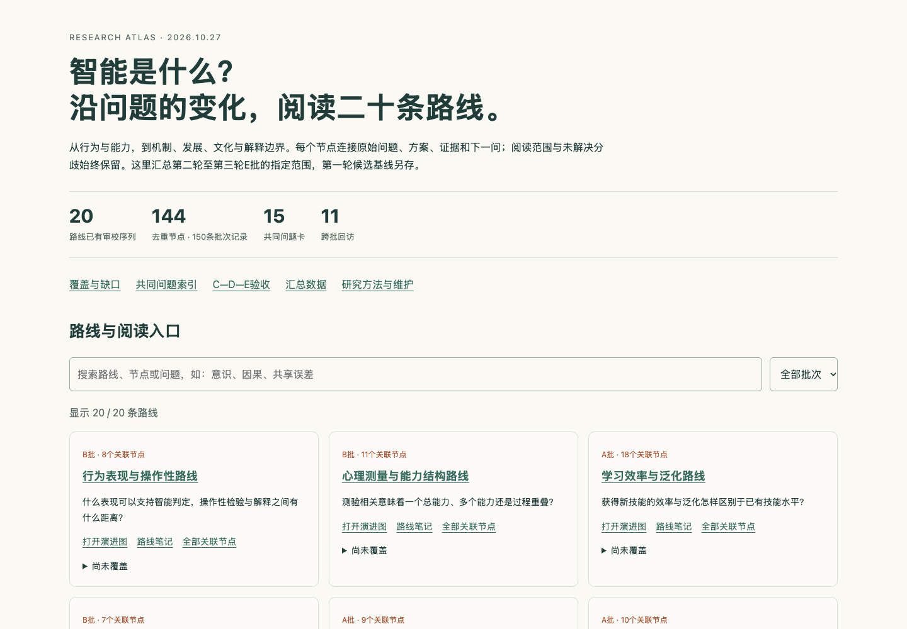

# 第三轮C—D—E联合验收

2026-10-27完成连续目标的指定范围。第三轮全部五批与第二轮样板一起，为20条路线提供可审阅的研究序列；“完成”不意味着完整路线史、全部原文读完或统一智能定义成立。

[统一研究入口](index.html) · [覆盖与缺口](coverage.md) · [共同问题索引](questions-index.md) · [C批](round-three-c/validation.md) · [D批](round-three-d/validation.md) · [E批](round-three-e/validation.md)

| 批次 | 路线 | 节点记录 | 来源记录 | 定位主张 | 关系 | 问题卡／回访 |
| --- | ---: | ---: | ---: | ---: | ---: | ---: |
| C：生物与发展 | 3 | 19 | 19 | 40 | 15 | 3／3 |
| D：社会与文化 | 3 | 22 | 23 | 39 | 16 | 3／3 |
| E：解释边界 | 4 | 25 | 25 | 50 | 20 | 3／3 |
| 本次合计 | 10 | 66 | 67 | 129 | 51 | 9／9 |

66条是本次批次记录，含Thelen–Smith、Searle的前批延续；不是66个全部新增节点。全局第二轮至E批共150条记录，按稳定ID去重为144个节点；162条批次来源记录涉及153个来源ID。15张共同问题卡与11项跨批回访已建索引。首轮106候选中81个已有后续节点笔记，其余25个及版本、深度缺口均保留。

## 证据与版本边界

每个节点有原始问题、机制、前提、原文主张与定位、证据类型和下一问。来源注明实际载体、版本、阅读范围及未验内容。D批两份来源仅摘要；部分来源为重印、译本、作者稿、网页或图像选页，不把它们当作原版全文完成。所需原件未取得时记录失败及替代载体。

古典文本独立于现代等比例时间轴。现象学论证、规范判断、统计结果、神经指标和量子物理假说各自保留证据条件。关系图中的“本站比较”不宣称历史影响；理论家族的后续检验不自动等于对早期版本全部命题的检验。

[访问日志C](round-three-c/evidence/access-log.json)、[D](round-three-d/evidence/access-log.json)、[E](round-three-e/evidence/access-log.json)区分网络取回、可用载体和实际阅读。未向项目复制版权PDF原件。

## 三项已执行核验

1. [C：观察等价与因果机制](round-three-c/method-check/README.md)。同一联合分布在两个结构模型中对应不同干预结果。
2. [D：共享误差与群体平均](round-three-d/method-check/README.md)。固定个体方差，用完整枚举、协方差和解析式核对1/4、1、5/8等结果。
3. [E：顺序效应与实现](round-three-e/method-check/README.md)。二维投影与经典有限状态机得到同样的两次测量分布，同基负控制通过。

共12项精确检查通过。三份协议先于实现保存，协议及实现指纹与结果一并记录。以上均是合成模型核验；问题卡中的新实验仍为未执行，不冒称原论文、生物或人类实验复现。

## 工程与交互

- 第一轮、第二轮、A、B四份数据的SHA-256与[cde-baselines.json](cde-baselines.json)一致，四套旧生成器的`--check`均通过；B批合成核验亦保持一致。
- C、D、E三批生成器、全局索引生成器的`--check`通过；20张路线SVG、对应Mermaid、逐节点笔记和问题卡都可由数据重建。
- [结构检查记录](evidence-cde/structure-check.json)核验本地链接、24份SVG XML及CDE引用字段；[审计程序](../../scripts/audit-intelligence-history-cde.py)可复跑。
- [浏览器记录](evidence-cde/browser-check.json)覆盖10条路线、66个节点详情、4项证据字段、时间线和关系图、目录与SVG键盘Enter操作；390px布局无整页横向溢出，无脚本异常。
- 总览核验20条路线、15张问题卡、E批筛选、关键词“退相干”搜索和无结果状态。大图在容器内滚动，移动端另有目录入口。
- [工程检查记录](evidence-cde/engineering-check.json)：`pnpm check`检查188文件，0错误、0警告、0提示。`pnpm type-check`通过。完整`pnpm build`生成243页面；首跑被沙箱阻止tsx本地IPC，获运行权限后原命令通过。关闭外部AI摘要调用，未改变图标和LQIP缓存指纹。
- 构建保留npm配置、Vite较大分块及robots重复入口提示，均未阻止构建；未发布、部署或提交。研究结果在docs下，与正式站点集成另列。

## 预览

[手机预览](evidence-cde/overview-mobile.png) · [D古典文本与现代路线](evidence-cde/d-wisdom-desktop.png) · [E关系图](evidence-cde/e-relations-desktop.png) · [C手机](evidence-cde/c-mobile.png)

## 继续维护

编辑各批`research.json`，运行对应批次生成器，再运行`node scripts/generate-intelligence-history-index.mjs`。全局汇总文件不手工修改。SVG与Mermaid为可编辑导出；长期修改应回到源数据，避免下次覆盖。

核验顺序：各批生成检查 → 三项方法核验 → 全局索引检查 → 本地链接审计。新增图形交互再复查浏览器；新增站点内容再按仓库规范执行完整工程检查。

第四轮尚未启动。建议从共同问题卡挑选最能区分解释的一组问题，先补足会影响结论的原文／版本／反方证据，再形成综述和新的实验协议。
