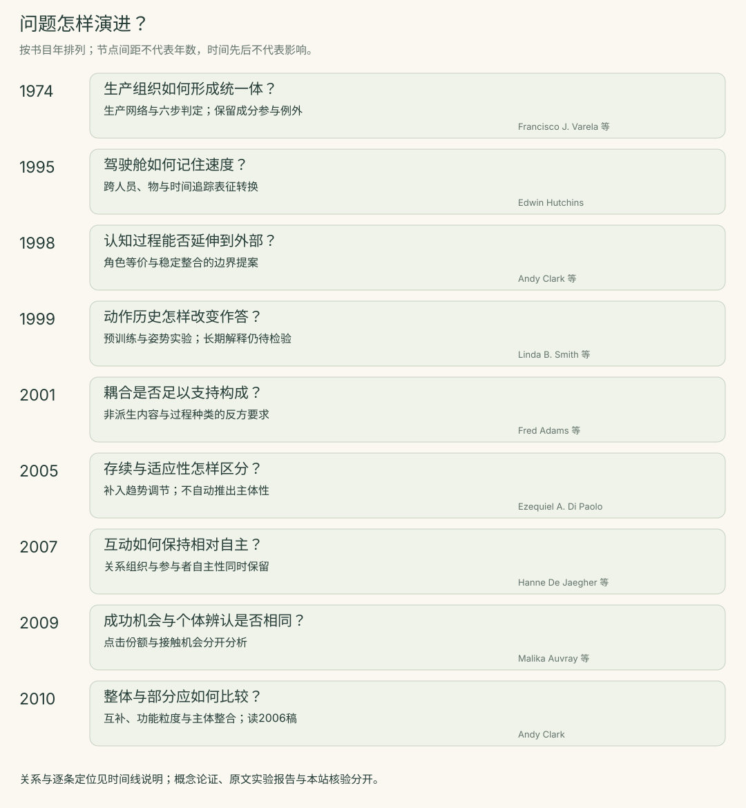

<!-- 由boundaries/research.json与method-check/results.json生成；修改数据后重生成。 -->

# 系统边界问题的演进与争论

按书目年排列，不以时间先后冒充影响。Clark的2010书章实际读的是2006仓储稿；2009知觉交互论文在线于2008年。横纵间距不代表年数，本表不是完整思想史。

[编辑Mermaid关系图](timeline.mmd) · [编辑数据](research.json)

SVG按时间列出问题节点；Mermaid表达下面的争论与比较关系。两种视图互补，均从同一份来源与关系数据维护。

| 年份／来源 | 当时的问题 | 方案与推进 | 仍未解决 |
| --- | --- | --- | --- |
| 1974 [varela-1974](notes/varela-1974.md) | 怎样在不以繁殖史定义个体的情况下，描述一个活系统的组织？ | 以成分生产网络及其生成的统一体界定自创生，附最小模型与六步判定。 | 判据不等于智能或体验指标；形式模型与具体生物实现之间仍需论证。 |
| 1995 [hutchins-cockpit-1995](notes/hutchins-cockpit-1995.md) | 驾驶舱如何在任务展开过程中保存并使用着陆速度？ | 追踪数值、语音、刻度和速度标记在人、物和时间之间的转换。 | 功能单位的有效分析，不直接裁决心灵本体边界或个体记忆容量。 |
| 1998 [clark-chalmers-1998](notes/clark-chalmers-1998.md) | 某项功能若移入头脑就算认知，为何放在可靠外部工具上便被排除？ | 提出角色等价、主动耦合与外部信念的论证，讨论稳定可用等条件。 | 条件是否足以界定认知，以及什么粒度的功能角色可比较，仍有争论。 |
| 1999 [smith-thelen-1999](notes/smith-thelen-1999.md) | A-not-B错误是否只反映稳定的物体知识，还是受到此前动作和当下状态影响？ | 操纵伸手经历与任务条件，比较错误随局部历史和姿势改变的情况。 | 短时任务变化不唯一定位记忆实现，也不能独自排除所有表征解释。 |
| 2001 [adams-aizawa-2001](notes/adams-aizawa-2001.md) | 功能耦合何以足以把外部物品判为认知过程的一部分？ | 提出非派生内容与因果过程种类的边界要求，质疑从耦合跳到构成。 | 作者允许颅外认知在原则上可能；争点是判据及其应用，不能化为头骨定义。 |
| 2005 [dipaolo-2005](notes/dipaolo-2005.md) | 持续自我生产是否已足以说明规范、适应性和行动主体？ | 补充对接近存活边界的趋势进行监测与补偿的适应性概念。 | 稳健存续、适应性与主体性仍需分别判定。 |
| 2007 [dejaegher-dipaolo-2007](notes/dejaegher-dipaolo-2007.md) | 互动本身能否产生相对自主的组织，而又保留参与者各自的自主性？ | 以互动过程的维持及参与者自主性的同时保留刻画社会互动，提出参与式意义生成。 | 不能由协调成功直接推出共同体验或独立群体心灵。 |
| 2009 [auvray-2009](notes/auvray-2009.md) | 极简接触信息下，真实互动伙伴如何比其他接触源更容易被选中？ | 比较真实伙伴、固定物与同步移动诱饵，分别考察接触机会和点击分布。 | 总体选中更多与接触之后能辨认对象是不同结论。 |
| 2010 [clark-reply-2010](notes/clark-reply-2010.md) | 外部部件是否必须单独具有完整认知特征，才可能成为认知系统的部分？ | 区分整体与部分的属性，并提出互补功能、合适粒度及与主体的整合。 | 仍须说明什么构成统一主体，以及哪些整合方式足以支持认知归属。 |

## 有依据的关系与编辑比较

| 关系 | 类型 | 定位依据 |
| --- | --- | --- |
| clark-chalmers-1998 → adams-aizawa-2001：明确批评边界论证 | documented-debate | [adams-aizawa-2001-2](notes/adams-aizawa-2001.md#adams-aizawa-2001-2)、[adams-aizawa-2001-3](notes/adams-aizawa-2001.md#adams-aizawa-2001-3) |
| adams-aizawa-2001 → clark-reply-2010：回应系列批评，含2001论文；实际读2006稿 | documented-debate | [clark-reply-2010-1](notes/clark-reply-2010.md#clark-reply-2010-1)、[clark-reply-2010-2](notes/clark-reply-2010.md#clark-reply-2010-2) |
| varela-1974 → dipaolo-2005：明确引用并补充适应性条件 | documented-debate | [dipaolo-2005-2](notes/dipaolo-2005.md#dipaolo-2005-2) |
| dipaolo-2005 → dejaegher-dipaolo-2007：在自主性讨论中引用；扩展到互动 | documented-reference | [dejaegher-dipaolo-2007-1](notes/dejaegher-dipaolo-2007.md#dejaegher-dipaolo-2007-1) |
| dejaegher-dipaolo-2007 → auvray-2009：本站比较互动组织与实验指标；未核实直接影响 | editorial-comparison | [dejaegher-dipaolo-2007-2](notes/dejaegher-dipaolo-2007.md#dejaegher-dipaolo-2007-2)、[auvray-2009-2](notes/auvray-2009.md#auvray-2009-2) |
| hutchins-cockpit-1995 → clark-chalmers-1998：本站比较功能单位与构成；不把同年专著引用冒充本文影响 | editorial-comparison | [hutchins-cockpit-1995-3](notes/hutchins-cockpit-1995.md#hutchins-cockpit-1995-3)、[clark-chalmers-1998-1](notes/clark-chalmers-1998.md#clark-chalmers-1998-1) |

实线表示有原文依据的争论／引用；虚线表示本站为比较而连线。没有从Hutchins同年专著的引用推出驾驶舱论文的影响，也没有把2007互动理论与2009实验自动连成已核实传承。
