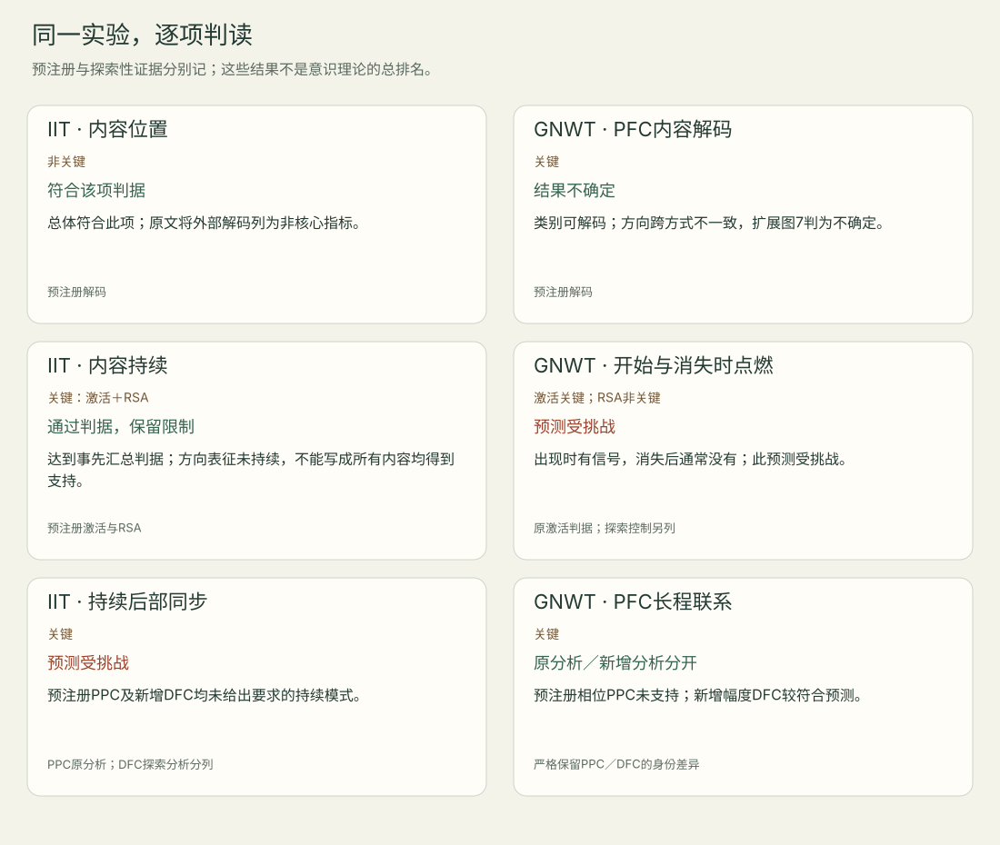

<!-- 由meaning/research.json和method-check/results.json生成；编辑源数据后重生成。 -->

# COGITATE逐项预测与解释台账

这六行按理论×三类预测组织，属于同一个实验项目。判断转述自2025主文、扩展图7／表1及理论方回应；本轮没有复算原始数据。不能把“后部解码成功”等同于测得完整Φ。

## IIT · 内容位置

- 事先预测：后部类别与方向解码较强；加入PFC不改善。
- 关键程度：非关键
- 结果：总体符合此项；原文将外部解码列为非核心指标。
- 分析身份：预注册解码
- 反方／理论方回应：IIT方视为支持后部复合体；GNWT方提醒后部刺激编码也可能是非意识加工。
- 下一项区分：增加匹配的有／无体验条件和机制干预。
- 定位依据：[cogitate-2025-c3](notes/cogitate-2025.md#cogitate-2025-c3)、[cogitate-supp-2025-c1](notes/cogitate-supp-2025.md#cogitate-supp-2025-c1)、[cogitate-supp-2025-c2](notes/cogitate-supp-2025.md#cogitate-supp-2025-c2)。

## IIT · 内容持续

- 事先预测：后部有跨时段持续的内容相关激活和表征。
- 关键程度：关键：激活＋RSA
- 结果：达到事先汇总判据；方向表征未持续，不能写成所有内容均得到支持。
- 分析身份：预注册激活与RSA
- 反方／理论方回应：理论方提出眼动、视网膜位置和稀疏低级视区取样可能影响内容持续。
- 下一项区分：同时校验持续体验、眼动与各内容维度。
- 定位依据：[cogitate-2025-c3](notes/cogitate-2025.md#cogitate-2025-c3)、[cogitate-supp-2025-c1](notes/cogitate-supp-2025.md#cogitate-supp-2025-c1)。

## IIT · 持续后部同步

- 事先预测：类别选择区与V1/V2有持续、内容相关的联系。
- 关键程度：关键
- 结果：预注册PPC及新增DFC均未给出要求的持续模式。
- 分析身份：PPC原分析；DFC探索分析分列
- 反方／理论方回应：IIT方提出频段、稀疏覆盖及ROI筛选放宽；联盟仍认为这是主要挑战。
- 下一项区分：预先固定频段及筛选，以更密覆盖和敏感性控制复核。
- 定位依据：[cogitate-2025-c4](notes/cogitate-2025.md#cogitate-2025-c4)、[cogitate-2025-c5](notes/cogitate-2025.md#cogitate-2025-c5)、[cogitate-supp-2025-c1](notes/cogitate-supp-2025.md#cogitate-supp-2025-c1)、[cogitate-supp-2025-c5](notes/cogitate-supp-2025.md#cogitate-supp-2025-c5)。

## GNWT · PFC内容解码

- 事先预测：PFC可解码类别与方向，并跨任务泛化。
- 关键程度：关键
- 结果：类别可解码；方向跨方式不一致，扩展图7判为不确定。
- 分析身份：预注册解码
- 反方／理论方回应：GNWT方提出混合细胞代码及宏观测量分辨率问题；联盟要求解释内容维度的不完整。
- 下一项区分：先证实测量可检测相关维度，再比较两种理论预测。
- 定位依据：[cogitate-2025-c3](notes/cogitate-2025.md#cogitate-2025-c3)、[cogitate-supp-2025-c2](notes/cogitate-supp-2025.md#cogitate-supp-2025-c2)。

## GNWT · 开始与消失时点燃

- 事先预测：PFC在刺激出现和消失后都有内容相关瞬时点燃。
- 关键程度：激活关键；RSA非关键
- 结果：出现时有信号，消失后通常没有；此预测受挑战。
- 分析身份：原激活判据；探索控制另列
- 反方／理论方回应：GNWT方认为体验可能提前转移、消失未被注意；这需要新的独立检验。
- 下一项区分：预先校验持续体验，交叉操纵消失显著性与任务。
- 定位依据：[cogitate-2025-c4](notes/cogitate-2025.md#cogitate-2025-c4)、[cogitate-supp-2025-c2](notes/cogitate-supp-2025.md#cogitate-supp-2025-c2)、[cogitate-supp-2025-c3](notes/cogitate-supp-2025.md#cogitate-supp-2025-c3)。

## GNWT · PFC长程联系

- 事先预测：类别选择区与PFC有约0.3–0.5秒的内容相关联系。
- 关键程度：关键
- 结果：预注册相位PPC未支持；新增幅度DFC较符合预测。
- 分析身份：严格保留PPC／DFC的身份差异
- 反方／理论方回应：GNWT方强调跨区联系；联盟同时保留原分析的负结果。
- 下一项区分：在新数据上预先锁定两指标及失败解释。
- 定位依据：[cogitate-2025-c4](notes/cogitate-2025.md#cogitate-2025-c4)、[cogitate-supp-2025-c2](notes/cogitate-supp-2025.md#cogitate-supp-2025-c2)、[cogitate-supp-2025-c5](notes/cogitate-supp-2025.md#cogitate-supp-2025-c5)。

## 分母与版本

256是总招募数，不能作为所有分析的共同分母。MEG纳入97（32优化、65检验），fMRI纳入108（35优化、73检验）；iEEG招募34、排除2份不完整记录，各分析仍有不同纳入数，且没有相同独立拆分。两方预注册PPC同步均未获支持；较符合GNWT的DFC是新增分析。详见[版本台账](versions.md)与[COGITATE笔记](notes/cogitate-2025.md)。

[编辑SVG](prediction-map.svg) · [编辑Mermaid](prediction-map.mmd)
