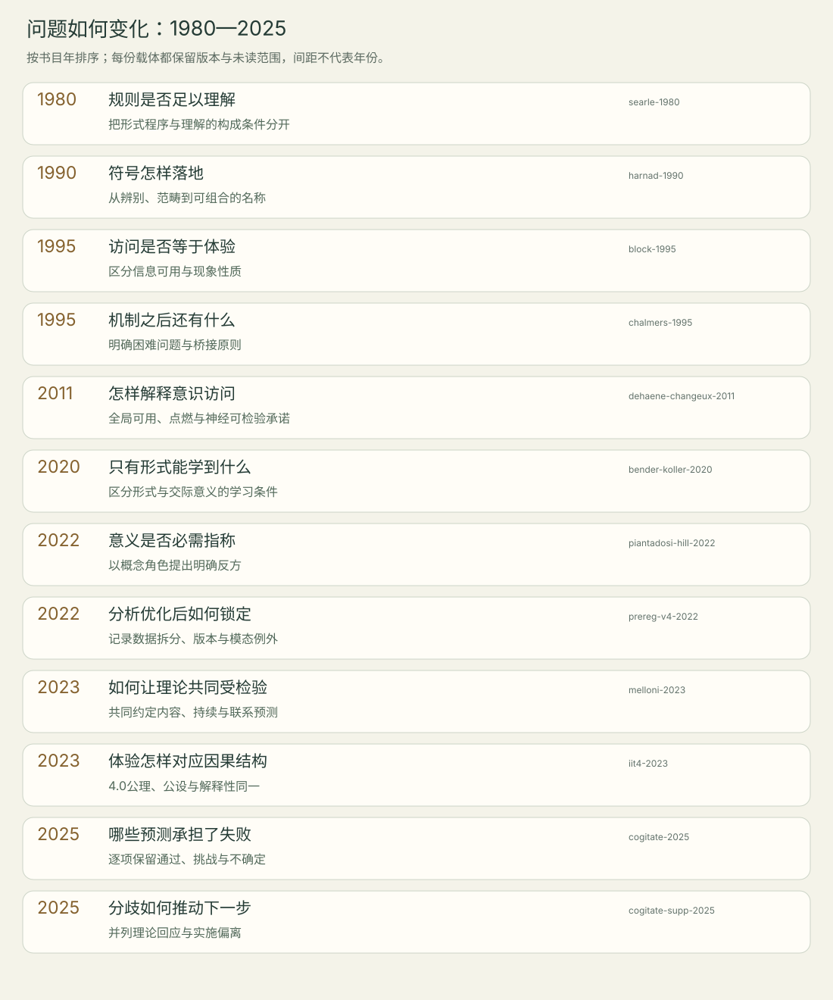

<!-- 由meaning/research.json和method-check/results.json生成；编辑源数据后重生成。 -->

# 问题演进与有依据的关系

节点按书目年排序，同年先后不表示影响，间距不代表年份长度。2022锁定文件和2023发表协议的时间差需结合[版本台账](versions.md)。本图为选定问题链，未声称覆盖整个意义与意识思想史。

| 年份与来源 | 问题 | 方案 | 下一问 |
| --- | --- | --- | --- |
| 1980 [searle-1980](notes/searle-1980.md) | 执行规则而产生正确回答，是否足以构成理解？ | 以中文房间及其变体挑战程序形式本身的充分性，强调能产生意向性的因果能力。 | 系统层次能否拥有操作者不具备的理解，以及何种因果能力才相关，仍存在争论。 |
| 1990 [harnad-1990](notes/harnad-1990.md) | 符号的解释如何不完全依赖外部解释者？ | 用感知辨别和范畴识别支撑基本名称，再通过组合使复合描述继承落地。 | 哪些概念可由此形成、如何学习不变特征，以及行为成功是否具有主观意义，仍需区分。 |
| 1995 [block-1995](notes/block-1995.md) | 从信息使用障碍推出体验的功能，是否混淆了不同解释对象？ | 区分经验的现象性质与信息可用于推理及理性行动的访问性质。 | 概念区分是否对应经验上的可分离性，以及功能主义能否解释体验，不能靠命名解决。 |
| 1995 [chalmers-1995](notes/chalmers-1995.md) | 为什么执行认知功能会伴随体验，而非只有功能？ | 提出困难问题，并以体验为基本性质、心理物理桥接原则为非还原理论方向。 | 解释鸿沟是否意味着还原不可能、桥接原则能否形成可区分预测，仍是哲学与科学争议。 |
| 2011 [dehaene-changeux-2011](notes/dehaene-changeux-2011.md) | 信息如何从非意识加工进入可报告的意识访问？ | 以长程网络的信息全局可用和非线性点燃建立机制模型，并提出神经检验。 | 信号是否编码内容、是否只是任务后果、是否具必要因果作用，以及如何延伸到更广体验。 |
| 2020 [bender-koller-2020](notes/bender-koller-2020.md) | 仅观察语言形式能否学到与交际意图和外部内容的关系？ | 明确表达式、交际意图及常规意义的联系，区分形式学习和意义学习。 | 文本包含何种间接结构、任务标签何时超出形式，以及定义是否覆盖概念角色意义，需另作比较。 |
| 2022 [piantadosi-hill-2022](notes/piantadosi-hill-2022.md) | 把缺少外部指称直接等同于毫无意义，是否忽略概念之间的作用关系？ | 以概念角色语义学反对只由训练目标或指称缺失否定意义，强调内部表征与推理关系。 | 真实模型是否具有稳定的因果概念角色，以及交际意图和感知行动增加什么，仍需实验。 |
| 2022 [prereg-v4-2022](notes/prereg-v4-2022.md) | 分析优化之后，怎样约束对剩余数据的检验？ | 在优化后锁定分析与预测解释；分清独立保留数据与颅内记录的特殊策略。 | 落实到最终发表版本有哪些偏离，哪些影响理论判定，须与补充材料逐项对照。 |
| 2023 [melloni-2023](notes/melloni-2023.md) | 相互竞争的意识解释，怎样在同一个实验中承担不同的预测风险？ | 共同约定内容位置、持续方式和区域联系的预测，操纵任务相关性与刺激持续时长。 | 判定权重、测量灵敏度和可见刺激是否持续被体验，是协议走向解释时的重要条件。 |
| 2023 [iit4-2023](notes/iit4-2023.md) | 如何将体验的性质与物理系统的内在因果结构对应？ | 从现象公理提出物理公设，以复合体的Φ结构及其区别、关系表达体验。 | 桥接主张的正当性、可计算性、近似量的效度及其神经实现仍需分别检验。 |
| 2025 [cogitate-2025](notes/cogitate-2025.md) | 两理论共同认可的神经预测，哪些得到支持、受挑战或仍不确定？ | 清晰视觉刺激、任务相关性控制与三种记录方式，按约定预测进行检验并公开不同解释。 | 从统计结果到理论修订须追踪核心程度、探索性分析、覆盖局限与体验测量假定。 |
| 2025 [cogitate-supp-2025](notes/cogitate-supp-2025.md) | 同一组结果为何仍产生不同理论评价，后续应怎样区分？ | 分别保存理论方回应、测量反驳和实施偏离，而非把论文摘要当作完整裁决。 | 更密覆盖、持续体验和因果必要性的检验，应预先锁定新预测与失败条件。 |

## 引用、争论与本站比较

| 关系 | 类型 | 定位依据 |
| --- | --- | --- |
| searle-1980 → harnad-1990：同一符号问题的不同充分性要求 | editorial-comparison | [searle-1980-c3](notes/searle-1980.md#searle-1980-c3)、[harnad-1990-c3](notes/harnad-1990.md#harnad-1990-c3) |
| harnad-1990 → bender-koller-2020：落地问题进入形式／意义讨论 | documented-reference | [bender-koller-2020-c1](notes/bender-koller-2020.md#bender-koller-2020-c1)、[bender-koller-2020-c2](notes/bender-koller-2020.md#bender-koller-2020-c2) |
| bender-koller-2020 → piantadosi-hill-2022：概念角色路线质疑指称中心判据 | documented-debate | [piantadosi-hill-2022-c1](notes/piantadosi-hill-2022.md#piantadosi-hill-2022-c1)、[piantadosi-hill-2022-c2](notes/piantadosi-hill-2022.md#piantadosi-hill-2022-c2) |
| block-1995 → dehaene-changeux-2011：对齐访问概念与综述的实验目标 | editorial-comparison | [block-1995-c2](notes/block-1995.md#block-1995-c2)、[dehaene-changeux-2011-c1](notes/dehaene-changeux-2011.md#dehaene-changeux-2011-c1) |
| chalmers-1995 → iit4-2023：比较桥接原则与解释性同一 | editorial-comparison | [chalmers-1995-c3](notes/chalmers-1995.md#chalmers-1995-c3)、[iit4-2023-c1](notes/iit4-2023.md#iit4-2023-c1) |
| dehaene-changeux-2011 → cogitate-2025：主文引为GNWT背景之一，非同一版本 | documented-reference | [cogitate-2025-c1](notes/cogitate-2025.md#cogitate-2025-c1) |
| iit4-2023 → cogitate-2025：主文引用4.0；测试的是约定生物预测 | documented-reference | [cogitate-2025-c1](notes/cogitate-2025.md#cogitate-2025-c1) |
| prereg-v4-2022 → cogitate-2025：最终分析文件与发表结果对照 | documented-reference | [cogitate-2025-c2](notes/cogitate-2025.md#cogitate-2025-c2)、[cogitate-2025-c4](notes/cogitate-2025.md#cogitate-2025-c4) |
| melloni-2023 → cogitate-2025：协议中的实验1预测进入检验 | documented-reference | [cogitate-2025-c1](notes/cogitate-2025.md#cogitate-2025-c1)、[cogitate-2025-c3](notes/cogitate-2025.md#cogitate-2025-c3)、[cogitate-2025-c4](notes/cogitate-2025.md#cogitate-2025-c4) |
| cogitate-2025 → cogitate-supp-2025：同一研究内三方解释及偏离记录 | documented-debate | [cogitate-supp-2025-c1](notes/cogitate-supp-2025.md#cogitate-supp-2025-c1)、[cogitate-supp-2025-c2](notes/cogitate-supp-2025.md#cogitate-supp-2025-c2)、[cogitate-supp-2025-c4](notes/cogitate-supp-2025.md#cogitate-supp-2025-c4)、[cogitate-supp-2025-c5](notes/cogitate-supp-2025.md#cogitate-supp-2025-c5) |

[Mermaid关系图](timeline.mmd)实线表示原文引用／争论，虚线表示本站编辑比较；[SVG时间线](timeline.svg)只表示阅读节点的先后，两者互补。
