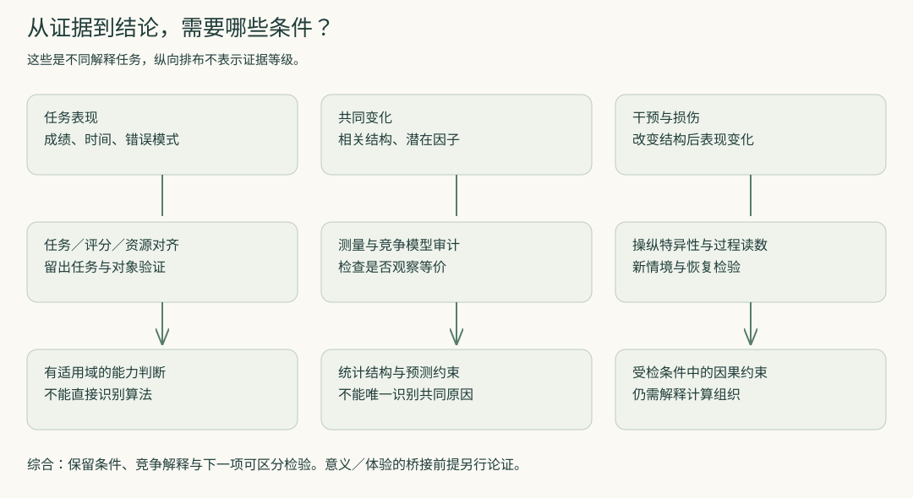
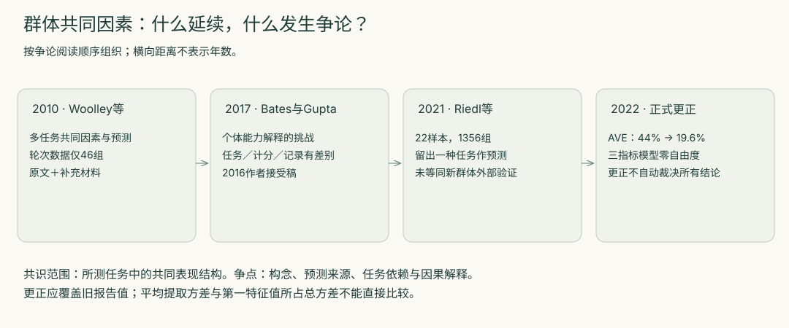

<!-- 由round-four/research.json生成；请修改源数据后重生成。 -->

# 从表现到机制的证据边界

从表现、相关结构和干预结果，我们分别能推出哪些关于能力与机制的结论？

本篇结论是条件性的：表现约束能力判断，相关结构约束统计解释，干预结果约束因果作用；每向机制推进一步，都需要说明额外的假设和仍可成立的竞争解释。

[交互页](index.html) · [完整比较矩阵](comparison.md) · [逐条结论审计](conclusions.md)

## 同一个“更聪明”，可能是四种不同判断

一个系统答对更多题，可能因为相关经验更多、时间更多、评分偏好某种策略，也可能因为更容易学会新技能。评价首先要说明要预测的是新题成绩、学习速度、跨环境适应，还是要解释实现过程。Chollet给出技能获取效率的一种操作化提案；群体测量研究则把多任务表现压缩为预测指标。它们都可以有研究用途，比较前却必须说明目标是否相同。

依据与边界：[p1](conclusions/p1.md)。

## 统计压缩不会自行变成机制

因子模型给出紧凑的共同变化结构，解释模型则要说明这种结构为什么形成。Borsboom等提出因果测量观，van der Maas等展示发展互动的竞争解释。本篇不以某一种效度观统摄所有研究，而用一个更窄的要求审计推理：如果两种模型能生成同样观察，当前观察就不足以把其中一种宣布为唯一机制。数学反例使这一点不依赖任何心理学立场。

依据与边界：[p2](conclusions/p2.md)。

## 干预改变了什么，仍要继续追问

病损提供了比无干预共变更直接的因果约束，但自然损伤不是可随意设置的单一开关。Barbey的样本覆盖、伤后变化和任务构成都影响解释边界。Jonas与Kording的已知处理器案例进一步提醒：知道损坏哪个元件会让游戏启动失败，与解释该元件承担何种运算，仍有距离。真正推动解释的下一步，是对局部运算、时间过程和新条件给出能失败的预测。

依据与边界：[p3](conclusions/p3.md)。

## 群体争论的共同部分与分歧部分

Woolley、Bates–Gupta和Riedl所研究的群体任务都涉及共同表现结构；争论的重要部分是它与成员能力、社会敏感性及协作过程的关系。任务选择与计分并不完全一致，测量方式和模型也改变了。Riedl的分析增加了多个样本与过程记录，但预测变量的重要性仍不等于操纵该变量的因果效应。因此本篇保留共同因素的限定用途，也保留对其生成机制的争论。

依据与边界：[p4](conclusions/p4.md)。

## 一条更正记录为何改变综合方式

2010论文中的第一因素方差比例和2021论文的平均提取方差不是同一个统计量。2022正式更正把后者的44%改为19.6%，并说明三指标模型零自由度，拟合统计没有检验意义。更正没有自动否定所有预测结果，也没有自动解决机制争议。它要求我们把“报告了什么”“用何统计口径”和“是否独立重算”分别保存。

依据与边界：[p5](conclusions/p5.md)。

## 综合研究交付的是有边界的解释

本篇的推进结果不是为智能建立一个从成绩直通本质的总分，而是把六条结论的条件、反对意见和下一项区分实验列清楚。系统边界、意义与体验属于后续阶段：若要从功能结果推进到这些主张，必须把桥接前提写出来，不能仅靠新增节点或更大的数据集替代论证。

依据与边界：[p6](conclusions/p6.md)。

## 群体研究的演进与版本

箭头只表示这里组织的阅读和争论次序；具体反驳与方法差异以文献笔记为准。

## 回访第三轮

- [round-three-b／q-performance-capability](../round-three-b/questions/q-performance-capability.md)：将一次成绩、跨任务预测、技能获取效率拆开；增加留出单位字段。
- [round-three-b／q-factor-mechanism](../round-three-b/questions/q-factor-mechanism.md)：加入因果效度观与互惠模型，并用完全相同高斯分布的不同机制核验推论。
- [round-three-c／q-neural-mechanism](../round-three-c/questions/q-neural-mechanism.md)：把自然病损、理想do与算法解释拆开；补读处理器任务输入限制。
- [round-three-d／q-system-boundary](../round-three-d/questions/q-system-boundary.md)：加入群体能力任务／样本／计分差异与2022更正；仍不把性能贡献当作认知构成证明。
- [round-three-e／q-consciousness-explanation](../round-three-e/questions/q-consciousness-explanation.md)：作为后续问题接口：功能或因果结果到体验主张所需桥接前提未在本篇裁决。

## 下一步怎样产生新证据

优先执行[已知模型识别方案](research-designs.md#design-causal)和[群体研究版本复算](research-designs.md#design-version)，再决定是否实施需要招募的[协作条件实验](research-designs.md#design-group)。这些扩展尚未执行，当前完成的独立验证仅是[预先协议下的精确反例](method-check/README.md)。
