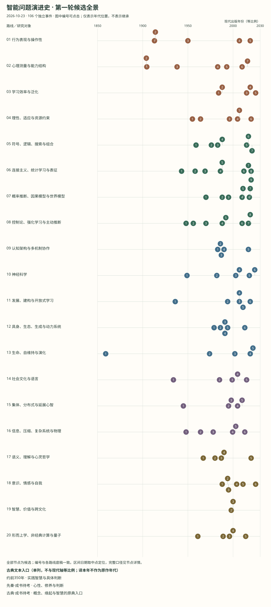

# 第一轮：20 条路线的候选时间线

检索与整理日期：2026-10-23。106 个独立候选事件、106 份来源，允许跨路线归属。全部方法摘要是初筛工作稿，待原文深读和事实审校；下列待核问题是本站的阅读任务，不冒充作者自述局限。

[返回总览](README.md) · [文献队列](reading-queue.md) · [可交互阅读图](atlas.html) · [编辑数据](atlas.json)

编号与图中每条路线的节点一致。时间顺序不表示继承；未知年代置于路线末尾。正式文献页记录书目身份，不自动证明节点解释。

## 01 行为表现与操作性路线

**核心问题：** 什么表现可以支持智能判定，操作性检验与解释之间有什么距离？

**当前分支：** 行为主义；图灵式行为判定；任务能力路线；能力维度模型。

**建议继续检索：** behaviorism operational definition intelligence；Turing imitation game objections；行为主义 操作性定义 智能判定。

**已有材料：** [rsi.astro](../../src/pages/rsi.astro)、[rsi-reading-notebook.md](../../docs/rsi-reading-notebook.md)

**当前缺口：**

- 行为主义与图灵式判定不能合并为同一个理论。
- 需补认知能力测试、行为充分性批评及当代交互评测原始来源。

### 1.1 1913 · 以可观察行为重设研究对象

- **当时要研究的问题：** 心理学怎样减少对内省的依赖？
- **候选变化：** 以行为的预测与控制组织实验问题。
- **下一轮重点核对：** 行为研究的操作性是否足以回答理解与意识？
- **日期口径：** publication；精度 year。
- **来源：** [Psychology as the Behaviorist Views It](https://psychclassics.yorku.ca/Watson/views)；John B. Watson；书目年 1913；已读指定片段。
- **记录：** `e-watson-1913`；候选，未完成全文论证审校。

### 1.2 1914 · 行为主义纲领的早期回应

- **当时要研究的问题：** 排除意识是否改变了研究对象而非解决了旧问题？
- **候选变化：** 从心理学对象与方法的区分批评行为主义纲领。
- **下一轮重点核对：** 准确重建双方使用 consciousness 与 observation 的语义。
- **日期口径：** publication；精度 year。
- **来源：** [On Psychology as the Behaviorist Views It](https://psychclassics.yorku.ca/Titchener/watson.htm)；E. B. Titchener；书目年 1914；仅定位，待阅读。
- **记录：** `e-titchener-1914`；候选，未完成全文论证审校。

### 1.3 1950 · 模仿游戏与操作性判定

- **当时要研究的问题：** 怎样把机器能否思考转化为可讨论的检验？
- **候选变化：** 提出模仿游戏并讨论反对意见与学习机器。
- **下一轮重点核对：** 通过特定行为检验与具有一般智能之间需要哪些额外论证？
- **日期口径：** publication；精度 year。
- **来源：** [Computing Machinery and Intelligence](https://academic.oup.com/mind/article/LIX/236/433/986238)；A. M. Turing；书目年 1950；仅定位，待阅读。
- **记录：** `e-turing-1950`；候选，未完成全文论证审校。

### 1.4 2007 · 汇集不同智能定义

- **当时要研究的问题：** 不同领域对 intelligence 使用了哪些不相同的标准？
- **候选变化：** 收集并比较多种定义，为形式化问题提供入口。
- **下一轮重点核对：** 回查被收录定义的原始语境，避免把汇编当作统一共识。
- **日期口径：** publication；精度 year。
- **来源：** [A Collection of Definitions of Intelligence](https://www.hutter1.net/ai/idefs.pdf)；Shane Legg; Marcus Hutter；书目年 2007；仅定位，待阅读。
- **记录：** `e-legg-definitions-2007`；候选，未完成全文论证审校。

### 1.5 2019 · 从任务技能转向技能获取效率

- **当时要研究的问题：** 高任务分数是否测到了获得新技能的能力？
- **候选变化：** 区分技能、先验、经验与泛化，提出 ARC 作为探索性测量。
- **下一轮重点核对：** 先验怎样计入，任务覆盖和训练污染怎样限制解释？
- **日期口径：** preprint-v1；精度 year。
- **来源：** [On the Measure of Intelligence](https://arxiv.org/abs/1911.01547)；François Chollet；书目年 2019；已读摘要/内容提要。
- **记录：** `e-chollet-2019`；候选，未完成全文论证审校。

## 02 心理测量与能力结构路线

**核心问题：** 测验相关意味着一个总能力、多个能力还是过程重叠？

**当前分支：** 一般智力因素 (g)；CHC 层级模型；过程重叠理论；多元智能与成功智力。

**建议继续检索：** general intelligence g factor CHC；measurement invariance intelligence cross cultural；智力 测量效度 一般因素 CHC。

**已有材料：** [2024-08-15-统计学基础与假设检验.md](../../src/content/posts/2024-08-15-%E7%BB%9F%E8%AE%A1%E5%AD%A6%E5%9F%BA%E7%A1%80%E4%B8%8E%E5%81%87%E8%AE%BE%E6%A3%80%E9%AA%8C.md)

**当前缺口：**

- 补 Cattell、Horn 与后续 CHC 整合，区分模型版本。
- 补文化偏差、测量不变性、复现及多元智能批评；现有统计文章只是方法基础。

### 2.1 1904/1905（待核） · 诊断用途的任务测验

- **当时要研究的问题：** 怎样为教育与诊断判断建立可操作的任务集合？
- **候选变化：** 通过不同难度的任务考察儿童表现；原文历史用语需保留语境。
- **下一轮重点核对：** 卷年 1904 与通常使用的 1905 如何对应？不得把诊断用途直接推广为普遍能力本体。
- **日期口径：** volume-publication-unresolved；精度 range。
- **来源：** [Méthodes nouvelles pour le diagnostic du niveau intellectuel des anormaux](https://www.persee.fr/doc/psy_0003-5033_1904_num_11_1_3675)；Alfred Binet; Théodore Simon；书目年 1904；仅定位，待阅读。
- **记录：** `e-binet-simon-1905`；候选，未完成全文论证审校。

### 2.2 1904 · 一般因素与测验相关

- **当时要研究的问题：** 不同任务的表现为什么相关？
- **候选变化：** 通过测验相关与因素思想研究共同能力成分。
- **下一轮重点核对：** 统计共同因素能否直接解释为单一心理机制？
- **日期口径：** publication；精度 year。
- **来源：** [General Intelligence, Objectively Determined and Measured](https://www.jstor.org/stable/1412107)；Charles Spearman；书目年 1904；已核对书目。
- **记录：** `e-spearman-1904`；候选，未完成全文论证审校。

### 2.3 1938 · 多种基本能力

- **当时要研究的问题：** 测验相关必须用一个总因素解释吗？
- **候选变化：** 用多因素结构研究不同基本心理能力。
- **下一轮重点核对：** 旋转、任务选择与样本怎样影响得到的能力结构？
- **日期口径：** publication；精度 year。
- **来源：** [Primary Mental Abilities](https://wellcomecollection.org/works/aq4k648g)；L. L. Thurstone；书目年 1938；仅定位，待阅读。
- **记录：** `e-thurstone-1938`；候选，未完成全文论证审校。

### 2.4 1983 · 扩展智能的能力范围

- **当时要研究的问题：** 标准心理测验是否遗漏重要的人类能力？
- **候选变化：** 提出多元智能分类，扩大讨论对象。
- **下一轮重点核对：** 分类依据、各维度独立性与可测性有哪些支持及批评？
- **日期口径：** publication；精度 year。
- **来源：** [Frames of Mind: The Theory of Multiple Intelligences](https://search.worldcat.org/title/750754464)；Howard Gardner；书目年 1983；仅定位，待阅读。
- **记录：** `e-gardner-1983`；候选，未完成全文论证审校。

### 2.5 1993 · 能力的层级结构

- **当时要研究的问题：** 不同因素分析结果能否纳入一个多层结构？
- **候选变化：** 综合既有因素分析研究，建立三层能力框架。
- **下一轮重点核对：** 三层模型与后续 CHC 整合不能混为同一发表事件；跨群体不变性待补。
- **日期口径：** publication；精度 year。
- **来源：** [Human Cognitive Abilities: A Survey of Factor-Analytic Studies](https://www.cambridge.org/core/books/human-cognitive-abilities/F83D5EADF14A453F6350FF3DD39631C8)；John B. Carroll；书目年 1993；仅定位，待阅读。
- **记录：** `e-carroll-1993`；候选，未完成全文论证审校。

### 2.6 2010 · 群体任务表现的共同因素

- **当时要研究的问题：** 群体在不同任务上的表现是否有共同成分？
- **候选变化：** 以多任务群体表现研究集体智能因素。
- **下一轮重点核对：** 任务组合、成员构成与独立复现如何影响结论？
- **日期口径：** publication；精度 year。
- **来源：** [Evidence for a Collective Intelligence Factor in the Performance of Human Groups](https://pubmed.ncbi.nlm.nih.gov/20929725/)；Anita Williams Woolley et al.；书目年 2010；仅定位，待阅读。
- **记录：** `e-woolley-2010`；候选，未完成全文论证审校。

### 2.7 2016 · 以过程重叠解释一般因素

- **当时要研究的问题：** 测验的正相关能否来自多个任务共享过程？
- **候选变化：** 提出领域一般与领域特定过程重叠的解释。
- **下一轮重点核对：** 哪些可区分的预测能对照单一共同原因模型？
- **日期口径：** publication；精度 year。
- **来源：** [Process Overlap Theory: A Unified Account of the General Factor of Intelligence](https://www.tandfonline.com/doi/abs/10.1080/1047840X.2016.1153946)；Kristof Kovacs; Andrew R. A. Conway；书目年 2016；仅定位，待阅读。
- **记录：** `e-kovacs-conway-2016`；候选，未完成全文论证审校。

## 03 学习效率与泛化路线 · 第二轮样板

**核心问题：** 获得新技能的效率与泛化怎样区别于已有技能水平？

**当前分支：** 技能获取效率 (Chollet ARC)；结构性与组合性泛化；计算学习理论 (Valiant PAC)。

**建议继续检索：** sample efficiency compositional generalization priors；PAC learning ARC evaluation contamination；学习效率 组合泛化 先验 评测。

**已有材料：** [rsi.astro](../../src/pages/rsi.astro)、[evaluation-reproducibility-research.md](../../docs/evaluation-reproducibility-research.md)、[2026-10-21-fly-connectome-05-meta-learning.md](../../src/content/posts/2026-10-21-fly-connectome-05-meta-learning.md)

**当前缺口：**

- 补迁移、系统性泛化与分布外评测的失败案例。
- ARC、PAC 与人类少样本学习的任务及先验口径需对齐；近年基准只先定位 ARC-AGI-2，未完成截至2026年的前沿检索。

### 3.1 1984 · 把可学习性变为形式问题

- **当时要研究的问题：** 在有限样本和计算约束下，哪些概念可以学习？
- **候选变化：** 用学习协议、错误容限与概率保证界定可学习性。
- **下一轮重点核对：** 分布假设和概念类如何限定保证，能否解释开放世界迁移？
- **日期口径：** publication；精度 year。
- **来源：** [A Theory of the Learnable](https://doi.org/10.1145/1968.1972)；Leslie G. Valiant；书目年 1984；仅定位，待阅读。
- **记录：** `e-valiant-1984`；候选，未完成全文论证审校。

### 3.2 1988 · 系统性与组合性的挑战

- **当时要研究的问题：** 学会一组表达或关系为何应当带来相关组合能力？
- **候选变化：** 比较连接主义与经典架构，提出系统性等解释要求。
- **下一轮重点核对：** 后续神经模型在哪些严格测试中回应了批评，哪些只是换了任务？
- **日期口径：** publication；精度 year。
- **来源：** [Connectionism and Cognitive Architecture: A Critical Analysis](https://www.sciencedirect.com/science/article/pii/0010027788900315)；Jerry A. Fodor; Zenon W. Pylyshyn；书目年 1988；仅定位，待阅读。
- **记录：** `e-fodor-pylyshyn-1988`；候选，未完成全文论证审校。

### 3.3 2015 · 少样本概念学习与生成程序

- **当时要研究的问题：** 人如何从极少例子获得可迁移的概念？
- **候选变化：** 以概率程序归纳表达构成结构与生成过程。
- **下一轮重点核对：** 字符任务中的先验和人为设计占多少作用，如何跨域检验？
- **日期口径：** publication；精度 year。
- **来源：** [Human-level Concept Learning through Probabilistic Program Induction](https://pubmed.ncbi.nlm.nih.gov/26659050/)；Brenden M. Lake; Ruslan Salakhutdinov; Joshua B. Tenenbaum；书目年 2015；仅定位，待阅读。
- **记录：** `e-lake-2015`；候选，未完成全文论证审校。

### 3.4 2019 · 从任务技能转向技能获取效率

- **当时要研究的问题：** 高任务分数是否测到了获得新技能的能力？
- **候选变化：** 区分技能、先验、经验与泛化，提出 ARC 作为探索性测量。
- **下一轮重点核对：** 先验怎样计入，任务覆盖和训练污染怎样限制解释？
- **日期口径：** preprint-v1；精度 year。
- **来源：** [On the Measure of Intelligence](https://arxiv.org/abs/1911.01547)；François Chollet；书目年 2019；已读摘要/内容提要。
- **记录：** `e-chollet-2019`；候选，未完成全文论证审校。

### 3.5 2025 · 更新抽象推理测量

- **当时要研究的问题：** 当既有评测被大量适配，怎样继续区分泛化能力？
- **候选变化：** 发布新任务集与技术报告，讨论人类校准和评测设置。
- **下一轮重点核对：** 需固定报告版本、推理预算与私有测试口径；不引用动态排行榜作历史事实。
- **日期口径：** publication；精度 year。
- **来源：** [ARC-AGI-2: A New Challenge for Frontier AI Reasoning Systems](https://arcprize.org/blog/arc-agi-2-technical-report)；ARC Prize; Greg Kamradt（发布说明）；书目年 2025；已核对书目。
- **记录：** `e-arc-agi-2-2025`；候选，未完成全文论证审校。

## 04 理性、适应与资源约束路线

**核心问题：** 知识与资源不足时，怎样定义合理的适应与决策？

**当前分支：** 通用智能形式化 (Legg-Hutter / AIXI)；有限理性与资源理性 (Simon / Griffiths)；生态理性与快速启发式 (Gigerenzer)；知识与资源不足下的适应 (NARS / 王培)。

**建议继续检索：** bounded rationality ecological rationality；AIXI universal intelligence resource rational analysis；有限理性 资源理性 NARS。

**已有材料：** [2024-6-30-应用CFR实现德州扑克对战.md](../../src/content/posts/2024-6-30-%E5%BA%94%E7%94%A8CFR%E5%AE%9E%E7%8E%B0%E5%BE%B7%E5%B7%9E%E6%89%91%E5%85%8B%E5%AF%B9%E6%88%98.md)、[2024-08-15-统计学基础与假设检验.md](../../src/content/posts/2024-08-15-%E7%BB%9F%E8%AE%A1%E5%AD%A6%E5%9F%BA%E7%A1%80%E4%B8%8E%E5%81%87%E8%AE%BE%E6%A3%80%E9%AA%8C.md)

**当前缺口：**

- 补 NARS/王培原始论文与资源不足定义，当前尚未建节点。
- 补 AIXI 不可计算性、启发式反例与资源理性批评；CFR 是特定博弈方法，不是路线历史的替代。

### 4.1 1955 · 有限理性

- **当时要研究的问题：** 信息和计算资源不足时怎样理解理性选择？
- **候选变化：** 将行为决策放到实际认知与环境约束下讨论。
- **下一轮重点核对：** 满足化的搜索与停止规则如何实证区分于优化？
- **日期口径：** publication；精度 year。
- **来源：** [A Behavioral Model of Rational Choice](https://doi.org/10.2307/1884852)；Herbert A. Simon；书目年 1955；仅定位，待阅读。
- **记录：** `e-simon-1955`；候选，未完成全文论证审校。

### 4.2 1964 · 算法概率与归纳

- **当时要研究的问题：** 能否形式化依据有限序列预测后续观察？
- **候选变化：** 以程序描述和算法概率研究归纳。
- **下一轮重点核对：** 不可计算性、参考机器依赖和有限资源近似怎样处理？
- **日期口径：** publication；精度 year。
- **来源：** [A Formal Theory of Inductive Inference, Part I](https://doi.org/10.1016/S0019-9958(64)90223-2)；Ray J. Solomonoff；书目年 1964；仅定位，待阅读。
- **记录：** `e-solomonoff-1964`；候选，未完成全文论证审校。

### 4.3 1996 · 快速节俭启发式

- **当时要研究的问题：** 使用更少信息的规则何时仍能做好推断？
- **候选变化：** 比较简单启发式与更复杂方法在特定环境中的表现。
- **下一轮重点核对：** 成功依赖哪些环境结构；必须补反例与样本外评估。
- **日期口径：** publication；精度 year。
- **来源：** [Reasoning the Fast and Frugal Way: Models of Bounded Rationality](https://pubmed.ncbi.nlm.nih.gov/8888650/)；Gerd Gigerenzer; Daniel G. Goldstein；书目年 1996；仅定位，待阅读。
- **记录：** `e-gigerenzer-goldstein-1996`；候选，未完成全文论证审校。

### 4.4 2005 · 通用序贯决策的形式化

- **当时要研究的问题：** 能否统一未知环境中的预测与行动选择？
- **候选变化：** 结合算法概率与序贯决策构建通用智能形式框架。
- **下一轮重点核对：** 不可计算性、先验与效用设定如何影响工程可实现性？
- **日期口径：** publication；精度 year。
- **来源：** [Universal Artificial Intelligence: Sequential Decisions Based on Algorithmic Probability](https://www.hutter1.net/ai/uaibook.htm)；Marcus Hutter；书目年 2005；仅定位，待阅读。
- **记录：** `e-hutter-2005`；候选，未完成全文论证审校。

### 4.5 2007 · 跨环境的智能度量

- **当时要研究的问题：** 能否在不同环境上用统一形式评价智能体？
- **候选变化：** 用环境复杂度加权的期望表现提出形式化度量。
- **下一轮重点核对：** 环境权重与奖励尺度的选择，如何连接可执行测验？
- **日期口径：** publication；精度 year。
- **来源：** [Universal Intelligence: A Definition of Machine Intelligence](https://www.hutter1.net/ai/iorx.pdf)；Shane Legg; Marcus Hutter；书目年 2007；仅定位，待阅读。
- **记录：** `e-legg-hutter-2007`；候选，未完成全文论证审校。

### 4.6 2020 · 把计算成本纳入认知解释

- **当时要研究的问题：** 行为偏离理想最优是否来自合理的资源分配？
- **候选变化：** 在有限计算资源下分析认知策略的效用。
- **下一轮重点核对：** 成本模型是否独立确定，还是事后适配行为？
- **日期口径：** publication；精度 year。
- **来源：** [Resource-rational Analysis: Understanding Human Cognition as the Optimal Use of Limited Computational Resources](https://pubmed.ncbi.nlm.nih.gov/30714890/)；Falk Lieder; Thomas L. Griffiths；书目年 2020；仅定位，待阅读。
- **记录：** `e-lieder-griffiths-2020`；候选，未完成全文论证审校。

## 05 符号、逻辑、搜索与组合路线

**核心问题：** 结构、符号和搜索怎样支持推理、组合与类比？

**当前分支：** 物理符号系统假说 (Newell & Simon)；启发式搜索与规划；结构映射与类比推理 (Gentner)；程序归纳与神经符号系统。

**建议继续检索：** physical symbol system heuristic search；structure mapping program induction neural symbolic；符号系统 类比 程序归纳 搜索。

**已有材料：** [2024-08-20-MCTS算法深度解析.md](../../src/content/posts/2024-08-20-MCTS%E7%AE%97%E6%B3%95%E6%B7%B1%E5%BA%A6%E8%A7%A3%E6%9E%90.md)、[2024-6-30-Alpha Zero算法实现五子棋.md](../../src/content/posts/2024-6-30-Alpha%20Zero%E7%AE%97%E6%B3%95%E5%AE%9E%E7%8E%B0%E4%BA%94%E5%AD%90%E6%A3%8B.md)

**当前缺口：**

- 补 Logic Theorist、GPS、框架问题、规划和 UCT 的一手节点。
- 神经符号不是单一路线；需按可检验的组合能力区分不同实现。

### 5.1 1959 · 常识知识与推理程序

- **当时要研究的问题：** 程序如何接受陈述性知识并据此采取行动？
- **候选变化：** 提出 Advice Taker，以形式化知识支持推理。
- **下一轮重点核对：** 常识获取、默认推理与环境变化怎样处理？
- **日期口径：** publication；精度 year。
- **来源：** [Programs with Common Sense](https://www-formal.stanford.edu/jmc/mcc59/mcc59.html)；John McCarthy；书目年 1959；仅定位，待阅读。
- **记录：** `e-mccarthy-1959`；候选，未完成全文论证审校。

### 5.2 1976 · 物理符号系统与搜索

- **当时要研究的问题：** 一般智能行动需要哪些计算结构？
- **候选变化：** 提出物理符号系统假说并讨论启发式搜索。
- **下一轮重点核对：** 必要性和充分性的主张分别由什么证据支持，反例如何界定？
- **日期口径：** publication；精度 year。
- **来源：** [Computer Science as Empirical Inquiry: Symbols and Search](https://www.computerhistory.org/chess/doc-431614f691642/)；Allen Newell; Herbert A. Simon；书目年 1976；已核对书目。
- **记录：** `e-newell-simon-1976`；候选，未完成全文论证审校。

### 5.3 1983 · 类比中的关系结构映射

- **当时要研究的问题：** 类比为什么常保留关系而非表面属性？
- **候选变化：** 以结构映射描述源域与目标域之间的关系对应。
- **下一轮重点核对：** 表征从何而来，如何处理候选类比的搜索与评价？
- **日期口径：** publication；精度 year。
- **来源：** [Structure-Mapping: A Theoretical Framework for Analogy](https://www.sciencedirect.com/science/article/pii/S0364021383800093)；Dedre Gentner；书目年 1983；仅定位，待阅读。
- **记录：** `e-gentner-1983`；候选，未完成全文论证审校。

### 5.4 1988 · 系统性与组合性的挑战

- **当时要研究的问题：** 学会一组表达或关系为何应当带来相关组合能力？
- **候选变化：** 比较连接主义与经典架构，提出系统性等解释要求。
- **下一轮重点核对：** 后续神经模型在哪些严格测试中回应了批评，哪些只是换了任务？
- **日期口径：** publication；精度 year。
- **来源：** [Connectionism and Cognitive Architecture: A Critical Analysis](https://www.sciencedirect.com/science/article/pii/0010027788900315)；Jerry A. Fodor; Zenon W. Pylyshyn；书目年 1988；仅定位，待阅读。
- **记录：** `e-fodor-pylyshyn-1988`；候选，未完成全文论证审校。

### 5.5 2015 · 少样本概念学习与生成程序

- **当时要研究的问题：** 人如何从极少例子获得可迁移的概念？
- **候选变化：** 以概率程序归纳表达构成结构与生成过程。
- **下一轮重点核对：** 字符任务中的先验和人为设计占多少作用，如何跨域检验？
- **日期口径：** publication；精度 year。
- **来源：** [Human-level Concept Learning through Probabilistic Program Induction](https://pubmed.ncbi.nlm.nih.gov/26659050/)；Brenden M. Lake; Ruslan Salakhutdinov; Joshua B. Tenenbaum；书目年 2015；仅定位，待阅读。
- **记录：** `e-lake-2015`；候选，未完成全文论证审校。

### 5.6 2017 · 搜索与自我对弈相互改进

- **当时要研究的问题：** 能否用自我对弈数据改进策略与价值估计？
- **候选变化：** 组合搜索、策略价值网络和自我对弈。
- **下一轮重点核对：** 规则已知、任务封闭和训练预算限定什么；不等同于通用自我改进。
- **日期口径：** preprint-v1；精度 year。
- **来源：** [Mastering Chess and Shogi by Self-Play with a General Reinforcement Learning Algorithm](https://arxiv.org/abs/1712.01815)；David Silver et al.；书目年 2017；已读摘要/内容提要。
- **记录：** `e-silver-2017`；候选，未完成全文论证审校。

### 5.7 2021 · 程序库与搜索策略共同学习

- **当时要研究的问题：** 怎样减少程序归纳对手工库和昂贵搜索的依赖？
- **候选变化：** 以交替学习方式积累可复用抽象并改进搜索。
- **下一轮重点核对：** 初始语言、任务分布和搜索预算如何限制开放泛化？
- **日期口径：** publication；精度 year。
- **来源：** [DreamCoder: Bootstrapping Inductive Program Synthesis with Wake-Sleep Library Learning](https://dspace.mit.edu/entities/publication/86d768ab-558f-4fb1-b92e-9288de643ccb)；Kevin Ellis et al.；书目年 2021；仅定位，待阅读。
- **记录：** `e-ellis-2021`；候选，未完成全文论证审校。

## 06 连接主义、统计学习与表征路线

**核心问题：** 分布式连接如何学习表示，训练规模如何改变能力与限制？

**当前分支：** 分布式表征与连接主义；深层表征与流形学习；预测与自监督学习；Scaling Law 经验路线。

**建议继续检索：** connectionism perceptron representation learning；backpropagation scaling laws limitations；连接主义 表征学习 感知机 规模规律。

**已有材料：** [llm-training-series-plan.md](../../docs/llm-training-series-plan.md)、[llm-training-series-progress.md](../../docs/llm-training-series-progress.md)、[2024-09-01-Transformer架构详解.md](../../src/content/posts/2024-09-01-Transformer%E6%9E%B6%E6%9E%84%E8%AF%A6%E8%A7%A3.md)

**当前缺口：**

- 补统计学习理论、连接主义早期独立起源、深层网络复兴和样本/计算权衡。
- 现有大模型文章丰富，但不能用当代训练流程反推整条历史；需补神经网络失败与竞争解释。

### 6.1 1943 · 神经活动的逻辑模型

- **当时要研究的问题：** 简单神经元怎样组成可计算的逻辑结构？
- **候选变化：** 以形式神经元和网络构造连接逻辑与神经活动。
- **下一轮重点核对：** 模型的简化假设与真实神经系统差异多大？
- **日期口径：** publication；精度 year。
- **来源：** [A Logical Calculus of the Ideas Immanent in Nervous Activity](https://doi.org/10.1007/BF02478259)；Warren S. McCulloch; Walter Pitts；书目年 1943；仅定位，待阅读。
- **记录：** `e-mcculloch-pitts-1943`；候选，未完成全文论证审校。

### 6.2 1958 · 从样本调整连接

- **当时要研究的问题：** 识别能力能否通过经验改变连接而获得？
- **候选变化：** 以感知机研究学习与模式识别。
- **下一轮重点核对：** 具体模型可表达哪些函数，学习结论依赖什么条件？
- **日期口径：** publication；精度 year。
- **来源：** [The Perceptron: A Probabilistic Model for Information Storage and Organization in the Brain](https://pubmed.ncbi.nlm.nih.gov/13602029/)；Frank Rosenblatt；书目年 1958；仅定位，待阅读。
- **记录：** `e-rosenblatt-1958`；候选，未完成全文论证审校。

### 6.3 1969 · 感知机能力边界

- **当时要研究的问题：** 一类感知机的表示能力受哪些结构限制？
- **候选变化：** 形式分析特定感知机类的计算能力。
- **下一轮重点核对：** 限制适用于哪些模型，不能外推为所有神经网络都不可行。
- **日期口径：** publication；精度 year。
- **来源：** [Perceptrons: An Introduction to Computational Geometry](https://mitpress.mit.edu/9780262130431/perceptrons/)；Marvin Minsky; Seymour A. Papert；书目年 1969；仅定位，待阅读。
- **记录：** `e-minsky-papert-1969`；候选，未完成全文论证审校。

### 6.4 1986 · 多层网络中的误差分配

- **当时要研究的问题：** 隐藏层怎样得到有用的学习信号？
- **候选变化：** 通过反向传播误差调整内部表示。
- **下一轮重点核对：** 梯度传播能运行与能获得有用泛化之间还缺什么？不宣称此文是反向传播最早起源。
- **日期口径：** publication；精度 year。
- **来源：** [Learning Representations by Back-propagating Errors](https://doi.org/10.1038/323533a0)；David E. Rumelhart; Geoffrey E. Hinton; Ronald J. Williams；书目年 1986；仅定位，待阅读。
- **记录：** `e-rumelhart-1986`；候选，未完成全文论证审校。

### 6.5 1988 · 系统性与组合性的挑战

- **当时要研究的问题：** 学会一组表达或关系为何应当带来相关组合能力？
- **候选变化：** 比较连接主义与经典架构，提出系统性等解释要求。
- **下一轮重点核对：** 后续神经模型在哪些严格测试中回应了批评，哪些只是换了任务？
- **日期口径：** publication；精度 year。
- **来源：** [Connectionism and Cognitive Architecture: A Critical Analysis](https://www.sciencedirect.com/science/article/pii/0010027788900315)；Jerry A. Fodor; Zenon W. Pylyshyn；书目年 1988；仅定位，待阅读。
- **记录：** `e-fodor-pylyshyn-1988`；候选，未完成全文论证审校。

### 6.6 2012 · 大规模视觉学习的工程转折

- **当时要研究的问题：** 深层模型如何在大规模图像识别任务中训练？
- **候选变化：** 结合卷积结构、训练技巧、数据与计算实现识别系统。
- **下一轮重点核对：** 分别识别架构、数据和计算贡献，不把分类成功扩张为通用理解。
- **日期口径：** publication；精度 year。
- **来源：** [ImageNet Classification with Deep Convolutional Neural Networks](https://papers.nips.cc/paper_files/paper/2012/hash/c399862d3b9d6b76c8436e924a68c45b-Abstract.html)；Alex Krizhevsky; Ilya Sutskever; Geoffrey E. Hinton；书目年 2012；仅定位，待阅读。
- **记录：** `e-krizhevsky-2012`；候选，未完成全文论证审校。

### 6.7 2017 · 以注意力组织序列建模

- **当时要研究的问题：** 序列建模能否摆脱循环结构的部分限制？
- **候选变化：** 使用注意力、多头机制和位置表示构成 Transformer。
- **下一轮重点核对：** 原始翻译证据与后来通用模型表现需分别考证。
- **日期口径：** preprint-v1；精度 year。
- **来源：** [Attention Is All You Need](https://arxiv.org/abs/1706.03762)；Ashish Vaswani et al.；书目年 2017；仅定位，待阅读。
- **记录：** `e-vaswani-2017`；候选，未完成全文论证审校。

### 6.8 2020 · 形式与意义在语言模型中的边界

- **当时要研究的问题：** 只学习语言形式能支持什么关于理解的结论？
- **候选变化：** 区分形式与意义并提出相关论证。
- **下一轮重点核对：** 前提适用于哪些训练信号，多模态与交互如何改变讨论？
- **日期口径：** publication；精度 year。
- **来源：** [Climbing towards NLU: On Meaning, Form, and Understanding in the Age of Data](https://aclanthology.org/2020.acl-main.463/)；Emily M. Bender; Alexander Koller；书目年 2020；已读摘要/内容提要。
- **记录：** `e-bender-koller-2020`；候选，未完成全文论证审校。

### 6.9 2020 · 规模与损失的经验关系

- **当时要研究的问题：** 模型、数据和训练计算怎样影响语言建模损失？
- **候选变化：** 研究受测范围内的经验缩放关系。
- **下一轮重点核对：** 损失规律的区间、数据分布与能力外推边界是什么？
- **日期口径：** preprint-v1；精度 year。
- **来源：** [Scaling Laws for Neural Language Models](https://arxiv.org/abs/2001.08361)；Jared Kaplan et al.；书目年 2020；仅定位，待阅读。
- **记录：** `e-kaplan-2020`；候选，未完成全文论证审校。

## 07 概率推断、因果模型与世界模型路线

**核心问题：** 怎样利用概率、因果与可预测动态形成对世界的可用解释？

**当前分支：** 贝叶斯认知科学 (Tenenbaum)；因果阶梯与结构因果模型 (Pearl)；预测编码与自由能推断；世界模型与隐空间模拟 (Ha / LeCun)。

**建议继续检索：** Bayesian cognition causal identification world models；do calculus latent dynamics model based planning；概率推断 因果识别 世界模型。

**已有材料：** [2024-6-30-动态不确定性因果图模型理论.md](../../src/content/posts/2024-6-30-%E5%8A%A8%E6%80%81%E4%B8%8D%E7%A1%AE%E5%AE%9A%E6%80%A7%E5%9B%A0%E6%9E%9C%E5%9B%BE%E6%A8%A1%E5%9E%8B%E7%90%86%E8%AE%BA.md)、[2024-6-30-应用Ylearn框架实现因果推断.md](../../src/content/posts/2024-6-30-%E5%BA%94%E7%94%A8Ylearn%E6%A1%86%E6%9E%B6%E5%AE%9E%E7%8E%B0%E5%9B%A0%E6%9E%9C%E6%8E%A8%E6%96%AD.md)、[2024-07-28-模型基础强化学习.md](../../src/content/posts/2024-07-28-%E6%A8%A1%E5%9E%8B%E5%9F%BA%E7%A1%80%E5%BC%BA%E5%8C%96%E5%AD%A6%E4%B9%A0.md)

**当前缺口：**

- 概率图、结构因果模型和潜在动态模型须保留不同分支。
- 补因果发现、预测编码原始论文与模型误差/干预反例；DUCG 与主流因果模型要单独比较。

### 7.1 1970 · 调节与模型的形式关系

- **当时要研究的问题：** 优良调节器在什么条件下需要具有系统模型结构？
- **候选变化：** 给出调节器与系统之间关系的形式论证。
- **下一轮重点核对：** 定理中的 model 与现代可学习世界模型是否同义？逐项检查假设。
- **日期口径：** publication；精度 year。
- **来源：** [Every Good Regulator of a System Must Be a Model of That System](https://doi.org/10.1080/00207727008920220)；Roger C. Conant; W. Ross Ashby；书目年 1970；仅定位，待阅读。
- **记录：** `e-conant-ashby-1970`；候选，未完成全文论证审校。

### 7.2 1988 · 概率图中的不确定性推理

- **当时要研究的问题：** 怎样在不完整证据下组合知识与推断？
- **候选变化：** 以图结构表示依赖并组织概率推理。
- **下一轮重点核对：** 概率依赖本身不能自动给出干预因果关系。
- **日期口径：** publication；精度 year。
- **来源：** [Probabilistic Reasoning in Intelligent Systems: Networks of Plausible Inference](https://www.sciencedirect.com/book/monograph/9780080514895/probabilistic-reasoning-in-intelligent-systems)；Judea Pearl；书目年 1988；仅定位，待阅读。
- **记录：** `e-pearl-1988`；候选，未完成全文论证审校。

### 7.3 1995 · 区分观察与干预

- **当时要研究的问题：** 观察到 X 与主动设定 X 为什么不是一回事？
- **候选变化：** 引入干预记号与推理规则研究可识别的因果效应。
- **下一轮重点核对：** 图和结构假设来自哪里，哪些效应不可识别？
- **日期口径：** publication；精度 year。
- **来源：** [A Causal Calculus for Statistical Research](https://proceedings.mlr.press/r0/pearl95a.html)；Judea Pearl；书目年 1995；已读摘要/内容提要。
- **记录：** `e-pearl-1995`；候选，未完成全文论证审校。

### 7.4 2010 · 自由能框架的统一解释尝试

- **当时要研究的问题：** 知觉、学习和行动能否共享一个形式原则？
- **候选变化：** 讨论用自由能框架连接若干脑理论。
- **下一轮重点核对：** 自由能原则与具体主动推断算法分层；哪些预测可以区分替代解释？
- **日期口径：** publication；精度 year。
- **来源：** [The Free-energy Principle: A Unified Brain Theory?](https://doi.org/10.1038/nrn2787)；Karl Friston；书目年 2010；仅定位，待阅读。
- **记录：** `e-friston-2010`；候选，未完成全文论证审校。

### 7.5 2011 · 结构先验与概率学习

- **当时要研究的问题：** 有限数据为何能支持丰富概念与抽象？
- **候选变化：** 讨论结构化表示与概率推断的结合。
- **下一轮重点核对：** 先验的来源和结构学习的计算成本如何解释？
- **日期口径：** publication；精度 year。
- **来源：** [How to Grow a Mind: Statistics, Structure, and Abstraction](https://pubmed.ncbi.nlm.nih.gov/21393536/)；Joshua B. Tenenbaum; Charles Kemp; Thomas L. Griffiths; Noah D. Goodman；书目年 2011；仅定位，待阅读。
- **记录：** `e-tenenbaum-2011`；候选，未完成全文论证审校。

### 7.6 2018 · 压缩环境动态并训练策略

- **当时要研究的问题：** 能否利用学习到的环境表示与动态支持控制？
- **候选变化：** 学习压缩表示和时序模型，并将其提供给策略。
- **下一轮重点核对：** 模型误差会怎样累积，模拟成功能否转移到真实环境？
- **日期口径：** preprint-v1；精度 year。
- **来源：** [World Models](https://arxiv.org/abs/1803.10122)；David Ha; Jürgen Schmidhuber；书目年 2018；仅定位，待阅读。
- **记录：** `e-ha-2018`；候选，未完成全文论证审校。

### 7.7 2019 · 学习用于规划的模型

- **当时要研究的问题：** 不知道完整环境规则时怎样进行搜索规划？
- **候选变化：** 学习与奖励、价值和策略相关的模型并结合搜索。
- **下一轮重点核对：** 任务相关模型不必完整重建环境；预印本 2019 与 Nature 2020 分开。
- **日期口径：** preprint-v1；精度 year。
- **来源：** [Mastering Atari, Go, Chess and Shogi by Planning with a Learned Model](https://arxiv.org/abs/1911.08265)；Julian Schrittwieser et al.；书目年 2019；已读摘要/内容提要。
- **记录：** `e-schrittwieser-2019`；候选，未完成全文论证审校。

## 08 控制论、强化学习与主动推断路线 · 第二轮样板

**核心问题：** 反馈、奖励、调节与主动推断分别怎样使行动获得方向？

**当前分支：** 好调节器定理与控制论 (Wiener / Ashby)；强化学习与策略优化 (Sutton & Barto)；主动推断与自由能框架 (Friston)；赋能度与行动可控性 (Empowerment)。

**建议继续检索：** cybernetics requisite variety good regulator；temporal difference Q learning active inference；控制论 强化学习 主动推断 奖励。

**已有材料：** [reasoning-rl-research.md](../../docs/reasoning-rl-research.md)、[2024-06-09-强化学习笔记记录.md](../../src/content/posts/2024-06-09-%E5%BC%BA%E5%8C%96%E5%AD%A6%E4%B9%A0%E7%AC%94%E8%AE%B0%E8%AE%B0%E5%BD%95.md)、[2024-07-28-模型基础强化学习.md](../../src/content/posts/2024-07-28-%E6%A8%A1%E5%9E%8B%E5%9F%BA%E7%A1%80%E5%BC%BA%E5%8C%96%E5%AD%A6%E4%B9%A0.md)

**当前缺口：**

- 补 Bellman 动态规划、Watkins 1989 论文、策略梯度与关键不稳定性反例。
- 补主动推断的具体算法与反方比较，不能用自由能综述替代其全部历史；补 empowerment。

### 8.1 1948 · 反馈与控制的共同语言

- **当时要研究的问题：** 动物与机器的调节过程有什么可共同研究的结构？
- **候选变化：** 以反馈、控制和通信连接不同系统。
- **下一轮重点核对：** 共享描述是否足以解释学习、目的和智能？
- **日期口径：** publication；精度 year。
- **来源：** [Cybernetics: Or Control and Communication in the Animal and the Machine](https://mitpress.mit.edu/9780262537841/cybernetics-or-control-and-communication-in-the-animal-and-the-machine/)；Norbert Wiener；书目年 1948；仅定位，待阅读。
- **记录：** `e-wiener-1948`；候选，未完成全文论证审校。

### 8.2 1956 · 调节能力与多样性

- **当时要研究的问题：** 调节器需要怎样的变化范围才能应对扰动？
- **候选变化：** 分析系统、稳定性和必要多样性。
- **下一轮重点核对：** 数学条件怎样对应实际智能系统的状态与扰动？
- **日期口径：** publication；精度 year。
- **来源：** [An Introduction to Cybernetics](https://www.biodiversitylibrary.org/item/26977)；W. Ross Ashby；书目年 1956；仅定位，待阅读。
- **记录：** `e-ashby-1956`；候选，未完成全文论证审校。

### 8.3 1970 · 调节与模型的形式关系

- **当时要研究的问题：** 优良调节器在什么条件下需要具有系统模型结构？
- **候选变化：** 给出调节器与系统之间关系的形式论证。
- **下一轮重点核对：** 定理中的 model 与现代可学习世界模型是否同义？逐项检查假设。
- **日期口径：** publication；精度 year。
- **来源：** [Every Good Regulator of a System Must Be a Model of That System](https://doi.org/10.1080/00207727008920220)；Roger C. Conant; W. Ross Ashby；书目年 1970；仅定位，待阅读。
- **记录：** `e-conant-ashby-1970`；候选，未完成全文论证审校。

### 8.4 1988 · 从相邻预测差异中学习

- **当时要研究的问题：** 尚未看到最终结果时如何更新预测？
- **候选变化：** 使用时间差分误差逐步调整预测。
- **下一轮重点核对：** 自举、采样分布和函数近似在什么条件下会失效？
- **日期口径：** publication；精度 year。
- **来源：** [Learning to Predict by the Methods of Temporal Differences](https://doi.org/10.1007/BF00115009)；Richard S. Sutton；书目年 1988；仅定位，待阅读。
- **记录：** `e-sutton-1988`；候选，未完成全文论证审校。

### 8.5 1992 · 动作价值学习的收敛条件

- **当时要研究的问题：** 怎样从交互经验学习行动价值？
- **候选变化：** 分析 Q-learning 并给出特定条件下的收敛证明。
- **下一轮重点核对：** 探索覆盖、学习率和表示的条件是否满足；与 1989 学位论文区分。
- **日期口径：** publication；精度 year。
- **来源：** [Q-learning](https://doi.org/10.1007/BF00992698)；Christopher J. C. H. Watkins; Peter Dayan；书目年 1992；仅定位，待阅读。
- **记录：** `e-watkins-dayan-1992`；候选，未完成全文论证审校。

### 8.6 2010 · 自由能框架的统一解释尝试

- **当时要研究的问题：** 知觉、学习和行动能否共享一个形式原则？
- **候选变化：** 讨论用自由能框架连接若干脑理论。
- **下一轮重点核对：** 自由能原则与具体主动推断算法分层；哪些预测可以区分替代解释？
- **日期口径：** publication；精度 year。
- **来源：** [The Free-energy Principle: A Unified Brain Theory?](https://doi.org/10.1038/nrn2787)；Karl Friston；书目年 2010；仅定位，待阅读。
- **记录：** `e-friston-2010`；候选，未完成全文论证审校。

### 8.7 2017 · 搜索与自我对弈相互改进

- **当时要研究的问题：** 能否用自我对弈数据改进策略与价值估计？
- **候选变化：** 组合搜索、策略价值网络和自我对弈。
- **下一轮重点核对：** 规则已知、任务封闭和训练预算限定什么；不等同于通用自我改进。
- **日期口径：** preprint-v1；精度 year。
- **来源：** [Mastering Chess and Shogi by Self-Play with a General Reinforcement Learning Algorithm](https://arxiv.org/abs/1712.01815)；David Silver et al.；书目年 2017；已读摘要/内容提要。
- **记录：** `e-silver-2017`；候选，未完成全文论证审校。

### 8.8 2019 · 学习用于规划的模型

- **当时要研究的问题：** 不知道完整环境规则时怎样进行搜索规划？
- **候选变化：** 学习与奖励、价值和策略相关的模型并结合搜索。
- **下一轮重点核对：** 任务相关模型不必完整重建环境；预印本 2019 与 Nature 2020 分开。
- **日期口径：** preprint-v1；精度 year。
- **来源：** [Mastering Atari, Go, Chess and Shogi by Planning with a Learned Model](https://arxiv.org/abs/1911.08265)；Julian Schrittwieser et al.；书目年 2019；已读摘要/内容提要。
- **记录：** `e-schrittwieser-2019`；候选，未完成全文论证审校。

## 09 认知架构与多机制协作路线

**核心问题：** 多种认知机制怎样在同一系统中协作？

**当前分支：** 统一认知架构 (ACT-R / Soar)；心智社会 (Minsky)；元认知与自我监控；创造性认知与概念空间 (Boden)。

**建议继续检索：** ACT star ACT R Soar cognitive architecture；standard model mind metacognition；认知架构 工作记忆 元认知。

**已有材料：** [2024-10-13-LLM-Agent开发指南.md](../../src/content/posts/2024-10-13-LLM-Agent%E5%BC%80%E5%8F%91%E6%8C%87%E5%8D%97.md)

**当前缺口：**

- 补 ACT-R 各版本、元认知与创造性架构的一手实验。
- LLM Agent 指南只可作为工程对照，不能等同 ACT-R/Soar 的心理学解释。

### 9.1 1983 · 认知架构与知识使用

- **当时要研究的问题：** 记忆、技能获得和执行怎样由一套架构解释？
- **候选变化：** 以 ACT* 的结构和过程组织认知理论。
- **下一轮重点核对：** 须区分 ACT* 与后续 ACT-R 版本，不将名称倒置到同一年。
- **日期口径：** publication；精度 year。
- **来源：** [The Architecture of Cognition](https://books.google.com/books/about/The_Architecture_of_Cognition.html?id=1OtfQgAACAAJ)；John R. Anderson；书目年 1983；仅定位，待阅读。
- **记录：** `e-anderson-1983`；候选，未完成全文论证审校。

### 9.2 1986 · 多机制协作的心智解释

- **当时要研究的问题：** 复杂思考能否由许多简单过程共同产生？
- **候选变化：** 以多种局部机制及其组织讨论心智。
- **下一轮重点核对：** 解释性比喻怎样转为可检验的机制与实现？
- **日期口径：** publication；精度 year。
- **来源：** [The Society of Mind](https://search.worldcat.org/title/223353010)；Marvin Minsky；书目年 1986；仅定位，待阅读。
- **记录：** `e-minsky-1986`；候选，未完成全文论证审校。

### 9.3 1987 · 统一问题求解与学习

- **当时要研究的问题：** 如何在一套架构内连接选择、子目标与学习？
- **候选变化：** 以问题空间、产生式和 chunking 等机制构建 Soar。
- **下一轮重点核对：** 不同任务的模型拟合和通用性证据需分开。
- **日期口径：** publication；精度 year。
- **来源：** [SOAR: An Architecture for General Intelligence](https://www.sciencedirect.com/science/article/abs/pii/0004370287900506)；John E. Laird; Allen Newell; Paul S. Rosenbloom；书目年 1987；仅定位，待阅读。
- **记录：** `e-soar-1987`；候选，未完成全文论证审校。

### 9.4 1990 · 跨任务的统一认知理论

- **当时要研究的问题：** 分散的局部实验如何约束一个整体理论？
- **候选变化：** 提出跨认知任务和时间尺度的统一理论要求。
- **下一轮重点核对：** 统一框架在哪些任务形成了可失败的预测？
- **日期口径：** publication；精度 year。
- **来源：** [Unified Theories of Cognition](https://catalogue.bnf.fr/ark:/12148/cb35529460g)；Allen Newell；书目年 1990；仅定位，待阅读。
- **记录：** `e-newell-1990`；候选，未完成全文论证审校。

### 9.5 2017 · 比较认知架构的共同结构

- **当时要研究的问题：** 不同架构之间有哪些可共同讨论的组件与约束？
- **候选变化：** 提出标准模型作为共同框架的研究议程。
- **下一轮重点核对：** 共同框架不等于已验证的统一心智机制。
- **日期口径：** publication；精度 year。
- **来源：** [A Standard Model of the Mind: Toward a Common Computational Framework across Artificial Intelligence, Cognitive Science, Neuroscience, and Robotics](https://ojs.aaai.org/aimagazine/index.php/aimagazine/article/view/2744/0)；John E. Laird; Christian Lebiere; Paul S. Rosenbloom；书目年 2017；已读摘要/内容提要。
- **记录：** `e-laird-2017`；候选，未完成全文论证审校。

## 10 神经科学路线

**核心问题：** 神经结构、可塑性与网络动态怎样解释认知能力？

**当前分支：** 顶额叶整合理论 (P-FIT)；网络神经科学；共享执行控制资源。

**建议继续检索：** P FIT intelligence network neuroscience；connectome intervention cognitive mechanism；神经可塑性 连接组 智力 脑网络。

**已有材料：** [2026-10-21-fly-connectome-01-circuit-and-framework.md](../../src/content/posts/2026-10-21-fly-connectome-01-circuit-and-framework.md)、[2026-10-21-fly-connectome-11-summary.md](../../src/content/posts/2026-10-21-fly-connectome-11-summary.md)

**当前缺口：**

- 补病损、干预与纵向研究，避免只用相关影像。
- 果蝇连接组与人类智力并非同一测量对象；补学习规则、结构与功能之间的桥接证据。

### 10.1 1949 · 从可塑性到行为组织

- **当时要研究的问题：** 细胞活动如何形成可持续的心理组织？
- **候选变化：** 以细胞集合等假设连接神经变化与行为。
- **下一轮重点核对：** 历史假说、现代可塑性实验与形式化学习规则需要分别记录。
- **日期口径：** publication；精度 year。
- **来源：** [The Organization of Behavior: A Neuropsychological Theory](https://search.worldcat.org/title/1175395)；D. O. Hebb；书目年 1949；仅定位，待阅读。
- **记录：** `e-hebb-1949`；候选，未完成全文论证审校。

### 10.2 1982 · 解释计算的多个层次

- **当时要研究的问题：** 只知道神经实现是否足以理解视觉计算？
- **候选变化：** 区分计算问题、表示与算法、物理实现的解释层次。
- **下一轮重点核对：** 视觉案例如何外推到其他认知功能，层次之间怎样约束？
- **日期口径：** publication；精度 year。
- **来源：** [Vision: A Computational Investigation into the Human Representation and Processing of Visual Information](https://academic.oup.com/mit-press-scholarship-online/book/13528)；David Marr；书目年 1982；仅定位，待阅读。
- **记录：** `e-marr-1982`；候选，未完成全文论证审校。

### 10.3 2003 · 神经活动的级联现象

- **当时要研究的问题：** 神经群体活动是否具有可描述的级联统计规律？
- **候选变化：** 分析神经元雪崩及其分布特征。
- **下一轮重点核对：** 幂律证据、临界性解释和智能功能之间还需要哪些检验？
- **日期口径：** publication；精度 year。
- **来源：** [Neuronal Avalanches in Neocortical Circuits](https://pmc.ncbi.nlm.nih.gov/articles/PMC6741045/)；John M. Beggs; Dietmar Plenz；书目年 2003；仅定位，待阅读。
- **记录：** `e-beggs-plenz-2003`；候选，未完成全文论证审校。

### 10.4 2007 · 脑区整合与智力差异

- **当时要研究的问题：** 智力差异是否与一组脑区的整合有关？
- **候选变化：** 综合神经影像证据提出顶额叶整合理论。
- **下一轮重点核对：** 影像相关、病损证据与因果机制分别支持到哪里？
- **日期口径：** publication；精度 year。
- **来源：** [The Parieto-Frontal Integration Theory (P-FIT) of Intelligence: Converging Neuroimaging Evidence](https://www.cambridge.org/core/journals/behavioral-and-brain-sciences/article/abs/parietofrontal-integration-theory-pfit-of-intelligence-converging-neuroimaging-evidence/175ECF09153B51136C21325465C6A86F)；Rex E. Jung; Richard J. Haier；书目年 2007；仅定位，待阅读。
- **记录：** `e-jung-haier-2007`；候选，未完成全文论证审校。

### 10.5 2018 · 从局部脑区到网络动态

- **当时要研究的问题：** 整体网络组织怎样参与智能行为？
- **候选变化：** 从网络拓扑和动态整合讨论人类智能。
- **下一轮重点核对：** 静态连接能否说明动态认知，预测个体差异是否具有跨样本效度？
- **日期口径：** publication；精度 year。
- **来源：** [Network Neuroscience Theory of Human Intelligence](https://pubmed.ncbi.nlm.nih.gov/29167088/)；Aron K. Barbey；书目年 2018；仅定位，待阅读。
- **记录：** `e-barbey-2018`；候选，未完成全文论证审校。

### 10.6 2024 · 全脑连接组的结构资料

- **当时要研究的问题：** 怎样获得可复用的细胞类型与连接结构地图？
- **候选变化：** 整合果蝇全脑注释和跨连接组细胞类型比较。
- **下一轮重点核对：** 结构地图本身不能证明学习算法或智能机制，需连接行为干预。
- **日期口径：** publication；精度 year。
- **来源：** [Whole-brain Annotation and Multi-connectome Cell Typing of Drosophila](https://www.nature.com/articles/s41586-024-07686-5)；Philipp Schlegel et al.；书目年 2024；仅定位，待阅读。
- **记录：** `e-schlegel-2024`；候选，未完成全文论证审校。

## 11 发展、建构与开放式学习路线

**核心问题：** 智能如何在发展和自发探索中形成新的能力？

**当前分支：** 发展建构主义 (Piaget)；核心知识与早期先验 (Spelke)；内在动机与好奇心驱动 (Oudeyer)；开放式自演化与 RSI (Stanley)。

**建议继续检索：** development sensorimotor intelligence core knowledge；intrinsic motivation novelty search open ended POET；发展心理学 内在动机 开放式学习。

**已有材料：** [2026-10-03-recursive-self-improvement-research.md](../../src/content/posts/2026-10-03-recursive-self-improvement-research.md)、[2026-10-21-fly-connectome-05-meta-learning.md](../../src/content/posts/2026-10-21-fly-connectome-05-meta-learning.md)

**当前缺口：**

- 个体发展、进化搜索、自动课程与递归自我改进必须分层。
- 补发展实验的修订、好奇心失败和开放性度量；不能把自动生成任务认定为无界改进。

### 11.1 1936 · 感觉运动智能的发生

- **当时要研究的问题：** 婴儿的感知行动怎样逐步形成认知结构？
- **候选变化：** 通过发展观察研究同化、顺应与感觉运动组织。
- **下一轮重点核对：** 原始观察样本与后续跨情境证据如何对照？1936 原著与 1952 英译分开。
- **日期口径：** publication；精度 year。
- **来源：** [La naissance de l'intelligence chez l'enfant](https://www.fondationjeanpiaget.ch/fjp/site/presentation/index.php?DOCID=1177)；Jean Piaget；书目年 1936；仅定位，待阅读。
- **记录：** `e-piaget-1936`；候选，未完成全文论证审校。

### 11.2 1994 · 认知与行动的发展动力学

- **当时要研究的问题：** 发展变化必须解释为内部固定阶段的展开吗？
- **候选变化：** 用多因素耦合与动力系统研究发展中的认知和行动。
- **下一轮重点核对：** 模型是否产生区别于阶段或表示理论的可检验预测？
- **日期口径：** publication；精度 year。
- **来源：** [A Dynamic Systems Approach to the Development of Cognition and Action](https://mitpress.mit.edu/9780262200950/a-dynamic-systems-approach-to-the-development-of-cognition-and-action/)；Esther Thelen; Linda B. Smith；书目年 1994；仅定位，待阅读。
- **记录：** `e-thelen-smith-1994`；候选，未完成全文论证审校。

### 11.3 2007 · 让系统选择自己的学习任务

- **当时要研究的问题：** 没有外部逐步指定任务时，学习如何继续？
- **候选变化：** 研究内在动机和学习进展驱动的探索。
- **下一轮重点核对：** 探索多样性与可迁移能力提升应怎样分别测量？
- **日期口径：** publication；精度 year。
- **来源：** [Intrinsic Motivation Systems for Autonomous Mental Development](https://www.pyoudeyer.com/ims.pdf)；Pierre-Yves Oudeyer; Frédéric Kaplan; Verena V. Hafner；书目年 2007；仅定位，待阅读。
- **记录：** `e-oudeyer-2007`；候选，未完成全文论证审校。

### 11.4 2007 · 早期认知的核心知识

- **当时要研究的问题：** 婴幼儿学习是否依赖某些早期结构？
- **候选变化：** 总结对象、数量、空间与主体等领域的核心知识研究。
- **下一轮重点核对：** 早期出现不自动等于先天，如何排除经验和任务解释？
- **日期口径：** publication；精度 year。
- **来源：** [Core Knowledge](https://pubmed.ncbi.nlm.nih.gov/17181705/)；Elizabeth S. Spelke; Katherine D. Kinzler；书目年 2007；仅定位，待阅读。
- **记录：** `e-spelke-2007`；候选，未完成全文论证审校。

### 11.5 2011 · 用新颖性应对欺骗性目标

- **当时要研究的问题：** 固定目标是否会让搜索错过必要的中间行为？
- **候选变化：** 以行为新颖性驱动进化搜索。
- **下一轮重点核对：** 行为描述空间和新颖性度量如何左右结果？
- **日期口径：** publication；精度 year。
- **来源：** [Abandoning Objectives: Evolution through the Search for Novelty Alone](https://pubmed.ncbi.nlm.nih.gov/20868264/)；Joel Lehman; Kenneth O. Stanley；书目年 2011；仅定位，待阅读。
- **记录：** `e-lehman-stanley-2011`；候选，未完成全文论证审校。

### 11.6 2019 · 环境与解法共同扩展

- **当时要研究的问题：** 怎样同时生成挑战并学习解决挑战？
- **候选变化：** 配对环境生成、智能体优化和跨环境迁移。
- **下一轮重点核对：** 有限演示中的持续扩展不等于无界开放性或递归自我改进。
- **日期口径：** preprint-v1；精度 year。
- **来源：** [Paired Open-Ended Trailblazer (POET): Endlessly Generating Increasingly Complex and Diverse Learning Environments and Their Solutions](https://arxiv.org/abs/1901.01753)；Rui Wang; Joel Lehman; Jeff Clune; Kenneth O. Stanley；书目年 2019；已读摘要/内容提要。
- **记录：** `e-wang-poet-2019`；候选，未完成全文论证审校。

## 12 具身、生态、生成与动力系统路线 · 第二轮样板

**核心问题：** 身体、环境与行动耦合怎样参与认知？

**当前分支：** 形态计算 (Morphological Computation)；生态心理学与示能 (Gibson)；行为式机器人 (Brooks / 包容式架构)；行动生成论 (Enactivism)。

**建议继续检索：** ecological perception affordances enactivism；subsumption dynamic systems morphological computation；具身认知 示能 动力系统 形态计算。

**已有材料：** [2026-10-04-strandbeest-leg-linkage.md](../../src/content/posts/2026-10-04-strandbeest-leg-linkage.md)、[2026-10-04-re-evolving-the-strandbeest-leg.md](../../src/content/posts/2026-10-04-re-evolving-the-strandbeest-leg.md)、[2026-10-04-strandbeest-evolution-history.md](../../src/content/posts/2026-10-04-strandbeest-evolution-history.md)

**当前缺口：**

- 补 Gibson 原始实验、被动行走和具身观点的批评。
- 连杆动力学是教学/工程入口，不能凭形态优化直接宣称认知；区分生态、生成和机器人各分支。

### 12.1 1979 · 生态知觉与行动可能性

- **当时要研究的问题：** 知觉怎样与环境中可采取的行动相联系？
- **候选变化：** 以生态信息与 affordances 研究知觉。
- **下一轮重点核对：** 直接知觉主张怎样与实验和内部表征解释比较？
- **日期口径：** publication；精度 year。
- **来源：** [The Ecological Approach to Visual Perception](https://search.worldcat.org/title/The-ecological-approach-to-visual-perception/oclc/4929611)；James J. Gibson；书目年 1979；仅定位，待阅读。
- **记录：** `e-gibson-1979`；候选，未完成全文论证审校。

### 12.2 1986 · 分层行为控制机器人

- **当时要研究的问题：** 机器人能否避免集中式建模与规划的部分困难？
- **候选变化：** 用分层控制与行为协调构建移动机器人。
- **下一轮重点核对：** 局部行为鲁棒性如何扩展到长期规划与新任务？
- **日期口径：** publication；精度 year。
- **来源：** [A Robust Layered Control System for a Mobile Robot](https://doi.org/10.1109/JRA.1986.1087032)；Rodney A. Brooks；书目年 1986；仅定位，待阅读。
- **记录：** `e-brooks-1986`；候选，未完成全文论证审校。

### 12.3 1991 · 对集中表征路线的挑战

- **当时要研究的问题：** 智能行为一定需要完整的中心世界表示吗？
- **候选变化：** 主张从与环境实时交互的增量系统研究智能。
- **下一轮重点核对：** representation 在批评中具体指什么；不把机器人演示写成对所有表征的反证。
- **日期口径：** publication；精度 year。
- **来源：** [Intelligence without Representation](https://www.sciencedirect.com/science/article/pii/000437029190053M)；Rodney A. Brooks；书目年 1991；仅定位，待阅读。
- **记录：** `e-brooks-1991`；候选，未完成全文论证审校。

### 12.4 1991 · 生成认知与具身经验

- **当时要研究的问题：** 认知如何在行动、身体和经验中形成？
- **候选变化：** 连接认知科学、现象学与佛教思想，发展生成式研究视角。
- **下一轮重点核对：** 哲学论证、经验研究与跨文化借用需要分别定位。
- **日期口径：** publication；精度 year。
- **来源：** [The Embodied Mind: Cognitive Science and Human Experience](https://mitpress.mit.edu/9780262220422/the-embodied-mind/)；Francisco J. Varela; Evan Thompson; Eleanor Rosch；书目年 1991；已核对书目。
- **记录：** `e-varela-1991`；候选，未完成全文论证审校。

### 12.5 1994 · 认知与行动的发展动力学

- **当时要研究的问题：** 发展变化必须解释为内部固定阶段的展开吗？
- **候选变化：** 用多因素耦合与动力系统研究发展中的认知和行动。
- **下一轮重点核对：** 模型是否产生区别于阶段或表示理论的可检验预测？
- **日期口径：** publication；精度 year。
- **来源：** [A Dynamic Systems Approach to the Development of Cognition and Action](https://mitpress.mit.edu/9780262200950/a-dynamic-systems-approach-to-the-development-of-cognition-and-action/)；Esther Thelen; Linda B. Smith；书目年 1994；仅定位，待阅读。
- **记录：** `e-thelen-smith-1994`；候选，未完成全文论证审校。

### 12.6 2013 · 量化身体形态的贡献

- **当时要研究的问题：** 身体与环境分担了多少行为生成工作？
- **候选变化：** 提出信息论视角的形态计算量化方案。
- **下一轮重点核对：** 度量是否依赖变量划分，机械便利与计算能力是否被混同？
- **日期口径：** publication；精度 year。
- **来源：** [Quantifying Morphological Computation](https://www.mdpi.com/1099-4300/15/5/1887)；Keyan Zahedi; Nihat Ay；书目年 2013；仅定位，待阅读。
- **记录：** `e-zahedi-ay-2013`；候选，未完成全文论证审校。

## 13 生命、自维持与演化路线

**核心问题：** 生命组织、自维持、适应与智能之间有哪些关系？

**当前分支：** 自创生理论 (Maturana & Varela)；多尺度基底认知 (Michael Levin)；生态演化适应。

**建议继续检索：** autopoiesis biological autonomy basal cognition；bioelectricity multiscale agency TAME；自创生 生物自主性 基底认知。

**已有材料：** 未定位到本项目的专门解读；需要从原始来源建立阅读笔记。

**当前缺口：**

- 补 Maturana 1970、原西语自创生文本、适应性与自维持的区别。
- 补基底认知的独立实验和反对解释；目前偏重少数学者，需要扩大来源谱系。

### 13.1 1859 · 适应的历史解释

- **当时要研究的问题：** 复杂适应如何由代际变化形成？
- **候选变化：** 以自然选择解释生物适应的形成。
- **下一轮重点核对：** 这是智能起源研究的背景入口，不能直接当作认知机制证据。
- **日期口径：** publication；精度 year。
- **来源：** [On the Origin of Species](https://darwin-online.org.uk/content/record?itemID=F373)；Charles Darwin；书目年 1859；仅定位，待阅读。
- **记录：** `e-darwin-1859`；候选，未完成全文论证审校。

### 13.2 1974 · 自创生的组织定义

- **当时要研究的问题：** 什么组织关系使一个系统持续生成自身？
- **候选变化：** 描述自创生组织并给出最小模拟模型。
- **下一轮重点核对：** 自生成、自维持、适应与智能之间的推论需要哪些额外条件？
- **日期口径：** publication；精度 year。
- **来源：** [Autopoiesis: The Organization of Living Systems, Its Characterization and a Model](https://repositorio.uchile.cl/bitstream/handle/2250/160309/item_34548860810.pdf)；Francisco G. Varela; Humberto R. Maturana; R. Uribe；书目年 1974；仅定位，待阅读。
- **记录：** `e-varela-maturana-uribe-1974`；候选，未完成全文论证审校。

### 13.3 2002 · 生命个体与自然目的

- **当时要研究的问题：** 生命系统的目的性如何从组织和存在条件理解？
- **候选变化：** 以自创生和生物个体性讨论自然目的。
- **下一轮重点核对：** 目的性的哲学论证如何接上可操作的生命与认知研究？
- **日期口径：** publication；精度 year。
- **来源：** [Life after Kant: Natural Purposes and the Autopoietic Foundations of Biological Individuality](https://www.ias-research.net/wp-content/uploads/2018/02/Weber_Varela_Life_after_Kant_2002.pdf)；Andreas Weber; Francisco J. Varela；书目年 2002；仅定位，待阅读。
- **记录：** `e-weber-varela-2002`；候选，未完成全文论证审校。

### 13.4 2019 · 多尺度主体边界假说

- **当时要研究的问题：** 细胞与组织的目标性活动如何界定系统的尺度？
- **候选变化：** 提出尺度可变的认知与主体边界研究假说。
- **下一轮重点核对：** 具体生物电干预证据与认知解释的外推需要分开。
- **日期口径：** publication；精度 year。
- **来源：** [The Computational Boundary of a Self: Developmental Bioelectricity Drives Multicellularity and Scale-Free Cognition](https://www.frontiersin.org/journals/psychology/articles/10.3389/fpsyg.2019.02688/full)；Michael Levin；书目年 2019；已读摘要/内容提要。
- **记录：** `e-levin-2019`；候选，未完成全文论证审校。

### 13.5 2022 · 比较不同基底上的认知

- **当时要研究的问题：** 怎样研究非常规身体与基底的认知能力？
- **候选变化：** 提出 TAME 研究框架与干预视角。
- **下一轮重点核对：** 实验结果、框架定义和关于心智的广泛推断分别支持什么？
- **日期口径：** publication；精度 year。
- **来源：** [Technological Approach to Mind Everywhere: An Experimentally-Grounded Framework for Understanding Diverse Bodies and Minds](https://doi.org/10.3389/fnsys.2022.768201)；Michael Levin；书目年 2022；仅定位，待阅读。
- **记录：** `e-levin-2022`；候选，未完成全文论证审校。

## 14 社会文化与语言路线

**核心问题：** 语言、社会交往和文化传承怎样改变认知？

**当前分支：** 社会文化历史学派 (Vygotsky)；共享意向性与合作 (Tomasello)；累积式文化演化 (Cultural Brain)。

**建议继续检索：** Vygotsky social mediation thought language；shared intentionality cumulative cultural evolution；社会文化 语言中介 共享意向性。

**已有材料：** 未定位到本项目的专门解读；需要从原始来源建立阅读笔记。

**当前缺口：**

- 补俄文原典及译本比较，补语言发展和非西方社会的实证研究。
- 需要反方证据与文化差异，不能由合作案例推出人类认知的唯一机制。

### 14.1 1934 · 语言中介与认知发展

- **当时要研究的问题：** 个体思维如何与社会交往及语言发展关联？
- **候选变化：** 研究概念形成、言语与思维的发生关系。
- **下一轮重点核对：** 1934 原作与 1962 等英译的删节、编排和词义差异待核。
- **日期口径：** publication；精度 year。
- **来源：** [Thinking and Speaking / Thought and Language](https://www.marxists.org/archive/vygotsky/works/words/index.htm)；Lev S. Vygotsky；书目年 1934；仅定位，待阅读。
- **记录：** `e-vygotsky-1934`；候选，未完成全文论证审校。

### 14.2 1985 · 文化传递的演化模型

- **当时要研究的问题：** 文化变化如何与遗传和个体学习相互作用？
- **候选变化：** 用形式模型研究社会学习与文化演化。
- **下一轮重点核对：** 传递规则的经验依据及模型与历史解释的距离是什么？
- **日期口径：** publication；精度 year。
- **来源：** [Culture and the Evolutionary Process](https://press.uchicago.edu/ucp/books/book/chicago/C/bo5970597.html)；Robert Boyd; Peter J. Richerson；书目年 1985；仅定位，待阅读。
- **记录：** `e-boyd-richerson-1985`；候选，未完成全文论证审校。

### 14.3 1999 · 文化积累与人类认知

- **当时要研究的问题：** 人类认知的特殊性如何与文化学习联系？
- **候选变化：** 从社会认知、模仿与文化积累解释认知发展。
- **下一轮重点核对：** 物种比较和文化比较的证据如何支持特定机制？
- **日期口径：** publication；精度 year。
- **来源：** [The Cultural Origins of Human Cognition](https://www.jstor.org/stable/j.ctvjsf4jc)；Michael Tomasello；书目年 1999；仅定位，待阅读。
- **记录：** `e-tomasello-1999`；候选，未完成全文论证审校。

### 14.4 2005 · 共享意向性

- **当时要研究的问题：** 理解他人目标与共同开展活动有什么区别？
- **候选变化：** 提出共享意向性在合作和文化认知中的作用。
- **下一轮重点核对：** 概念如何操作化，动机与表示贡献怎样区分？
- **日期口径：** publication；精度 year。
- **来源：** [Understanding and Sharing Intentions: The Origins of Cultural Cognition](https://pubmed.ncbi.nlm.nih.gov/16262930/)；Michael Tomasello; Malinda Carpenter; Josep Call; Tanya Behne; Henrike Moll；书目年 2005；仅定位，待阅读。
- **记录：** `e-tomasello-2005`；候选，未完成全文论证审校。

### 14.5 2015 · 累积文化与认知生态

- **当时要研究的问题：** 个体并不理解的知识为何仍能长期积累？
- **候选变化：** 综合文化演化与人类研究讨论群体积累。
- **下一轮重点核对：** 案例选择、替代解释和不同文化的覆盖需核对。
- **日期口径：** publication；精度 year。
- **来源：** [The Secret of Our Success: How Culture Is Driving Human Evolution, Domesticating Our Species, and Making Us Smart](https://henrich.fas.harvard.edu/publications/secret-our-success-how-culture-driving-human-evolution-domesticating-our)；Joseph Henrich；书目年 2015；已读摘要/内容提要。
- **记录：** `e-henrich-2015`；候选，未完成全文论证审校。

## 15 集体、分布式与延展心智路线

**核心问题：** 认知的单位能否跨越个体，延展到工具和群体？

**当前分支：** 延展心智假说 (Clark & Chalmers)；分布式认知 (Hutchins)；群体智慧与去中心化协调 (Hayek)。

**建议继续检索：** distributed cognition extended mind critique；collective intelligence group factor coordination；分布式认知 延展心智 群体智能。

**已有材料：** [2024-07-20-多智能体强化学习.md](../../src/content/posts/2024-07-20-%E5%A4%9A%E6%99%BA%E8%83%BD%E4%BD%93%E5%BC%BA%E5%8C%96%E5%AD%A6%E4%B9%A0.md)、[2024-6-30-新型群体智能算法对比实验.md](../../src/content/posts/2024-6-30-%E6%96%B0%E5%9E%8B%E7%BE%A4%E4%BD%93%E6%99%BA%E8%83%BD%E7%AE%97%E6%B3%95%E5%AF%B9%E6%AF%94%E5%AE%9E%E9%AA%8C.md)

**当前缺口：**

- 补耦合—构成批评、群体因素复现及协调失效。
- 工程多智能体与人类群体认知分开；分散协调不预设全局最优或主体体验。

### 15.1 1945 · 分散知识的协调问题

- **当时要研究的问题：** 无法集中全部局部知识时怎样协调行动？
- **候选变化：** 以价格等机制讨论分散知识的使用。
- **下一轮重点核对：** 经济协调是否以及在何种意义上构成认知？不预设全局最优。
- **日期口径：** publication；精度 year。
- **来源：** [The Use of Knowledge in Society](https://www.econlib.org/library/Essays/hykKnw.html)；F. A. Hayek；书目年 1945；仅定位，待阅读。
- **记录：** `e-hayek-1945`；候选，未完成全文论证审校。

### 15.2 1995 · 把认知分析单位扩展到系统

- **当时要研究的问题：** 导航计算怎样分布在人、工具和操作规程中？
- **候选变化：** 通过实地研究分析分布式认知系统。
- **下一轮重点核对：** 系统边界怎样划定，外部支持与认知构成如何区分？
- **日期口径：** publication；精度 year。
- **来源：** [Cognition in the Wild](https://pages.ucsd.edu/~ehutchins/citw.html)；Edwin Hutchins；书目年 1995；已读指定片段。
- **记录：** `e-hutchins-1995`；候选，未完成全文论证审校。

### 15.3 1998 · 延展心智假说

- **当时要研究的问题：** 外部工具何时可以被视为认知过程的一部分？
- **候选变化：** 提出积极外在论与功能等价等论证。
- **下一轮重点核对：** 可靠耦合是否足以构成心智，需纳入反对意见。
- **日期口径：** publication；精度 year。
- **来源：** [The Extended Mind](https://doi.org/10.1093/analys/58.1.7)；Andy Clark; David Chalmers；书目年 1998；仅定位，待阅读。
- **记录：** `e-clark-chalmers-1998`；候选，未完成全文论证审校。

### 15.4 2005 · 局部信息与群体方向

- **当时要研究的问题：** 少数知情个体怎样影响群体行动？
- **候选变化：** 用群体运动模型研究局部交互和信息传递。
- **下一轮重点核对：** 模型演示、动物实测与人类集体智能之间不能直接类推。
- **日期口径：** publication；精度 year。
- **来源：** [Effective Leadership and Decision-making in Animal Groups on the Move](https://www.nature.com/articles/nature03236)；Iain D. Couzin; Jens Krause; Nigel R. Franks; Simon A. Levin；书目年 2005；仅定位，待阅读。
- **记录：** `e-couzin-2005`；候选，未完成全文论证审校。

### 15.5 2010 · 群体任务表现的共同因素

- **当时要研究的问题：** 群体在不同任务上的表现是否有共同成分？
- **候选变化：** 以多任务群体表现研究集体智能因素。
- **下一轮重点核对：** 任务组合、成员构成与独立复现如何影响结论？
- **日期口径：** publication；精度 year。
- **来源：** [Evidence for a Collective Intelligence Factor in the Performance of Human Groups](https://pubmed.ncbi.nlm.nih.gov/20929725/)；Anita Williams Woolley et al.；书目年 2010；仅定位，待阅读。
- **记录：** `e-woolley-2010`；候选，未完成全文论证审校。

## 16 信息、压缩、复杂系统与物理路线

**核心问题：** 信息、压缩与物理原则能解释智能的哪些方面？

**当前分支：** 理解即压缩 (Kolmogorov / 索罗门诺夫归纳)；信息瓶颈理论 (Tishby)；因果熵与未来选择最大化；自组织临界性 (Criticality)。

**建议继续检索：** algorithmic probability MDL information bottleneck；criticality neuronal avalanches causal entropic forces；信息压缩 算法概率 临界性 因果熵。

**已有材料：** [2026-10-20-llm-training-pretrain-01-tokenization.md](../../src/content/posts/2026-10-20-llm-training-pretrain-01-tokenization.md)

**当前缺口：**

- 补 Kolmogorov 复杂度、可计算近似与物理成本原始工作。
- 对压缩、预测、理解之间的推论分别立证；补临界性统计检验与不同形态计算度量的比较。

### 16.1 1948 · 通信中的信息量

- **当时要研究的问题：** 怎样量化有噪声条件下的信息传输？
- **候选变化：** 建立熵、编码与信道容量的数学研究框架。
- **下一轮重点核对：** 通信信息量与语义、理解、智能需要哪些桥接假设？
- **日期口径：** publication；精度 year。
- **来源：** [A Mathematical Theory of Communication](https://doi.org/10.1002/j.1538-7305.1948.tb01338.x)；Claude E. Shannon；书目年 1948；仅定位，待阅读。
- **记录：** `e-shannon-1948`；候选，未完成全文论证审校。

### 16.2 1964 · 算法概率与归纳

- **当时要研究的问题：** 能否形式化依据有限序列预测后续观察？
- **候选变化：** 以程序描述和算法概率研究归纳。
- **下一轮重点核对：** 不可计算性、参考机器依赖和有限资源近似怎样处理？
- **日期口径：** publication；精度 year。
- **来源：** [A Formal Theory of Inductive Inference, Part I](https://doi.org/10.1016/S0019-9958(64)90223-2)；Ray J. Solomonoff；书目年 1964；仅定位，待阅读。
- **记录：** `e-solomonoff-1964`；候选，未完成全文论证审校。

### 16.3 1978 · 用描述长度选择模型

- **当时要研究的问题：** 拟合程度与模型复杂度怎样共同权衡？
- **候选变化：** 以数据和模型的描述长度进行模型选择。
- **下一轮重点核对：** 编码选择与任务目标如何影响所谓最短解释？
- **日期口径：** publication；精度 year。
- **来源：** [Modeling by Shortest Data Description](https://www.sciencedirect.com/science/article/pii/0005109878900055)；Jorma Rissanen；书目年 1978；仅定位，待阅读。
- **记录：** `e-rissanen-1978`；候选，未完成全文论证审校。

### 16.4 1999/2000（待核） · 保留与目标相关的信息

- **当时要研究的问题：** 压缩输入时应保留什么？
- **候选变化：** 在压缩输入与保留对目标的信息之间建立优化问题。
- **下一轮重点核对：** 1999 会议与 2000 arXiv 日期需分开；目标相关性不能直接等同理解。
- **日期口径：** conference-preprint-unresolved；精度 range。
- **来源：** [The Information Bottleneck Method](https://arxiv.org/abs/physics/0004057)；Naftali Tishby; Fernando C. Pereira; William Bialek；书目年 2000；已读摘要/内容提要。
- **记录：** `e-tishby-1999`；候选，未完成全文论证审校。

### 16.5 2003 · 神经活动的级联现象

- **当时要研究的问题：** 神经群体活动是否具有可描述的级联统计规律？
- **候选变化：** 分析神经元雪崩及其分布特征。
- **下一轮重点核对：** 幂律证据、临界性解释和智能功能之间还需要哪些检验？
- **日期口径：** publication；精度 year。
- **来源：** [Neuronal Avalanches in Neocortical Circuits](https://pmc.ncbi.nlm.nih.gov/articles/PMC6741045/)；John M. Beggs; Dietmar Plenz；书目年 2003；仅定位，待阅读。
- **记录：** `e-beggs-plenz-2003`；候选，未完成全文论证审校。

### 16.6 2013 · 未来可能性与目标性行为

- **当时要研究的问题：** 保持未来行动可能性能否产生某些适应性行为？
- **候选变化：** 提出因果熵力的形式方案并研究模型行为。
- **下一轮重点核对：** 模型情境、约束和时间范围如何决定结果，不视为智能定义的完成。
- **日期口径：** publication；精度 year。
- **来源：** [Causal Entropic Forces](https://journals.aps.org/prl/abstract/10.1103/PhysRevLett.110.168702)；Alexander D. Wissner-Gross; Cameron E. Freer；书目年 2013；仅定位，待阅读。
- **记录：** `e-wissner-gross-2013`；候选，未完成全文论证审校。

## 17 语义、理解与心灵哲学路线

**核心问题：** 形式操作、意义与理解之间有什么关系？

**当前分支：** 中文屋论证与生物自然主义 (Searle)；符号接地问题 (Harnad)；意向立场 (Dennett)；功能主义与计算主义。

**建议继续检索：** Chinese room systems reply symbol grounding；functionalism intentional stance meaning form；中文屋 符号接地 功能主义 理解。

**已有材料：** [rsi.astro](../../src/pages/rsi.astro)

**当前缺口：**

- 补功能主义早期论证、外在论和中文屋的系统回应/机器人回应。
- 需要原文论证重建，不把学者立场直接写成结论；现有互动页面只提供问题入口。

### 17.1 1967 · 心理状态的功能刻画

- **当时要研究的问题：** 心理状态是否必须由某种特定物理材料定义？
- **候选变化：** 通过功能组织讨论心理谓词与多重实现。
- **下一轮重点核对：** 原章与 1975 重印题名 The Nature of Mental States 待逐项核对。
- **日期口径：** publication；精度 year。
- **来源：** [Psychological Predicates](https://philpapers.org/versions/PUTPP-2)；Hilary Putnam；书目年 1967；仅定位，待阅读。
- **记录：** `e-putnam-1967`；候选，未完成全文论证审校。

### 17.2 1980 · 中文屋对形式操作的质疑

- **当时要研究的问题：** 按规则操作符号是否足以构成理解？
- **候选变化：** 以思想实验挑战强 AI 的特定主张并回应异议。
- **下一轮重点核对：** 系统回应、机器人回应等分别针对哪个前提，不能只保留原始反对论证。
- **日期口径：** publication；精度 year。
- **来源：** [Minds, Brains, and Programs](https://cse.buffalo.edu/~rapaport/Papers/Papers.by.Others/Searle/searle80.html)；John R. Searle；书目年 1980；仅定位，待阅读。
- **记录：** `e-searle-1980`；候选，未完成全文论证审校。

### 17.3 1987 · 意向立场与预测

- **当时要研究的问题：** 何时把系统解释为有信念和欲望有用？
- **候选变化：** 以意向立场讨论行为预测和心智归属。
- **下一轮重点核对：** 预测策略的有效性与内在理解的本体判断如何区分？
- **日期口径：** publication；精度 year。
- **来源：** [The Intentional Stance](https://mitpress.mit.edu/9780262040938/the-intentional-stance/)；Daniel C. Dennett；书目年 1987；仅定位，待阅读。
- **记录：** `e-dennett-1987`；候选，未完成全文论证审校。

### 17.4 1990 · 符号接地

- **当时要研究的问题：** 符号的意义怎样避免完全依赖外部解释者？
- **候选变化：** 讨论感知类别与符号系统的连接。
- **下一轮重点核对：** 感知关联是否足以产生语义，抽象概念怎样接地？
- **日期口径：** publication；精度 year。
- **来源：** [The Symbol Grounding Problem](https://www.southampton.ac.uk/~harnad/Papers/Harnad/harnad90.sgproblem.html)；Stevan Harnad；书目年 1990；仅定位，待阅读。
- **记录：** `e-harnad-1990`；候选，未完成全文论证审校。

### 17.5 2020 · 形式与意义在语言模型中的边界

- **当时要研究的问题：** 只学习语言形式能支持什么关于理解的结论？
- **候选变化：** 区分形式与意义并提出相关论证。
- **下一轮重点核对：** 前提适用于哪些训练信号，多模态与交互如何改变讨论？
- **日期口径：** publication；精度 year。
- **来源：** [Climbing towards NLU: On Meaning, Form, and Understanding in the Age of Data](https://aclanthology.org/2020.acl-main.463/)；Emily M. Bender; Alexander Koller；书目年 2020；已读摘要/内容提要。
- **记录：** `e-bender-koller-2020`；候选，未完成全文论证审校。

## 18 意识、情感与自我路线

**核心问题：** 智能表现、意识通达、体验、情感与自我怎样区分？

**当前分支：** 全局工作空间理论 (Baars / Dehaene)；整合信息理论 (Tononi IIT)；注意图式理论 (Graziano)；感受态与躯体标记 (Damasio)。

**建议继续检索：** global neuronal workspace IIT adversarial collaboration；somatic marker consciousness access phenomenology；意识通达 整合信息 情感 自我。

**已有材料：** 未定位到本项目的专门解读；需要从原始来源建立阅读笔记。

**当前缺口：**

- 补注意图式、情感实验争论、自我模型及 IIT 各版本差异。
- 对抗性实验需核对预注册、预测、实际指标和作者回应；本轮未读附录，不能宣称裁决理论。

### 18.1 1988 · 全局工作空间

- **当时要研究的问题：** 局部处理如何成为可被多个系统使用的信息？
- **候选变化：** 以工作空间与信息广播提出意识的认知理论。
- **下一轮重点核对：** 意识通达、报告能力和现象体验分别怎样定义和测量？
- **日期口径：** publication；精度 year。
- **来源：** [A Cognitive Theory of Consciousness](https://ccrg.cs.memphis.edu/assets/papers/1988/Baars-A%20Cognitive%20Theory%20of%20Consciousness.pdf)；Bernard J. Baars；书目年 1988；仅定位，待阅读。
- **记录：** `e-baars-1988`；候选，未完成全文论证审校。

### 18.2 1994 · 情感与决策

- **当时要研究的问题：** 理性决策能否脱离身体状态和情感？
- **候选变化：** 结合神经心理学病例讨论情感与决策的联系。
- **下一轮重点核对：** 躯体标记假说、病例证据与后续实验争论需要分别读取。
- **日期口径：** publication；精度 year。
- **来源：** [Descartes' Error: Emotion, Reason, and the Human Brain](https://www.loc.gov/item/94028473/)；Antonio R. Damasio；书目年 1994；仅定位，待阅读。
- **记录：** `e-damasio-1994`；候选，未完成全文论证审校。

### 18.3 1995 · 意识的解释困难

- **当时要研究的问题：** 解释认知功能是否同时解释了主观体验？
- **候选变化：** 区分功能问题与体验的解释问题。
- **下一轮重点核对：** 应记录不同回应，而非把困难问题当作已经证明不可解决。
- **日期口径：** publication；精度 year。
- **来源：** [Facing Up to the Problem of Consciousness](https://consc.net/consciousness/)；David J. Chalmers；书目年 1995；仅定位，待阅读。
- **记录：** `e-chalmers-1995`；候选，未完成全文论证审校。

### 18.4 2004 · 整合信息的意识理论

- **当时要研究的问题：** 能否把意识的特征与系统整合信息联系起来？
- **候选变化：** 提出整合信息理论的早期形式。
- **下一轮重点核对：** 不同 IIT 版本的公理和计算不能混用；与经验指标的对应待核。
- **日期口径：** publication；精度 year。
- **来源：** [An Information Integration Theory of Consciousness](https://pmc.ncbi.nlm.nih.gov/articles/PMC543470/)；Giulio Tononi；书目年 2004；仅定位，待阅读。
- **记录：** `e-tononi-2004`；候选，未完成全文论证审校。

### 18.5 2011 · 意识通达的实验与机制

- **当时要研究的问题：** 怎样对照有意识和无意识加工？
- **候选变化：** 综合神经测量与全局神经工作空间机制。
- **下一轮重点核对：** 报告、注意和意识的混杂如何控制？
- **日期口径：** publication；精度 year。
- **来源：** [Experimental and Theoretical Approaches to Conscious Processing](https://pubmed.ncbi.nlm.nih.gov/21521609/)；Stanislas Dehaene; Jean-Pierre Changeux；书目年 2011；仅定位，待阅读。
- **记录：** `e-dehaene-changeux-2011`；候选，未完成全文论证审校。

### 18.6 2025 · 竞争理论的对抗性检验

- **当时要研究的问题：** 如何预先约定能区分意识理论的预测？
- **候选变化：** 通过跨理论合作开展预先设计的经验比较。
- **下一轮重点核对：** 哪些具体预测受到挑战，不能概括成某理论整体获胜或被证伪。
- **日期口径：** publication；精度 year。
- **来源：** [Adversarial Testing of Global Neuronal Workspace and Integrated Information Theories of Consciousness](https://www.nature.com/articles/s41586-025-08888-1)；COGITATE Consortium et al.；书目年 2025；仅定位，待阅读。
- **记录：** `e-cogitate-2025`；候选，未完成全文论证审校。

## 19 智慧、价值与跨文化路线

**核心问题：** 聪明、智慧和价值判断在不同传统中怎样被区分？

**当前分支：** 实践智慧 (Aristotle Phronesis)；心性智识与修养 (儒道传统)；觉察与执念解构 (佛学认知传统)；适应性智能与平衡理论 (Sternberg)。

**建议继续检索：** phronesis wisdom Berlin wisdom paradigm；Mengzi xin xing prajna textual interpretation；实践智慧 心性 般若 跨文化 测量。

**已有材料：** [rsi.astro](../../src/pages/rsi.astro)

**当前缺口：**

- 古典原作成书、编纂、注疏与译本分别建档；当前三个原典入口不能代表全部传统。
- 补道家与其他文化、当代跨文化智慧测量和规范性批评；发现出版社摘要串书，须以实际文本复核。

### 19.1 约前350年 · 实践智慧与具体判断

- **当时要研究的问题：** 善于达成目的是否等于明智地行动？
- **候选变化：** 区分实践智慧等理智能力并考察具体情境中的判断。
- **下一轮重点核对：** 网页使用约公元前 350 年；成书与传本年代须另作考证，不能等同现代智能测量。
- **日期口径：** traditional-dating；精度 approximate。
- **来源：** [Nicomachean Ethics, Book VI](https://classics.mit.edu/Aristotle/nicomachaen.html)；Aristotle; W. D. Ross（译）；书目年 待核；已核对书目。
- **记录：** `e-aristotle-ethics`；候选，未完成全文论证审校。

### 19.2 1998 · 以平衡和共同善讨论智慧

- **当时要研究的问题：** 评价目标和权衡利益是否属于智慧？
- **候选变化：** 提出在多类利益、时间范围与环境适应方式之间平衡的理论。
- **下一轮重点核对：** 价值前提、文化差异和测量操作化怎样处理？
- **日期口径：** publication；精度 year。
- **来源：** [A Balance Theory of Wisdom](https://journals.sagepub.com/doi/full/10.1037/1089-2680.2.4.347)；Robert J. Sternberg；书目年 1998；仅定位，待阅读。
- **记录：** `e-sternberg-1998`；候选，未完成全文论证审校。

### 19.3 2000 · 智慧研究的心理学框架

- **当时要研究的问题：** 有关人生实践的判断怎样进入经验研究？
- **候选变化：** 讨论智慧作为有关人生实践的知识与判断框架。
- **下一轮重点核对：** 评分准则、文化适用性与规范性前提需分别审查。
- **日期口径：** publication；精度 year。
- **来源：** [Wisdom: A Metaheuristic (Pragmatic) to Orchestrate Mind and Virtue toward Excellence](https://pubmed.ncbi.nlm.nih.gov/11392856/)；Paul B. Baltes; Ursula M. Staudinger；书目年 2000；仅定位，待阅读。
- **记录：** `e-baltes-staudinger-2000`；候选，未完成全文论证审校。

### 19.4 先秦·成书待考 · 心性、修养与判断

- **当时要研究的问题：** 认识自身、道德修养与行动判断怎样相关？
- **候选变化：** 从原典语境研究心、性、知与修养的关系。
- **下一轮重点核对：** 明确底本和注疏，避免用现代 intelligence 直接替换古典概念。
- **日期口径：** textual-tradition；精度 unknown。
- **来源：** [孟子·尽心上](https://ctext.org/mengzi/jin-xin-i/ens)；孟子及传承编纂者（作者归属与成书待考）；书目年 待核；仅定位，待阅读。
- **记录：** `e-mengzi-jinxin`；候选，未完成全文论证审校。

### 19.5 古典·成书待考 · 概念、缘起与智慧的原典入口

- **当时要研究的问题：** 概念执取与认识的局限怎样被论证？
- **候选变化：** 以原典与现代译释进入中观的论证问题。
- **下一轮重点核对：** 古典成书年代未核；出版页摘要疑似串书，不能用于解释原典内容，须对照实际译本。
- **日期口径：** textual-tradition；精度 unknown。
- **来源：** [Mūlamadhyamakakārikā / The Fundamental Wisdom of the Middle Way](https://academic.oup.com/book/50348)；Nāgārjuna; Jay L. Garfield（1995 英译与释读）；书目年 1995；仅定位，待阅读。
- **记录：** `e-nagarjuna-mmk`；候选，未完成全文论证审校。

## 20 形而上学、非经典计算与量子路线

**核心问题：** 心智是否需要非经典物理或超出常规计算的解释？

**当前分支：** 泛心论与双面论 (Panpsychism)；非可计算性与量子脑假说 (Penrose & Hameroff)；量子认知决策模型 (Busemeyer)。

**建议继续检索：** Lucas Penrose Godel mind objections；Orch OR decoherence microtubules criticism；非算法心智 量子意识 退相干。

**已有材料：** 未定位到本项目的专门解读；需要从原始来源建立阅读笔记。

**当前缺口：**

- 现有候选集中于 Gödel/Lucas/Penrose/Orch OR，尚未覆盖泛心论、量子认知概率模型等独立分支。
- 补反方与回应原文、可证伪预测及生物物理证据；量子概率建模不等于脑内量子意识。

### 20.1 1961 · 从不完备性到心智的争论

- **当时要研究的问题：** 形式系统的限制能否推出人类心智超越机器？
- **候选变化：** 借 Gödel 结果提出反机械论论证。
- **下一轮重点核对：** 人类一致性等前提是否成立；数学定理与心智推论不可混同。
- **日期口径：** publication；精度 year。
- **来源：** [Minds, Machines and Gödel](https://www.cambridge.org/core/journals/philosophy/article/minds-machines-and-godel1/727219EDEB5DD3679E56CF3D335C90C1)；J. R. Lucas；书目年 1961；仅定位，待阅读。
- **记录：** `e-lucas-1961`；候选，未完成全文论证审校。

### 20.2 1989 · 非算法心智与物理问题

- **当时要研究的问题：** 心智是否需要超出常规计算的物理解释？
- **候选变化：** 从数学、物理与意识问题提出非算法性论点。
- **下一轮重点核对：** 论证、物理假说与实验事实逐层分开。
- **日期口径：** publication；精度 year。
- **来源：** [The Emperor's New Mind: Concerning Computers, Minds, and the Laws of Physics](https://academic.oup.com/book/40643)；Roger Penrose；书目年 1989；仅定位，待阅读。
- **记录：** `e-penrose-1989`；候选，未完成全文论证审校。

### 20.3 1996 · Orch OR 的模型提案

- **当时要研究的问题：** 量子过程怎样可能参与意识机制？
- **候选变化：** 提出微管中量子相干与客观坍缩的意识模型。
- **下一轮重点核对：** 生物条件、相干时间和意识对应关系需要什么独立证据？
- **日期口径：** publication；精度 year。
- **来源：** [Orchestrated Reduction of Quantum Coherence in Brain Microtubules: A Model for Consciousness](https://www.sciencedirect.com/science/article/pii/0378475496804769)；Stuart Hameroff; Roger Penrose；书目年 1996；仅定位，待阅读。
- **记录：** `e-hameroff-penrose-1996`；候选，未完成全文论证审校。

### 20.4 2000 · 脑内量子相干的时间尺度质疑

- **当时要研究的问题：** 相关量子状态能否在脑内持续到认知所需的时间？
- **候选变化：** 计算特定模型下的退相干时间并提出批评。
- **下一轮重点核对：** 参数与模型选择如何受到回应，不把单一估算当作所有量子效应的否定。
- **日期口径：** publication；精度 year。
- **来源：** [Importance of Quantum Decoherence in Brain Processes](https://doi.org/10.1103/PhysRevE.61.4194)；Max Tegmark；书目年 2000；仅定位，待阅读。
- **记录：** `e-tegmark-2000`；候选，未完成全文论证审校。

### 20.5 2014 · Orch OR 的修订与回应

- **当时要研究的问题：** 原假说面对批评与新证据怎样调整？
- **候选变化：** 回顾 Orch OR 并讨论相关论据与争议。
- **下一轮重点核对：** 核对与 1996 版本的变化及反方回应；作者综述不能替代独立验证。
- **日期口径：** publication；精度 year。
- **来源：** [Consciousness in the Universe: A Review of the Orch OR Theory](https://doi.org/10.1016/j.plrev.2013.08.002)；Stuart Hameroff; Roger Penrose；书目年 2014；仅定位，待阅读。
- **记录：** `e-hameroff-penrose-2014`；候选，未完成全文论证审校。

## 跨路线比较队列

以下均为本站提出的比较问题，不代表已考证的历史影响：

- **个体与群体的共同因素，是否测量相同构念？** [一般因素与测验相关](#e-spearman-1904) ↔ [群体任务表现的共同因素](#e-woolley-2010)。
- **资源约束与技能获取效率怎样共同进入智能评价？** [有限理性](#e-simon-1955) ↔ [从任务技能转向技能获取效率](#e-chollet-2019)。
- **不同作者所说的 representation 是否指同一种结构？** [物理符号系统与搜索](#e-newell-simon-1976) ↔ [对集中表征路线的挑战](#e-brooks-1991)。
- **调节器定理与学习的规划模型使用了哪些不同假设？** [调节与模型的形式关系](#e-conant-ashby-1970) ↔ [学习用于规划的模型](#e-schrittwieser-2019)。
- **程序归纳先验与儿童核心知识能够怎样比较？** [少样本概念学习与生成程序](#e-lake-2015) ↔ [早期认知的核心知识](#e-spelke-2007)。
- **自维持、自由能与行动的关系需要哪些桥接论证？** [自由能框架的统一解释尝试](#e-friston-2010) ↔ [自创生的组织定义](#e-varela-maturana-uribe-1974)。
- **符号接地与形式/意义区分在训练信号上提出什么要求？** [符号接地](#e-harnad-1990) ↔ [形式与意义在语言模型中的边界](#e-bender-koller-2020)。
- **认知边界从工具系统扩展到生物多尺度时，判据是否改变？** [把认知分析单位扩展到系统](#e-hutchins-1995) ↔ [多尺度主体边界假说](#e-levin-2019)。
- **价值判断与目标达成效率为何不能直接用同一分数合并？** [以平衡和共同善讨论智慧](#e-sternberg-1998) ↔ [跨环境的智能度量](#e-legg-hutter-2007)。
