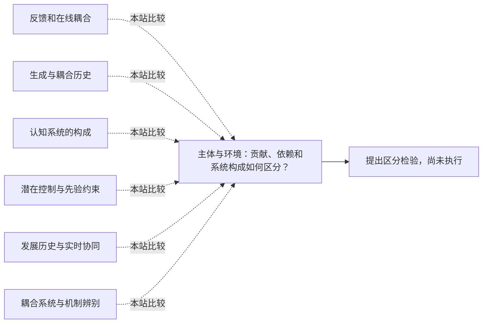

<!-- 由 research.json 生成；修改数据后重生成。A批已验收；不代表完整路线史。 -->

# 主体与环境：贡献、依赖和系统构成如何区分？

**问题：** 环境参与行为的形成，在何种意义上支持具身、生成或扩展认知的主张？

这是基于所列阅读范围的本站比较；下述实验为待执行构想，不计入正式复现。

## 定义与比较对象

### 反馈和在线耦合

效果反馈与局部感知行动循环说明环境如何影响控制；这本身不决定认知系统的哲学边界。

[反馈为什么既能调节，也会引起振荡？](../notes/e-wiener-1948.md) · [Brooks：没有中央表征能做到哪里？](../../round-two/notes/e-brooks-1991.md)

### 生成与耦合历史

生成论强调感知引导的行动及反复感知运动模式，并明确区别于对Gibson路线的简单等同。

[认知如何通过感知行动形成一个有意义的世界？](../notes/e-varela-1991.md)

### 认知系统的构成

环境产生因果贡献与环境属于认知系统，是需要分开论证的主张。

[Wilson：具身认知包含哪些不同主张？](../../round-two/notes/e-wilson-2002.md)

### 潜在控制与先验约束

赋能度依赖感知行动通道；主动推断依赖生成模型和偏好／运动先验。这些形式框架均需独立说明生物适应、任务成功与主体边界的联系。

[行动能带来多少可区分的感知结果？](../notes/e-klyubin-2005.md) · [感知更新与行动能否共享一个优化框架？](../notes/e-friston-2010.md) · [主动推断：为什么先去看线索？](../../round-two/notes/e-friston-2015.md)

### 发展历史与实时协同

动作模式、身体支持与自主行走需要分别解释；跨年龄变化和当下情境变化也应分开。

[动作模式怎样从身体与情境中形成？](../notes/e-thelen-smith-1994.md)

### 耦合系统与机制辨别

主体与环境的形式划分是分析选择；正常行为相近可由不同动力学产生，需要对反馈和身体条件施加扰动。

[相同行为能否来自不同的耦合机制？](../notes/e-beer-1995.md)

## 比较结论

先说明要解释的是行为成功、学习过程、经验意义还是系统构成，再选择实验与论证。可存续、节省控制和认知能力不能未经论证互相替代。

[编辑比较图](q-agent-environment.mmd)

## 原文定位

- [反馈为什么既能调节，也会引起振荡？](../notes/e-wiener-1948.md)：所读1961第二版第IV章，95–99页；反馈取决于效果状态，设计不当也可能振荡。
- [Brooks：没有中央表征能做到哪里？](../../round-two/notes/e-brooks-1991.md)：§6–8；具体机器人及中央表征主张边界。
- [认知如何通过感知行动形成一个有意义的世界？](../notes/e-varela-1991.md)：第8章172–173页；第9章203–207页；生成论、Gibson区别及可存续性。
- [Wilson：具身认知包含哪些不同主张？](../../round-two/notes/e-wilson-2002.md)：Claim 4，629–630页；因果贡献与构成主张之别。
- [行动能带来多少可区分的感知结果？](../notes/e-klyubin-2005.md)：130–133页式3–4及实验；传感器与动作约束共同决定容量和所选形态。
- [感知更新与行动能否共享一个优化框架？](../notes/e-friston-2010.md)：AOP2–4及8–9页；感知更新、行动与运动先验的不同作用。
- [动作模式怎样从身体与情境中形成？](../notes/e-thelen-smith-1994.md)：第1章11–17页；第4章71–88页；发展成分、经验边界与稳定性检验。
- [相同行为能否来自不同的耦合机制？](../notes/e-beer-1995.md)：§3.1；191页图6；§4.2.4；§5.4；划分、反馈扰动和内部状态分别承担不同解释工作。
- [分层控制从模拟推进到实机](../notes/e-brooks-1986.md)：1985 §7；1986 §IV.C、§V.B；模拟、实机与视觉方案完成度分别登记。

## 可区分的检验（未执行）

- 操纵：在同一感知行动任务中改变反馈时延、工具可用性或身体动力学，分别比较初次使用与长期适应后的表现。 增设感知通道分辨率与目标偏好的独立操纵，比较潜在控制机会、实际行为和目标达成。 在正常表现相近的系统间，先固定参数施加扰动，再允许学习，以分开即时动力学适应与参数学习。
- 测量：记录行为稳定性、适应曲线和去除工具后的残留变化；必要时另设计对主观经验的研究，不能用控制误差代替。
- 控制：保持任务目标与可用信息一致，区分扰动造成的信息减少、能量变化和耦合规律变化。 发展研究同时记录年龄、身体条件和个体练习历史；动作模式与承重能力分别测量。
- 解释边界：扰动引起损害可支持因果依赖；要主张工具或环境构成认知系统，还须明确构成标准并提供独立论证。

本卡对齐指定阅读范围，提出的实验尚未执行。扰动依赖、任务适应和认知构成仍是不同结论；动力学用语或形式划分本身不能判定意识、意义及系统的哲学边界。

下一问：哪一种额外证据能把短期辅助、长期依赖与认知系统构成区分开来？

[返回A批](../README.md)
