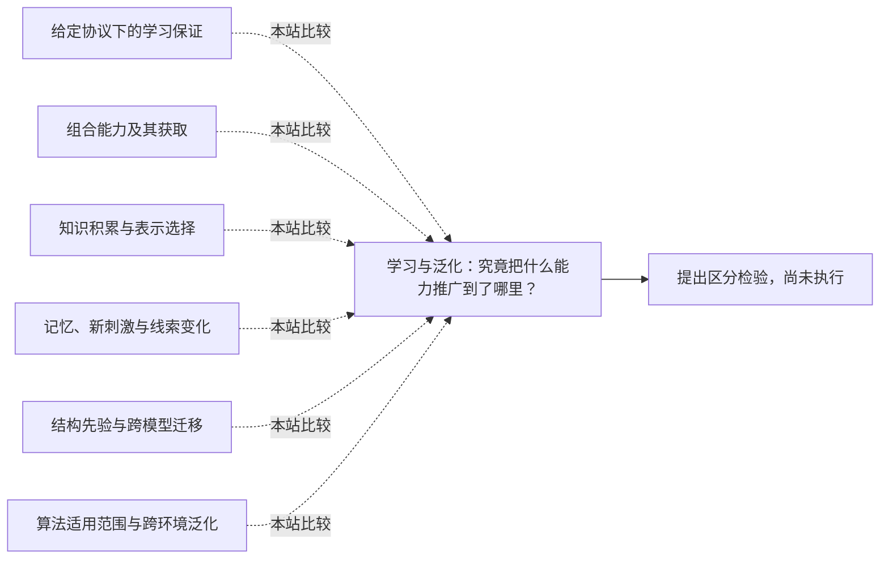

<!-- 由 research.json 生成；修改数据后重生成。A批已验收；不代表完整路线史。 -->

# 学习与泛化：究竟把什么能力推广到了哪里？

**问题：** 理论学习保证、组合任务成绩和从经验形成规则，能否在同一尺度上比较？

这是基于所列阅读范围的本站比较；下述实验为待执行构想，不计入正式复现。

## 定义与比较对象

### 给定协议下的学习保证

保证依赖表示类、样本分布、查询能力、误差类型和计算预算。比较时须保留原论文协议。

[Valiant：学习需要怎样的协议？](../../round-two/notes/e-valiant-1984.md)

### 组合能力及其获取

角色组合、词汇替换、长度外推和新结构是不同检验；元训练时见过的任务分布也属于经验与先验条件。

[相关认知能力为什么成组出现？](../notes/e-fodor-pylyshyn-1988.md) · [SCAN：随机切分掩盖了什么？](../../round-two/notes/e-lake-baroni-2018.md) · [MLC：用任务分布训练组合能力](../../round-two/notes/e-lake-baroni-2023.md)

### 知识积累与表示选择

Soar的规则复用和DreamCoder的程序库学习依赖任务表示与初始知识；技能得分不能独自分离先验、经验和适应效率。

[遇到僵局时如何求解并记住经验？](../notes/e-soar-1987.md) · [能否同时学习程序库和搜索程序的方法？](../notes/e-ellis-2021.md) · [Chollet：从任务得分转向技能习得效率](../../round-two/notes/e-chollet-2019.md)

### 记忆、新刺激与线索变化

重现已学刺激、有限关系留出、同分布新样本和打破线索相关性的测试，对训练所得能力提出不同要求。

[识别偏向怎样随经验改变？](../notes/e-rosenblatt-1958.md) · [隐藏单元怎样获得学习信号？](../notes/e-rumelhart-1986.md) · [高测试分数究竟来自哪条决策规则？](../notes/e-geirhos-2020.md)

### 结构先验与跨模型迁移

学习先验仍依赖上层表示族；模型内训练到原环境测试，与在线收集下的数据效率是不同的泛化／适应协议。

[少量经验如何支持丰富的结构推断？](../notes/e-tenenbaum-2011.md) · [学到的环境模型能把控制学习转移到哪里？](../notes/e-ha-2018.md) · [如何从像素学到足以在线规划的动态？](../notes/e-hafner-2019.md)

### 算法适用范围与跨环境泛化

同一算法在多个环境分别训练，不等于一个训练完成的模型可直接泛化到新环境。

[MuZero的版本、训练信息与泛化边界](../notes/e-schrittwieser-2019.md)

## 比较结论

为每项结果列出训练时知道什么、测试改变了什么、允许多少经验与计算，再比较机制。某种切分上的成功或失败，都不能自动推广为所有任务上的系统性结论。

[编辑比较图](q-learning-generalization.mmd)

## 原文定位

- [Valiant：学习需要怎样的协议？](../../round-two/notes/e-valiant-1984.md)：§2–3，1135–1137页；正例、查询及单侧错误协议。
- [相关认知能力为什么成组出现？](../notes/e-fodor-pylyshyn-1988.md)：§3.2–3.5；系统性不是无界生产性的同义词。
- [SCAN：随机切分掩盖了什么？](../../round-two/notes/e-lake-baroni-2018.md)：PDF5–6 Experiment 3；隔离原语与组合测试。
- [MLC：用任务分布训练组合能力](../../round-two/notes/e-lake-baroni-2023.md)：119页表2与Discussion；词汇组合改善及结构外推失败。
- [遇到僵局时如何求解并记住经验？](../notes/e-soar-1987.md)：§3.3.3，55–57页；表示影响隐式泛化。
- [能否同时学习程序库和搜索程序的方法？](../notes/e-ellis-2021.md)：§2、§3及Fig.7；程序库、识别模型与任务设定。
- [Chollet：从任务得分转向技能习得效率](../../round-two/notes/e-chollet-2019.md)：§III.1–III.2；先验和效度的待解问题。
- [识别偏向怎样随经验改变？](../notes/e-rosenblatt-1958.md)：395–396页；记忆与新刺激泛化采用不同协议。
- [隐藏单元怎样获得学习信号？](../notes/e-rumelhart-1986.md)：534–535页图2–4；104个关系中的4个留出结果有明确任务范围。
- [高测试分数究竟来自哪条决策规则？](../notes/e-geirhos-2020.md)：§3，4–6页；Appendix A，28页；位置与形状线索可以在同分布数据中同时有效。
- [少量经验如何支持丰富的结构推断？](../notes/e-tenenbaum-2011.md)：1282–1285页图2–3及Open Questions；结构学习、初始假设与实现成本分开。
- [学到的环境模型能把控制学习转移到哪里？](../notes/e-ha-2018.md)：10页表2；模型内高分可能无法转移到原游戏。
- [如何从像素学到足以在线规划的动态？](../notes/e-hafner-2019.md)：6–8页；基准、输入模态、交互次数与种子汇总口径需对齐。
- [MuZero的版本、训练信息与泛化边界](../notes/e-schrittwieser-2019.md)：2020 Methods / Training，末段；2019 v1 Appendix H；逐环境训练与旧轨迹再利用是不同的效率／泛化问题。

## 可区分的检验（未执行）

- 操纵：在同一指令任务中依次引入新词、已知词的新组合、更长序列和新规则；分别比较固定架构下的普通训练与元训练。 增加一组训练时与答案相关、测试时独立随机化的无关标记，检查模型是否依赖该线索。
- 测量：逐项报告精确匹配率、失败类型、适应样本数和计算量；多种子分布与模型选择规则一并保存。
- 控制：固定词表、数据量、测试协议和模型容量；单独标注元训练增加的任务信息，禁止用最佳运行冒充平均表现。 随机化标记时保留任务可解性与标签语义；设置只读取该标记的基线。
- 解释边界：若收益只出现在元训练支持的变化内，应描述为限定范围的泛化提升；更广泛稳定性需要额外证据。

本卡不提供跨论文排行榜，也未运行该对比。已有Baird复现检验函数逼近的稳定性，不能算作组合泛化实验。 捷径学习中的星月实验仅登记作者结果，没有计作本项目复现。

下一问：能否找到训练经验相近、测试中却能区分结构归纳与局部规律复用的最小任务组？

[返回A批](../README.md)
