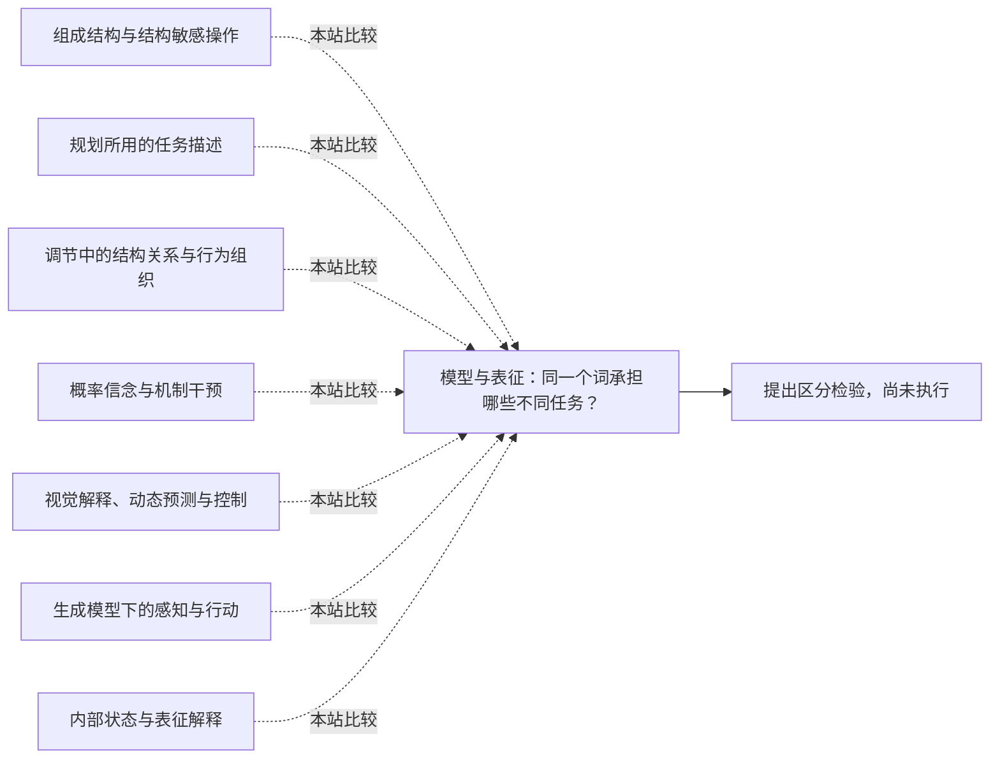

<!-- 由 research.json 生成；修改数据后重生成。A批已验收；不代表完整路线史。 -->

# 模型与表征：同一个词承担哪些不同任务？

**问题：** 哪些表示服务于解释、推理、预测或控制？这些功能能否互相推出？

这是基于所列阅读范围的本站比较；下述实验为待执行构想，不计入正式复现。

## 定义与比较对象

### 组成结构与结构敏感操作

争论涉及认知层表征及其实现方式；网络单元或活动分布的存在，尚未说明如何绑定角色与组成复杂内容。 张量积表示进一步给出角色绑定与精确解绑条件；表示定理不自动提供学习过程。

[相关认知能力为什么成组出现？](../notes/e-fodor-pylyshyn-1988.md) · [分布式状态能否具有组成结构？](../notes/e-smolensky-1988-bbs.md) · [分布式向量怎样保存谁处于哪个角色？](../notes/e-smolensky-1990.md)

### 规划所用的任务描述

STRIPS使用可应用算子的世界描述；MuZero的潜在模型以奖励、价值和策略预测为训练约束。两者的表示内容、用途和学习方式不同。

[如何在世界模型之间搜索行动计划？](../notes/e-strips-1971.md) · [MuZero的版本、训练信息与泛化边界](../notes/e-schrittwieser-2019.md)

### 调节中的结构关系与行为组织

好调节器定理中的映射关系不能直接换成中央显式模拟器；Brooks对中央表征的批评也不能读成系统完全没有内部状态。

[好调节器：模型究竟意味着什么？](../../round-two/notes/e-conant-ashby-1970.md) · [Brooks：没有中央表征能做到哪里？](../../round-two/notes/e-brooks-1991.md)

### 概率信念与机制干预

给定结构更新观察后的信念，与替换机制后推断结果是不同问题。识别依赖额外因果假设。

[局部消息怎样完成全局信念更新？](../notes/e-pearl-1982.md) · [观察分布何时足以回答干预问题？](../notes/e-pearl-1995.md)

### 视觉解释、动态预测与控制

静态图像的层级残差、随行动演化的潜在动态、模型内训练控制器与在线搜索，分别说明不同模型用途。

[层间反馈能解释哪些视觉反应？](../notes/e-rao-ballard-1999.md) · [学到的环境模型能把控制学习转移到哪里？](../notes/e-ha-2018.md) · [如何从像素学到足以在线规划的动态？](../notes/e-hafner-2019.md)

### 生成模型下的感知与行动

生成模型、识别分布及运动／结果偏好分别承担解释、近似推断和目标约束。瞬时自由能与策略预期自由能需区分。

[感知更新与行动能否共享一个优化框架？](../notes/e-friston-2010.md) · [主动推断：为什么先去看线索？](../../round-two/notes/e-friston-2015.md)

### 内部状态与表征解释

有内部状态允许行为依赖历史；是否称为表征还需要额外标准及具体机制证据，不能从状态的存在直接推出。

[相同行为能否来自不同的耦合机制？](../notes/e-beer-1995.md)

## 比较结论

先对齐四项：表示什么、用于什么运算、由什么经验获得、通过什么失败检验。共享“模型”一词不足以判定这些研究相互支持或相互否定。 对结构表示还须分别检查可表达性、可取回性、可学习性及实际过程，不能从其中一项自动推出其余各项。

[编辑比较图](q-model-representation.mmd)

## 原文定位

- [相关认知能力为什么成组出现？](../notes/e-fodor-pylyshyn-1988.md)：§2及§3.2–3.5；结构、实现层次和系统性前提。
- [分布式状态能否具有组成结构？](../notes/e-smolensky-1988-bbs.md)：§7.2及作者回应；分布式实现与认知层解释的分歧。
- [如何在世界模型之间搜索行动计划？](../notes/e-strips-1971.md)：608–613页；状态描述、算子与模型空间搜索。
- [MuZero的版本、训练信息与泛化边界](../notes/e-schrittwieser-2019.md)：2019 v1 PDF2、4；潜在模型的训练目标。
- [好调节器：模型究竟意味着什么？](../../round-two/notes/e-conant-ashby-1970.md)：§4，重排本PDF7–9；映射意义和成立条件。
- [Brooks：没有中央表征能做到哪里？](../../round-two/notes/e-brooks-1991.md)：§6–8；局部行为组织及适用范围。
- [分布式向量怎样保存谁处于哪个角色？](../notes/e-smolensky-1990.md)：§2.2.3–2.2.4，173–176页；§3.1，186–187页；角色绑定、对偶解绑与自寻址串扰的条件不同。
- [观察分布何时足以回答干预问题？](../notes/e-pearl-1995.md)：672–679页；评论688–689页；回应705–706页；区分形式干预、领域假设与实际操作。
- [层间反馈能解释哪些视觉反应？](../notes/e-rao-ballard-1999.md)：85–86页Methods；本文静态推断不能直接当作时序预测。
- [学到的环境模型能把控制学习转移到哪里？](../notes/e-ha-2018.md)：9–10页表2；14–15页训练设置；模型内成绩与原环境成绩可能分离。
- [如何从像素学到足以在线规划的动态？](../notes/e-hafner-2019.md)：3–5页；7页表1；在线规划、模型组成与评测统计分别记录。
- [感知更新与行动能否共享一个优化框架？](../notes/e-friston-2010.md)：AOP2–4及8–9页；优化分解、神经实现假设与行为先验分别核查。
- [相同行为能否来自不同的耦合机制？](../notes/e-beer-1995.md)：§5.4，210–211页；明确区分内部状态和表征，保留具体系统的经验检验。
- [MuZero的版本、训练信息与泛化边界](../notes/e-schrittwieser-2019.md)：版本对照；2020 Methods / Comparison to AlphaZero、Training；根节点动作信息与逐环境训练界定模型的实际能力范围。

## 可区分的检验（未执行）

- 操纵：在同一环境中分别改变视觉外观、任务奖励和行动后果；每次只改变一项，记录模型、策略和搜索预算哪些部分需要重学。
- 测量：比较原任务性能、迁移错误、重新学习的数据量，以及能否预测未执行动作的后果。
- 控制：固定传感输入、训练经验、计算预算与动作空间；将架构变化和训练目标变化分开。
- 解释边界：只在训练奖励不变时有效的潜在表示，不能因此被认定为通用因果理解；性能下降也需排除训练量和优化差异。

这是本站比较框架及未执行的实验构想；不能用单一任务裁决所有表征理论。新增因果与世界模型材料要求明确干预语义、训练位置及模型用途；主动推断已补原文范围；MuZero已完成所列文字与表1的版本对照，未覆盖的公式和补充材料单列。

下一问：什么任务能迫使控制充分的表示与支持新问题推理的表示给出不同预测？

[返回A批](../README.md)
