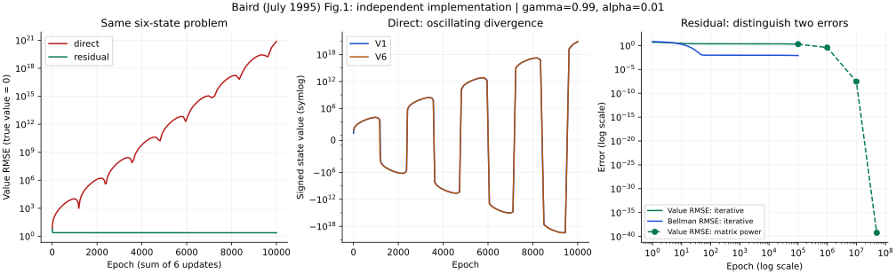

# Baird 六状态反例：正式复现与原文差异

2026-10-25。**独立实现复现了指定设置下直接法的发散，以及残差梯度的收敛趋势；同时发现，发散形态和适用参数必须比原文的概括说得更准确。** 本项完成的是图1预测问题的机制与结果核验，不是图5速度实验的逐点复绘，也不代表A批整体完成。

[预先保存的协议与修订](protocol.md) · [机器可读结果](results.json) · [采样轨迹](traces.csv) · [可编辑SVG](baird-six-state.svg) · [实现](../../../../scripts/replicate-baird-1995.py) · [A批计划](../plan.md)



图左比较相同问题和步长下的真值误差；图中保留状态值的正负号，避免对数曲线掩盖振荡；图右区分Bellman残差和真值误差。实线来自实际逐轮计算；虚线圆点来自同一线性递推的矩阵快速幂，并非执行了五千万轮。

## 原始问题与本次范围

[Baird 1995 作者版](http://leemon.com/papers/1995b.pdf)讨论：表格表示下成立的学习收敛性质，在共享权重的函数逼近中还能否成立？采用的9页PDF末页注明1995年7月15日勘误，图1已补上系数2。版本指纹为 `a32e916f75e4ca626c470d24fe0a3e587c14bd10edfae686fc9edf7498831979`。

原文给出六个状态，全部转移到状态6，后者自循环，奖励均为零。状态值由七个共享权重表示：前五项为 `V(i)=w0+2wi`，末项为 `V(6)=2w0+w6`。各转移在训练中同样频繁。它能表示任意六维状态值，因此本例的问题并非模型容量不足。

本次采用§5正文的按轮更新：用同一组旧权重计算六项增量，求和后一次应用。直接法遵循式3；残差梯度遵循式6、8。折扣率0.99、步长0.01、初值 `w0…w5=1,w6=10` 是本次公开选定的参数，不冒称作者图5的原始配置。特征不归一化，也不把求和偷偷替换成均值。

这里均匀更新六个状态，不等于沿这条确定性链的长期访问频率训练。本结果不能用于否定满足相应条件的线性、同策略预测收敛结论。它也不等同于末页新增的双动作Q-learning例子。

## 数值结果

| 方法与计算范围 | 真值RMSE | Bellman残差MSE | 解释 |
| --- | ---: | ---: | --- |
| 直接法，实际10000轮 | 7.306958×10²⁰ | 1.804419×10³⁹ | 已出现巨大误差，途中多次变号 |
| 残差梯度，实际100000轮 | 2.016999 | 6.894723×10⁻⁵ | 残差很小仍不等于值估计准确 |
| 残差梯度，矩阵快速幂至1000000轮 | 0.390476 | 2.584010×10⁻⁶ | 同一递推的长时间结果 |
| 残差梯度，矩阵快速幂至10000000轮 | 2.887226×10⁻⁸ | 1.412756×10⁻²⁰ | 与谱分析的收敛结论一致 |

100000轮残差梯度中，逐轮检查未发现超出数值容差的残差MSE上升。参数空间有一维零空间，权重可以保持非零而所有状态值趋近零；因此不以权重范数归零作为成功标准。

## 为什么发生：重建更新而不是只看曲线

令特征矩阵为X，转移矩阵为P，`D=γP−I`，`v=Xw`。零奖励时误差为 `δ=Dv`。两种更新分别是：

```text
直接法：     w_next = [I + α Xᵀ D X] w
残差梯度：   w_next = [I − α (DX)ᵀ(DX)] w
```

残差梯度对后继状态的值也求导。这里相当于对 `J=½Σδ²` 作梯度下降；原文平均平方残差的常数因子已吸收到步长，与式8的求和写法一致。

状态值的独立递推为 `v_next=[I+αXXᵀD]v` 和 `v_next=[I−αXXᵀDᵀD]v`。主实验两者的最大特征值模分别为 **1.004253454** 与 **0.999998176**：前者含不稳定模式，后者收敛，但最慢模式非常接近1。

初值对称，使前五个状态值始终相同，记为U，末项记为L。直接法还可以独立化成二维递推：

```text
[U_next]       [−9      11γ−2] [U]
[L_next] = (I+α[−10     15γ−5])[L]
```

增量矩阵的迹为 `15γ−14`，行列式为 `25(1−γ)`。γ=0.99时，它的特征值为 `0.425±0.263391i`；离散更新因子的模大于1。这解释了持续放大的振荡，也说明不能把它描述成始终同号的单调发散。该推导由完整六维状态递推独立核对。

## 两项原文差异

**式7的符号冲突。** PDF第4页式7写成 `+αΣδ[−∇V]`，与第2页式3的 `+αδ∇V` 相反。主实验明确遵循式3，并记录逐字式7的谱作为对照。单状态表格问题给出一个与星形模型无关的检查：式3的更新因子是0.9999，逐字式7则是1.0001，后者让零奖励的表格值发散。把式7视为疑似排印错误是本次研究判断，尚无作者确认；这一选择在首次运行前作为协议修订A保存。

**发散不保证固定符号。** PDF第3页§3进一步声称状态值及多数权重趋向正无穷、末项权重趋向负无穷。本次参数符合正初值、末状态值更大的设置，却出现变号；数值与解析结果均支持振荡增长。复现支持“可以发散”的结论，不能支持无参数限定的固定方向表述。

作者后来的[1999年学位论文](https://www.ri.cmu.edu/pub_files/pub2/baird_leemon_1999_1/baird_leemon_1999_1.pdf)，PDF37–38／印刷35–36页，明确区分图4.2的七状态螺旋发散与图4.3的十一状态单调增长。两图均使用γ=0.9，初始化也不同。这里只做原文版本对照，未数值复现这两个后期例子，不能把其参数移植到1995六状态图而仍称同一实验。

## 敏感性：哪些改变会改变结论

下表为直接法状态值迭代矩阵的最大特征值模；小于1表示本线性递推渐近稳定。顺序更新按状态1至6依次使用最新权重，与主实验同步求和有区别。

| γ | α | 同步直接法 | 顺序直接法 | 同步残差梯度 |
| ---: | ---: | ---: | ---: | ---: |
| 0.90 | 0.001 | 0.999751219 | 0.999749969 | 0.999977833 |
| 0.90 | 0.010 | 0.997622173 | 0.997497268 | 0.999778326 |
| 0.95 | 0.001 | 1.000125617 | 1.000125381 | 0.999995028 |
| 0.95 | 0.010 | 1.001311640 | 1.001288807 | 0.999950279 |
| 0.99 | 0.001 | 1.000425035 | 1.000425770 | 0.999999818 |
| 0.99 | 0.010 | 1.004253454 | 1.004328183 | 0.999998176 |

本例在γ=0.9的两个步长下稳定；因此“六状态共享线性参数必然发散”是错误概括。上述检查也不能推出任意步长的残差梯度都收敛，更未检验一般非线性模型、随机转移中的双采样问题或Q-learning控制。

## 核验与重跑

- 原文图1、式3/6/7/8、末页勘误和1999年图4.2/4.3已逐页视觉核对。
- 独立标量求和与矩阵式的100轮最大绝对差：直接法3.84×10⁻¹³，残差梯度6.66×10⁻¹⁵。
- 中心差分梯度检查最大绝对差1.14×10⁻¹⁰；预定容差为10⁻⁶。
- 实际迭代、权重矩阵快速幂、状态值矩阵快速幂，以及二维对称推导相符。
- 图表修订仅调整刻度，未改变协议参数、验收条件或数值方法；PNG已视觉检查，SVG保留文字和曲线可编辑性。

需要Python、NumPy和Matplotlib。项目根目录运行：

```sh
python3 scripts/replicate-baird-1995.py
```

当前环境版本、代码与协议SHA-256随 `results.json` 保存。依赖版本见 `requirements.txt`。这不是作者代码复跑；复现图5仍缺完整实验设置，其100次随机初始化和学习率搜索没有纳入本次结果。
