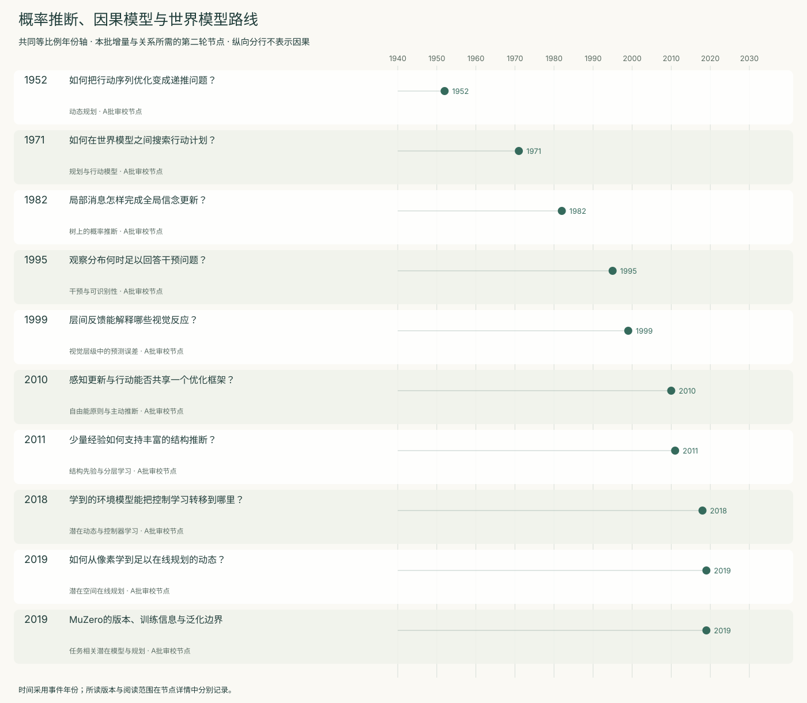
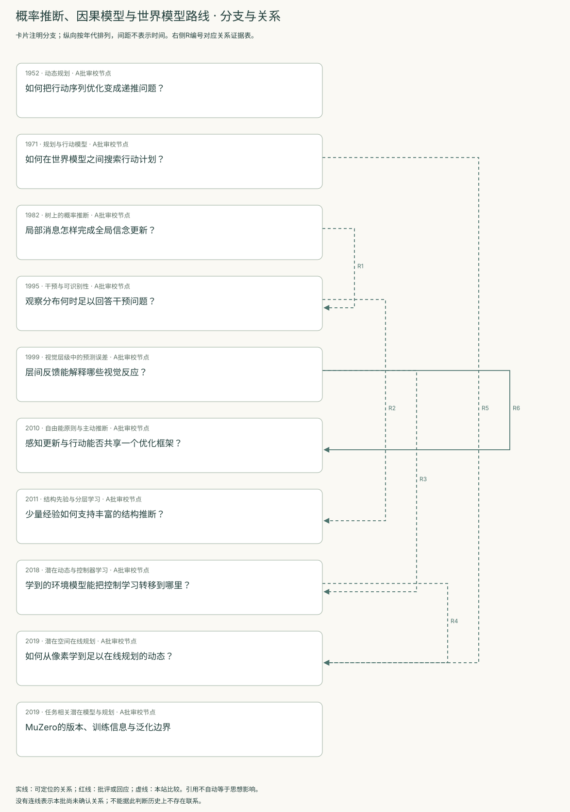
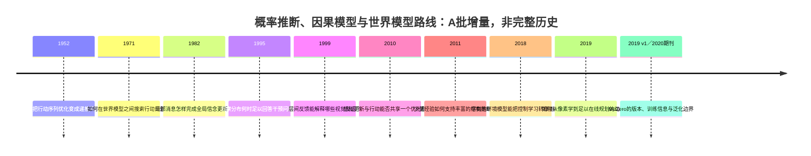
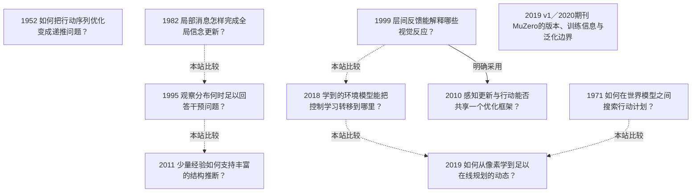

<!-- 由 research.json 生成；修改数据后重生成。A批已验收；不代表完整路线史。 -->

# 概率推断、因果模型与世界模型路线 · A批增量

**已完成本批指定范围验收，后续扩展与未覆盖材料另列。** 当前10个本批节点，图中另有0个第二轮延续节点；前两轮记录仍独立保留。

十个节点区分已知模型中的最优控制与规划、概率信念更新、干预识别、结构先验学习、视觉层级推断和学得动态中的控制。它们使用模型的目标与证据标准不同，关系图保留分支。

Pearl 1982研究树上的证据传播；1995引入机制干预及识别条件。同期评论把注意力拉回领域假设与实际操作；正确推导不替代建模证据。Tenenbaum等则追问结构先验怎样从多层经验形成。

Rao与Ballard的静态视觉模型、World Models的潜在动态与控制器、PlaNet的在线规划分别保留任务和训练协议。模型重建、预测、迁移与控制成功需要分别检验。

2010自由能综述另列感知与行动的统一提案；它采用预测编码的一种实现，同时依赖生成模型与运动先验，不能从优化恒等式直接推出生物学普遍性。

MuZero加入了2019预印本与2020期刊版的指定范围对照：Reanalyze和表1结果已见于v1；期刊版补充的训练与跨环境边界说明须与新增算法区分。

[交互阅读](../atlas.html?route=causal-world-models) · [编辑SVG时间线](causal-world-models-timeline.svg) · [编辑SVG关系图](causal-world-models-relations.svg)

图中标为“第二轮延续”的节点用于呈现本批新增关系，不计入本批独立节点数。SVG关系编号与下表对应；完整原文定位见[关系台账](../relations.md)。

| 编号 | 关系 | 解释 |
| --- | --- | --- |
| R1 | 1982 → 1995 · 本站比较 | 本站比较给定树上的信念更新与机制干预；不把条件独立语义自动升级为因果语义，也不据年代判定具体影响链。 |
| R2 | 1995 → 2011 · 本站比较 | 比较给定因果假设后的识别问题与学习结构先验的问题；后者的学习结果不免除前者的识别条件。 |
| R3 | 1999 → 2018 · 本站比较 | 本站区分静态视觉层级推断与按时间预测潜在状态的控制模型；没有把共同使用预测一词当作神经机制验证或直接继承证据。 |
| R4 | 2018 → 2019 · 本站比较 | PlaNet在相关工作中列出Ha与Schmidhuber；本图具体比较预训练控制器与在线潜在规划。引用本身不证明RSSM或CEM由前者直接继承。 |
| R5 | 1971 → 2019 · 本站比较 | 本站比较手工算子与学得动态模型中的行动搜索；状态语义、模型获取与执行反馈各不相同。 |
| R6 | 1999 → 2010 · 明确采用 | Friston明确采用预测编码作为特定假设下的消息传递方案，并引用Rao–Ballard；这不证明统一原则已获实验验证，且所读版参考文献误列原文年份。 |

[编辑时间线](causal-world-models-timeline.mmd) · [编辑关系图](causal-world-models-relations.mmd)

- [如何把行动序列优化变成递推问题？](../notes/e-bellman-1952.md)：每步操作的结果会影响后续决策，怎样求整个序列的最优收益或代价？
- [如何在世界模型之间搜索行动计划？](../notes/e-strips-1971.md)：怎样减少把整个行动序列都交给定理证明器造成的搜索困难？
- [局部消息怎样完成全局信念更新？](../notes/e-pearl-1982.md)：如何在分层推理系统中传播新证据，同时避免证据被重复计算？
- [观察分布何时足以回答干预问题？](../notes/e-pearl-1995.md)：没有随机实验时，什么额外假设使干预效果能从观察数据唯一确定？
- [层间反馈能解释哪些视觉反应？](../notes/e-rao-ballard-1999.md)：局部视觉响应为何受更大范围的情境与高层反馈影响？
- [感知更新与行动能否共享一个优化框架？](../notes/e-friston-2010.md)：怎样把感知、学习和行动放进同一生成模型框架，同时说明其生物学解释条件？
- [少量经验如何支持丰富的结构推断？](../notes/e-tenenbaum-2011.md)：从稀疏数据作出广泛概括时，所需的先验和假设空间从何而来？
- [学到的环境模型能把控制学习转移到哪里？](../notes/e-ha-2018.md)：怎样压缩视觉与时间信息以支持控制，模型中的成功能否转移到原环境？
- [如何从像素学到足以在线规划的动态？](../notes/e-hafner-2019.md)：部分可观测环境中，怎样保持记忆并预测多种未来，用有限经验选择行动？
- [MuZero的版本、训练信息与泛化边界](../notes/e-schrittwieser-2019.md)：规划是否必须重建每个像素或真实状态？

## 未覆盖范围与后续研究

- Pearl 1988专著、因果发现与演算完备性的后续发展尚未独立展开；此处不声称覆盖全部因果史。
- PlaNet补充材料与训练代码、World Models后续版本及更广泛世界模型成果留作扩展；本文的作者实验数字均未计作本项目复现。

[返回A批](../README.md)
