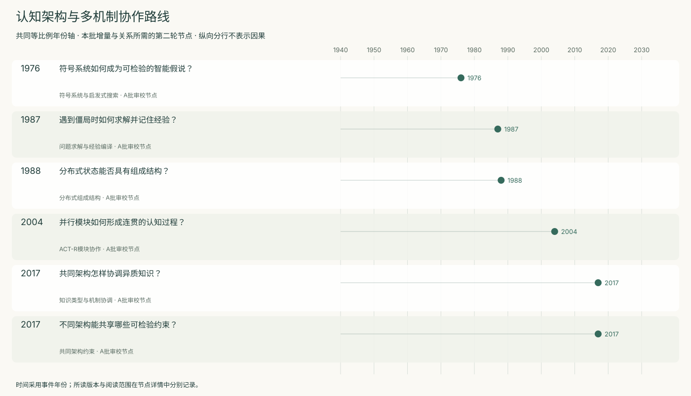
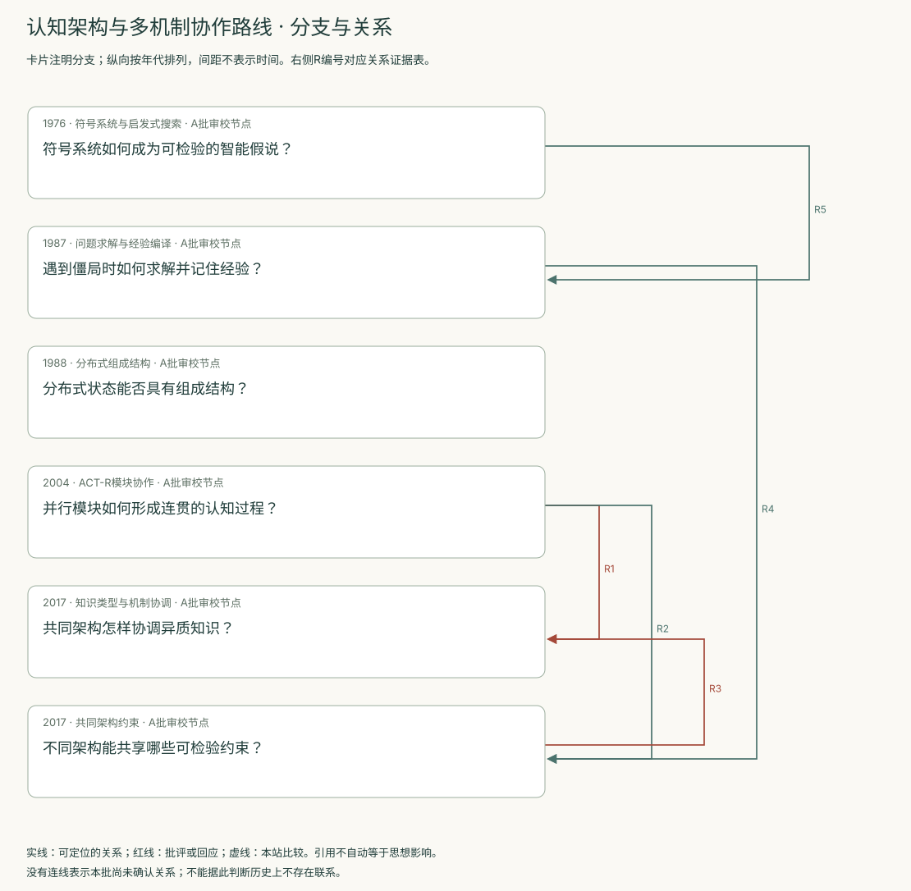
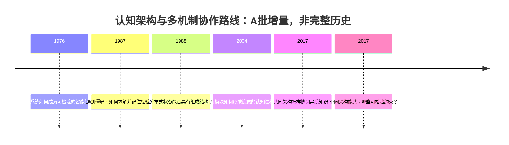
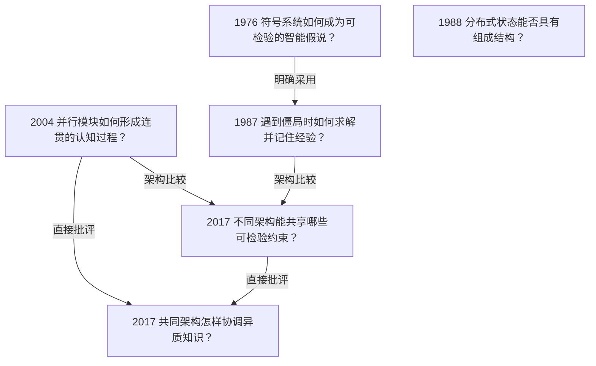

<!-- 由 research.json 生成；修改数据后重生成。A批已验收；不代表完整路线史。 -->

# 认知架构与多机制协作路线 · A批增量

**已完成本批指定范围验收，后续扩展与未覆盖材料另列。** 当前6个本批节点，图中另有0个第二轮延续节点；前两轮记录仍独立保留。

本批从物理符号系统的一般假说进入具体架构：Soar将决策僵局、子目标和chunking连接起来，ACT-R 5.0以模块、有限缓冲区与产生式周期约束协作。二者采用不同组织方式；年代相继不意味着单向替代。

Smolensky的层次论证提醒我们区分认知解释与底层实现。2017年的共同模型进一步比较符号结构、量化元数据和多种学习机制；它是类人心智的研究提案，而非已经验证的统一实现。

直接批评把问题转向知识内容：架构拥有模块或大型知识库以后，还须说明原型、实例与规则发生冲突时如何协调。下一步比较应固定知识与参数，检验跨任务、冲突和时序操纵下的预测。

[交互阅读](../atlas.html?route=cognitive-architectures) · [编辑SVG时间线](cognitive-architectures-timeline.svg) · [编辑SVG关系图](cognitive-architectures-relations.svg)

图中标为“第二轮延续”的节点用于呈现本批新增关系，不计入本批独立节点数。SVG关系编号与下表对应；完整原文定位见[关系台账](../relations.md)。

| 编号 | 关系 | 解释 |
| --- | --- | --- |
| R1 | 2004 → 2017 · 直接批评 | 后文明确引用Anderson等2004，并讨论ACT-R的异质知识协调限制；不是对2004年双任务拟合结果的直接反驳。 |
| R2 | 2004 → 2017 · 架构比较 | 共同模型明确将ACT-R纳入比较；后者讨论更晚版本，不能把所有2017年假设倒置成2004年的实现。 |
| R3 | 2017 → 2017 · 直接批评 | 批评明确针对当时待刊的标准模型提案，侧重知识类型及推理协调。两者同年，并非依靠期刊出版日期推断阅读顺序。 |
| R4 | 1987 → 2017 · 架构比较 | 共同模型纳入后来的Soar，讨论多个记忆与学习机制；本边表示同名架构在比较中的位置，不把2017结构倒置为1987实现。 |
| R5 | 1976 → 1987 · 明确采用 | Soar作者明确把物理符号系统假说列为其架构假说并引用Newell与Simon 1976；这证明采用关系，不证明该假说的必要性已获验证。 |

[编辑时间线](cognitive-architectures-timeline.mmd) · [编辑关系图](cognitive-architectures-relations.mmd)

- [符号系统如何成为可检验的智能假说？](../notes/e-newell-simon-1976.md)：哪些结构和过程可能支持一般智能行动，又应怎样检验？
- [遇到僵局时如何求解并记住经验？](../notes/e-soar-1987.md)：如何让决策、子目标和学习在同一架构内持续协作？
- [分布式状态能否具有组成结构？](../notes/e-smolensky-1988-bbs.md)：连接主义是否只能把一个完整思想当成没有结构的原子？
- [并行模块如何形成连贯的认知过程？](../notes/e-anderson-2004.md)：视觉、动作、目标和记忆各自工作时，怎样约束它们的相互协调？
- [共同架构怎样协调异质知识？](../notes/e-chella-frixione-lieto-2017.md)：增加知识量以后，原型、实例和规则之间的冲突如何处理？
- [不同架构能共享哪些可检验约束？](../notes/e-laird-2017.md)：怎样从多个认知架构提取共同假设，支持累积研究？

## 未覆盖范围与后续研究

- Newell 1990原书及ACT* 1983尚未建立本批原典笔记；现有节点不替代这些版本。
- 标准模型的其他直接异议、图2逐格比较与2017年后的修订仍待扩展；本批没有全面重跑认知架构。

[返回A批](../README.md)
