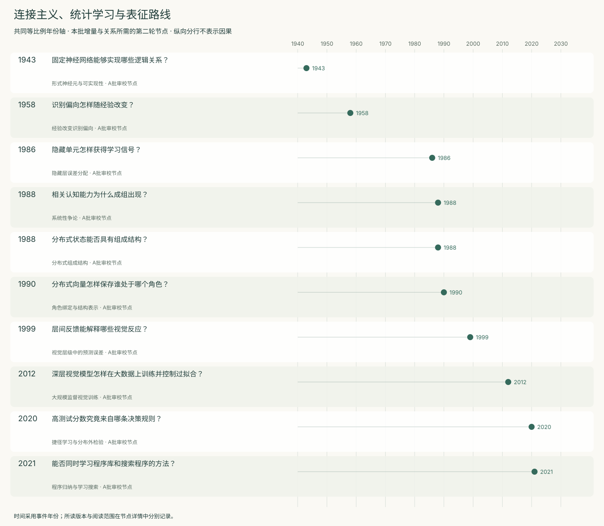
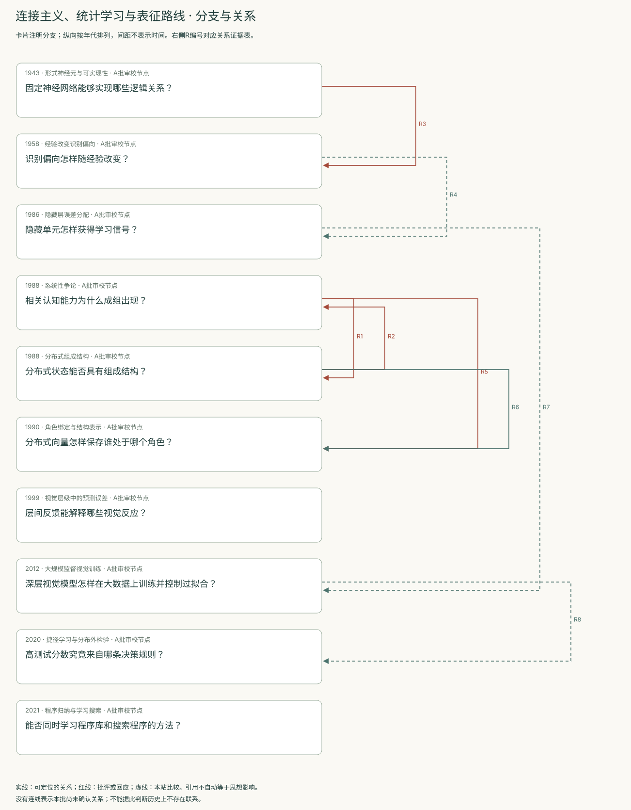
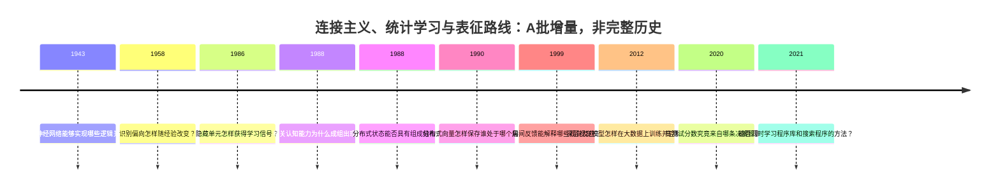
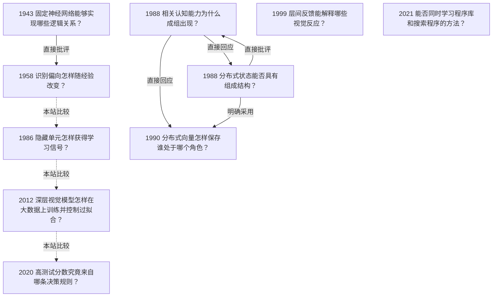

<!-- 由 research.json 生成；修改数据后重生成。A批已验收；不代表完整路线史。 -->

# 连接主义、统计学习与表征路线 · A批增量

**已完成本批指定范围验收，后续扩展与未覆盖材料另列。** 当前10个本批节点，图中另有0个第二轮延续节点；前两轮记录仍独立保留。

本批以十个节点区分三类问题：网络能表示什么，怎样从经验中学得内部表示，以及学到的规则能迁移到哪里。1943年的形式构造、1958年的统计学习、1986年的隐藏层误差分配具有不同任务和证据标准。

Fodor与Pylyshyn、Smolensky的争论集中在组成结构与系统性。1990年张量积表示给出角色绑定和解绑条件，补上具体数学机制；精确表示与成功学习仍须分开检验。

AlexNet展示结构先验、数据、优化与计算结合的视觉训练；捷径学习通过改变线索关系审查测试成绩。DreamCoder则把神经识别与程序库、搜索结合。它们保留不同的先验和任务约束，不能汇成一个无条件的能力增长指标。

Rao与Ballard补入视觉层级中的生成与误差反馈；这是对特定视觉现象的模型解释，与监督分类训练或时序世界模型分别记录。

[交互阅读](../atlas.html?route=connectionist) · [编辑SVG时间线](connectionist-timeline.svg) · [编辑SVG关系图](connectionist-relations.svg)

图中标为“第二轮延续”的节点用于呈现本批新增关系，不计入本批独立节点数。SVG关系编号与下表对应；完整原文定位见[关系台账](../relations.md)。

| 编号 | 关系 | 解释 |
| --- | --- | --- |
| R1 | 1988 → 1988 · 直接回应 | 直接点名并回应；同年往复，不推断明确先后顺序。 |
| R2 | 1988 → 1988 · 直接批评 | 直接批评咖啡例及语境近似；关系图应允许同年双向争论。 |
| R3 | 1943 → 1958 · 直接批评 | Rosenblatt明确讨论并批评包含McCulloch与Pitts在内的确定性模型，转向未知随机连接的统计分析；这是作者立场，不表示早期形式结果已被否定。 |
| R4 | 1958 → 1986 · 本站比较 | 本站比较经验调整响应与学习隐藏表示；1986论文引用的是Rosenblatt专著，不能据此画成对1958论文的直接引用边。 |
| R5 | 1988 → 1990 · 直接回应 | 作者明确说明这项工作始于回应Fodor与Pylyshyn的表征挑战；1990是期刊节点，不表示研究直到该年才开始。 |
| R6 | 1988 → 1990 · 明确采用 | 1990文章明确沿用BBS论文的理论立场并形式化结构表示问题；本边不宣称BBS是张量积方法的首次提出。 |
| R7 | 1986 → 2012 · 本站比较 | 本站比较梯度训练隐藏表示与大规模卷积训练的实现条件；没有把缺乏直接引文的两篇文章写成已考证的单线影响史。 |
| R8 | 2012 → 2020 · 本站比较 | 本站将基准分类成果与决策规则诊断并置；捷径学习的玩具实验不是对AlexNet表1结果的复现或推翻。 |

[编辑时间线](connectionist-timeline.mmd) · [编辑关系图](connectionist-relations.mmd)

- [固定神经网络能够实现哪些逻辑关系？](../notes/e-mcculloch-pitts-1943.md)：怎样从连接结构计算网络行为，又从指定的逻辑条件构造网络？
- [识别偏向怎样随经验改变？](../notes/e-rosenblatt-1958.md)：在连接结构含随机性的系统中，记忆与泛化能否由物理参数和环境统计关系解释？
- [隐藏单元怎样获得学习信号？](../notes/e-rumelhart-1986.md)：任务只指定输入和目标输出时，怎样学习未被直接指定的内部表示？
- [相关认知能力为什么成组出现？](../notes/e-fodor-pylyshyn-1988.md)：理解某种关系为什么通常伴随理解相关的角色交换，而不是互不相关的能力清单？
- [分布式状态能否具有组成结构？](../notes/e-smolensky-1988-bbs.md)：连接主义是否只能把一个完整思想当成没有结构的原子？
- [分布式向量怎样保存谁处于哪个角色？](../notes/e-smolensky-1990.md)：把多个对象的特征叠加以后，怎样保留对象与角色的绑定并取回它们？
- [层间反馈能解释哪些视觉反应？](../notes/e-rao-ballard-1999.md)：局部视觉响应为何受更大范围的情境与高层反馈影响？
- [深层视觉模型怎样在大数据上训练并控制过拟合？](../notes/e-krizhevsky-2012.md)：如何让大容量卷积网络在有限计算与大量标注图像下取得有效识别结果？
- [高测试分数究竟来自哪条决策规则？](../notes/e-geirhos-2020.md)：当多种规则都能拟合训练与同分布测试时，怎样判断学到了预期能力？
- [能否同时学习程序库和搜索程序的方法？](../notes/e-ellis-2021.md)：预先设计专用语言限制了程序合成，怎样从已解任务中学出可复用抽象？

## 未覆盖范围与后续研究

- 十个节点覆盖本批指定转折，不代表完整连接主义史。
- Hebb原书、感知机专著与Minsky–Papert 1969的独立论证仍属后续拓展；不能以本文1958读段替代收敛定理或以一般神经网络替代被批评的模型类。
- 张量积表示的网络实现、递归操作及Fodor–McLaughlin 1990后续批评尚未完成原文审校。
- Transformer、规模规律和现代语言模型分支尚未展开；本批现代训练节点覆盖监督视觉及程序归纳，不声称覆盖全部现代模型。

[返回A批](../README.md)
