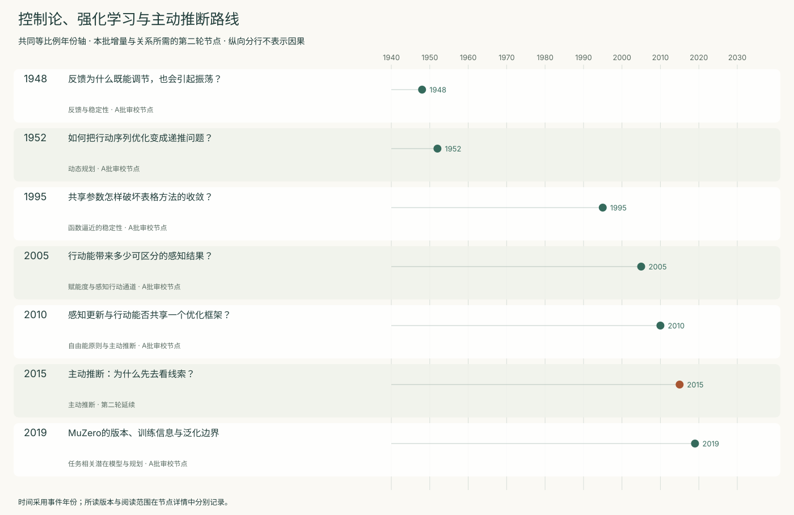
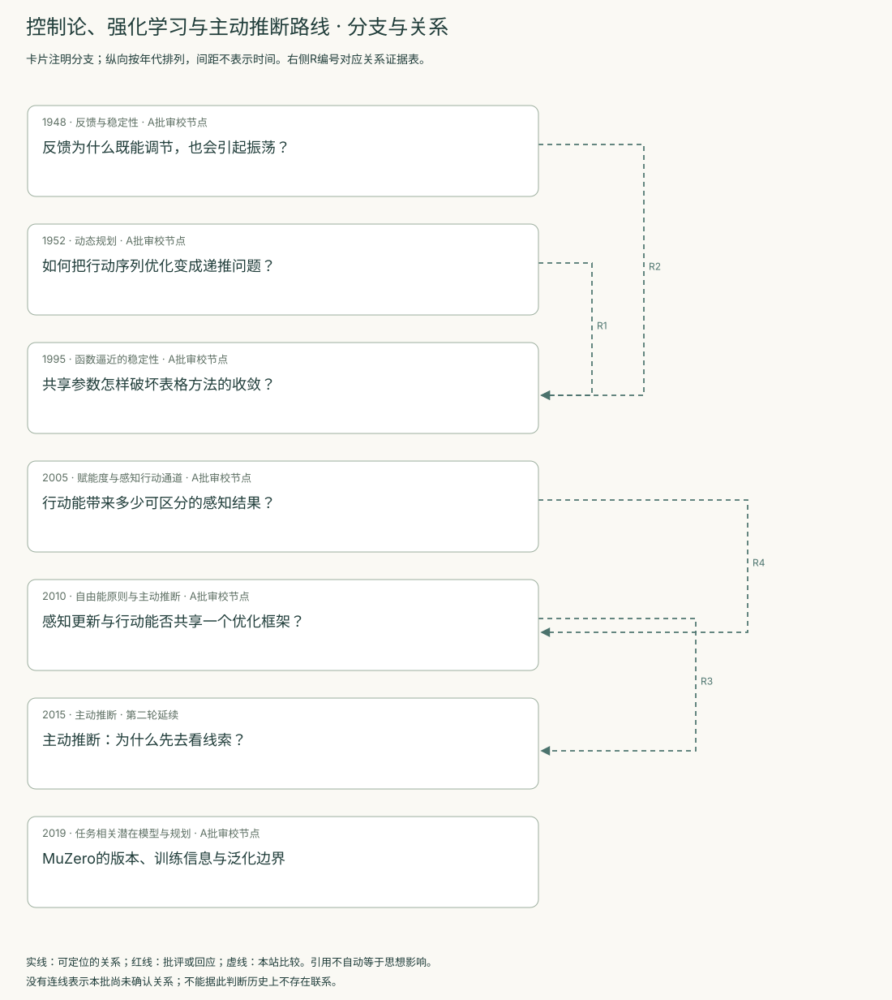
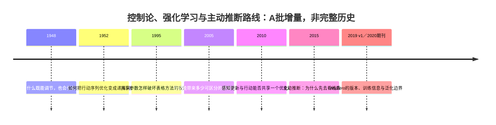
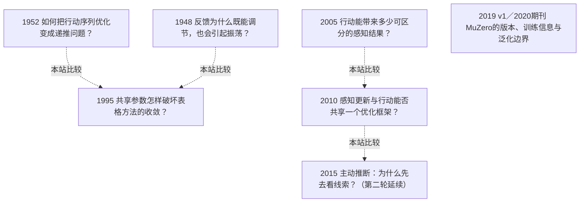

<!-- 由 research.json 生成；修改数据后重生成。A批已验收；不代表完整路线史。 -->

# 控制论、强化学习与主动推断路线 · A批增量

**已完成本批指定范围验收，后续扩展与未覆盖材料另列。** 当前6个本批节点，图中另有1个第二轮延续节点；前两轮记录仍独立保留。

反馈稳定性、已知模型中的最优决策、值函数学习、赋能度及主动推断保留为不同分支。Wiener和Bellman补历史问题，Baird的六状态反例检验共享参数下的更新稳定性。

赋能度把行动与可感知后果之间的容量作为内在准则；2010自由能综述将感知和行动写入生成模型，2015延续节点展示策略的信息价值。模型、先验、目标与优化对象分别记录。

[交互阅读](../atlas.html?route=cybernetics-rl) · [编辑SVG时间线](cybernetics-rl-timeline.svg) · [编辑SVG关系图](cybernetics-rl-relations.svg)

图中标为“第二轮延续”的节点用于呈现本批新增关系，不计入本批独立节点数。SVG关系编号与下表对应；完整原文定位见[关系台账](../relations.md)。

| 编号 | 关系 | 解释 |
| --- | --- | --- |
| R1 | 1952 → 1995 · 本站比较 | 本站比较函数方程的有界解与参数化学习更新的稳定性，不据此宣称直接历史影响。 |
| R2 | 1948 → 1995 · 本站比较 | 比较两种依赖条件的稳定性问题；不将控制回路与值函数迭代视为同一机制或宣称直接历史影响。 |
| R3 | 2010 → 2015 · 本站比较 | 本站比较运动先验下的行动与离散策略的预期价值分解；2010瞬时自由能与2015策略的预期自由能不写成相同目标式。 |
| R4 | 2005 → 2010 · 本站比较 | 赋能度评估可选择行动对感知的通道容量；自由能框架要求生成模型和先验。二者可在偏好、传感器与行动代价操纵下比较，不能按信息论用语相似合并。 |

[编辑时间线](cybernetics-rl-timeline.mmd) · [编辑关系图](cybernetics-rl-relations.mmd)

- [反馈为什么既能调节，也会引起振荡？](../notes/e-wiener-1948.md)：发出正确指令，是否足以保证执行器达到目标？
- [如何把行动序列优化变成递推问题？](../notes/e-bellman-1952.md)：每步操作的结果会影响后续决策，怎样求整个序列的最优收益或代价？
- [共享参数怎样破坏表格方法的收敛？](../notes/e-baird-1995.md)：值函数能表示正确答案，为什么迭代仍会发散？
- [行动能带来多少可区分的感知结果？](../notes/e-klyubin-2005.md)：能否以较通用的内在准则，评价一个主体潜在的可感知控制能力？
- [感知更新与行动能否共享一个优化框架？](../notes/e-friston-2010.md)：怎样把感知、学习和行动放进同一生成模型框架，同时说明其生物学解释条件？
- [主动推断：为什么先去看线索？](../../round-two/notes/e-friston-2015.md)：怎样把获取信息与达到偏好结果放进同一决策准则？
- [MuZero的版本、训练信息与泛化边界](../notes/e-schrittwieser-2019.md)：规划是否必须重建每个像素或真实状态？

## 未覆盖范围与后续研究

- Wiener原版与所读再版未逐字对勘，Bellman 1957专著、AlphaZero等仍可后续拓展；现有材料不替代这些版本。
- MuZero已核对2019v1和2020期刊正文的所列段落及表1；期刊网页缺失公式、补充材料与全套图形未逐项校勘。

[返回A批](../README.md)
