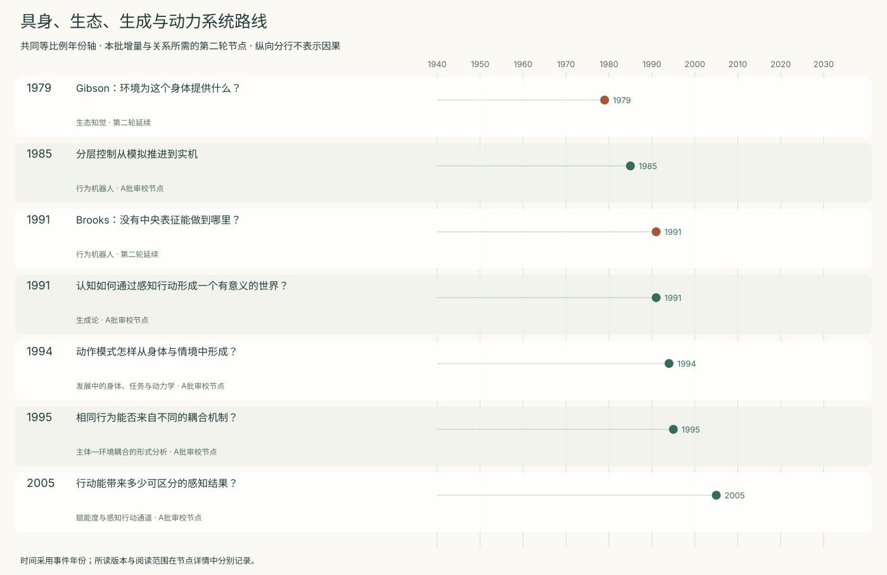
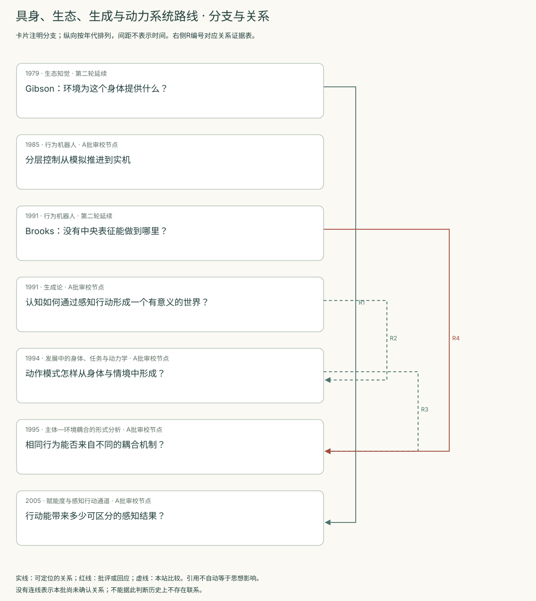
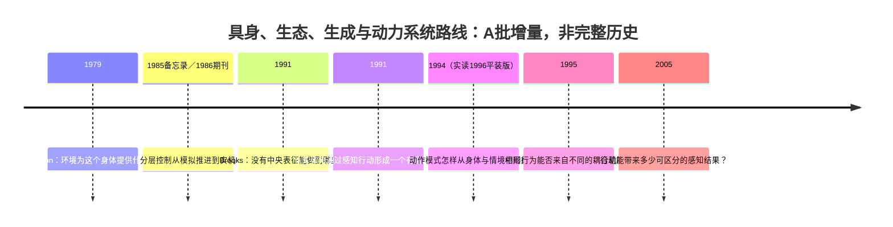
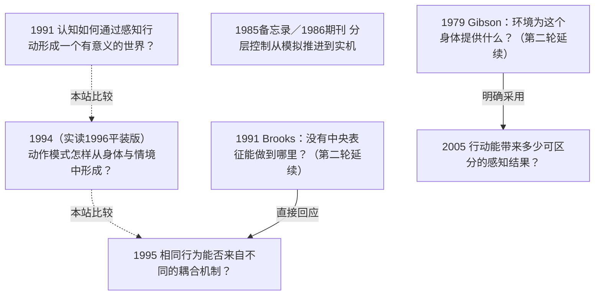

<!-- 由 research.json 生成；修改数据后重生成。A批已验收；不代表完整路线史。 -->

# 具身、生态、生成与动力系统路线 · A批增量

**已完成本批指定范围验收，后续扩展与未覆盖材料另列。** 当前5个本批节点，图中另有2个第二轮延续节点；前两轮记录仍独立保留。

本批将生成论、发展解释与动力学分析分开组织。Varela等讨论感知引导的行动与耦合历史；Thelen与Smith追问身体、任务和成分变化怎样形成发展转折；Beer提供主体—环境耦合的形式分析与模拟控制器比较。

三个方向可围绕历史、实时相互作用和内部状态比较，但证据标准不同。婴儿行为研究、模拟控制器及哲学构成主张分别登记；正常行为相似并不足以认定解释机制相同。

[交互阅读](../atlas.html?route=embodied-dynamical) · [编辑SVG时间线](embodied-dynamical-timeline.svg) · [编辑SVG关系图](embodied-dynamical-relations.svg)

图中标为“第二轮延续”的节点用于呈现本批新增关系，不计入本批独立节点数。SVG关系编号与下表对应；完整原文定位见[关系台账](../relations.md)。

| 编号 | 关系 | 解释 |
| --- | --- | --- |
| R1 | 1979 → 2005 · 明确采用 | 作者明确借鉴Gibson的感知行动视角，同时承认他对Shannon式信息度量的反对；这是作者自述的借鉴与改造，不表示Gibson认可这一量化。 |
| R2 | 1991 → 1994 · 本站比较 | 本站比较感知运动历史与发展中成分协同的不同解释任务；没有据此认定直接继承或二者理论等同。 |
| R3 | 1994 → 1995 · 本站比较 | 发展理论与耦合系统形式分析共享对相互作用的关注；二者采用的对象、证据与发展时间尺度不同。此线为比较，不宣称历史影响。 |
| R4 | 1991 → 1995 · 直接回应 | Beer直接回应包含Brooks与Kirsh在内的情境主体争论，将内部状态、纯反应性与表征分开；不把他概括的整个争论归结为Brooks一人的主张。 |

[编辑时间线](embodied-dynamical-timeline.mmd) · [编辑关系图](embodied-dynamical-relations.mmd)

- [Gibson：环境为这个身体提供什么？](../../round-two/notes/e-gibson-1979.md)：知觉是否能直接发现相对于行动者的行动可能性？
- [分层控制从模拟推进到实机](../notes/e-brooks-1986.md)：怎样增加机器人能力，同时保留已能运行的底层行为？
- [Brooks：没有中央表征能做到哪里？](../../round-two/notes/e-brooks-1991.md)：是否必须先建立统一世界表征，才能产生有效行为？
- [认知如何通过感知行动形成一个有意义的世界？](../notes/e-varela-1991.md)：知觉是在恢复预先给定的世界，还是在感知运动耦合中形成可行动的世界？
- [动作模式怎样从身体与情境中形成？](../notes/e-thelen-smith-1994.md)：为什么婴儿的踏步、踢腿、姿态支持与独立行走会呈现不同的发展轨迹？
- [相同行为能否来自不同的耦合机制？](../notes/e-beer-1995.md)：怎样形式化主体与环境的相互影响，并辨别产生相似行为的不同内部机制？
- [行动能带来多少可区分的感知结果？](../notes/e-klyubin-2005.md)：能否以较通用的内在准则，评价一个主体潜在的可感知控制能力？

## 未覆盖范围与后续研究

- Brooks已核对实验范围与第二层实现的版本变化；期刊图中全部连线及硬件行为未独立复核。
- Thelen与Smith限于第1章和第4章指定范围；Beer的全部相图推导和原始模拟未复核。更广泛的生物与发展路线留待第三轮C批。

[返回A批](../README.md)
