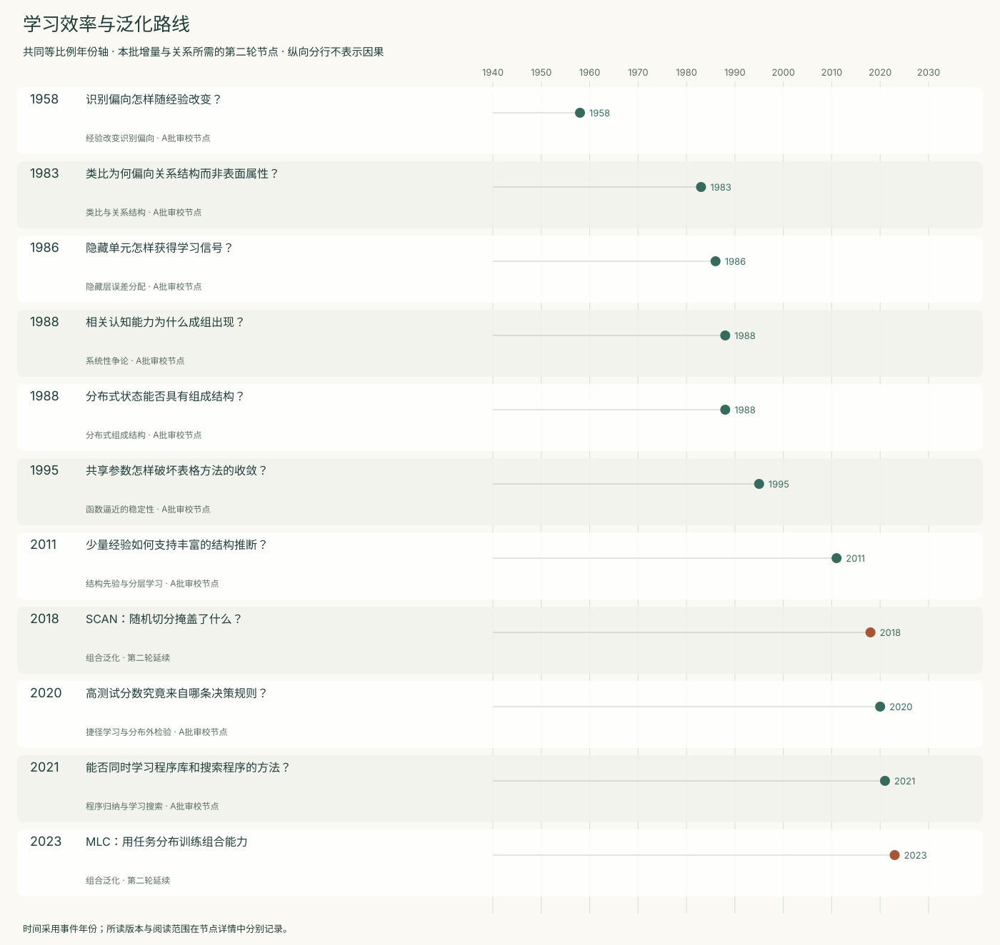
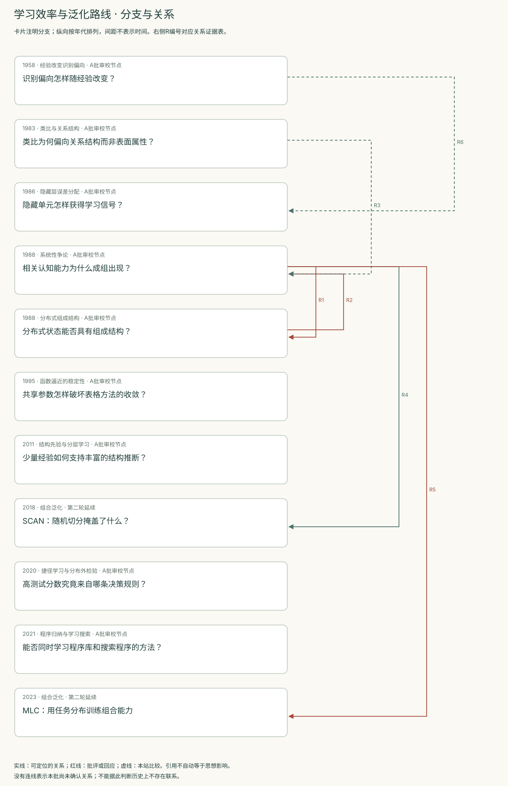
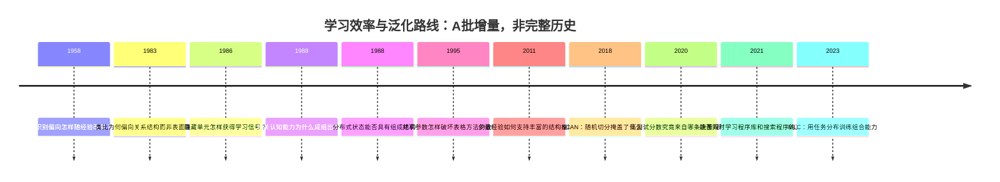
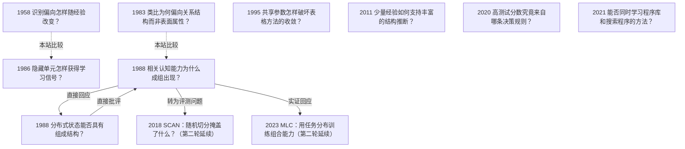

<!-- 由 research.json 生成；修改数据后重生成。A批已验收；不代表完整路线史。 -->

# 学习效率与泛化路线 · A批增量

**已完成本批指定范围验收，后续扩展与未覆盖材料另列。** 当前9个本批节点，图中另有2个第二轮延续节点；前两轮记录仍独立保留。

本批回访学习协议的含义：Rosenblatt区分旧刺激记忆与新刺激泛化，反向传播展示有限任务上的隐藏表示学习，Fodor与Smolensky追问组成结构与能力之间的联系。

SCAN与MLC以第二轮延续节点展示后来的评测回应；捷径学习进一步要求通过线索操纵辨别取得高分的规则。Baird反例检验更新稳定性，DreamCoder考察库学习与搜索；这些任务的成功标准分别记录。

[交互阅读](../atlas.html?route=learning-efficiency) · [编辑SVG时间线](learning-efficiency-timeline.svg) · [编辑SVG关系图](learning-efficiency-relations.svg)

图中标为“第二轮延续”的节点用于呈现本批新增关系，不计入本批独立节点数。SVG关系编号与下表对应；完整原文定位见[关系台账](../relations.md)。

| 编号 | 关系 | 解释 |
| --- | --- | --- |
| R1 | 1988 → 1988 · 直接回应 | 直接点名并回应；同年往复，不推断明确先后顺序。 |
| R2 | 1988 → 1988 · 直接批评 | 直接批评咖啡例及语境近似；关系图应允许同年双向争论。 |
| R3 | 1983 → 1988 · 本站比较 | 比较同名术语的不同解释目标，不将词语相同当作思想继承。 |
| R4 | 1988 → 2018 · 转为评测问题 | SCAN作者明确把隔离原语实验联系到Fodor等人的思想实验；这是特定模型与训练协议的操作化检验，不等于原架构论证的所有前提。 |
| R5 | 1988 → 2023 · 实证回应 | MLC直接回应系统性争论，提出经元训练获得组合能力的实例；同时明确未解决原论证的所有挑战，分布外结构和新符号仍有限制。 |
| R6 | 1958 → 1986 · 本站比较 | 本站比较经验调整响应与学习隐藏表示；1986论文引用的是Rosenblatt专著，不能据此画成对1958论文的直接引用边。 |

[编辑时间线](learning-efficiency-timeline.mmd) · [编辑关系图](learning-efficiency-relations.mmd)

- [识别偏向怎样随经验改变？](../notes/e-rosenblatt-1958.md)：在连接结构含随机性的系统中，记忆与泛化能否由物理参数和环境统计关系解释？
- [类比为何偏向关系结构而非表面属性？](../notes/e-gentner-1983.md)：当两个领域的对象不同，哪些知识仍可迁移？
- [隐藏单元怎样获得学习信号？](../notes/e-rumelhart-1986.md)：任务只指定输入和目标输出时，怎样学习未被直接指定的内部表示？
- [相关认知能力为什么成组出现？](../notes/e-fodor-pylyshyn-1988.md)：理解某种关系为什么通常伴随理解相关的角色交换，而不是互不相关的能力清单？
- [分布式状态能否具有组成结构？](../notes/e-smolensky-1988-bbs.md)：连接主义是否只能把一个完整思想当成没有结构的原子？
- [共享参数怎样破坏表格方法的收敛？](../notes/e-baird-1995.md)：值函数能表示正确答案，为什么迭代仍会发散？
- [少量经验如何支持丰富的结构推断？](../notes/e-tenenbaum-2011.md)：从稀疏数据作出广泛概括时，所需的先验和假设空间从何而来？
- [SCAN：随机切分掩盖了什么？](../../round-two/notes/e-lake-baroni-2018.md)：学会单个动作和组合规则后，能否执行新组合？
- [高测试分数究竟来自哪条决策规则？](../notes/e-geirhos-2020.md)：当多种规则都能拟合训练与同分布测试时，怎样判断学到了预期能力？
- [能否同时学习程序库和搜索程序的方法？](../notes/e-ellis-2021.md)：预先设计专用语言限制了程序合成，怎样从已解任务中学出可复用抽象？
- [MLC：用任务分布训练组合能力](../../round-two/notes/e-lake-baroni-2023.md)：训练方式能否让标准网络获得更强组合泛化并预测人的偏差？

## 未覆盖范围与后续研究

- 本批已将系统性争论、SCAN／MLC、捷径学习及问题卡对应；更广泛的现代泛化机制与评测仍可继续扩展。
- Baird复现范围限定为1995六状态预测例，不能替代组合泛化实验或一般强化学习收敛结论。

[返回A批](../README.md)
