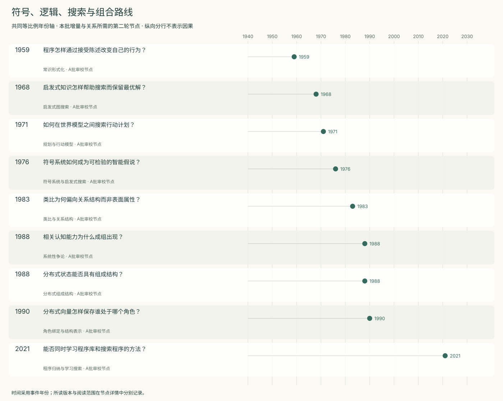
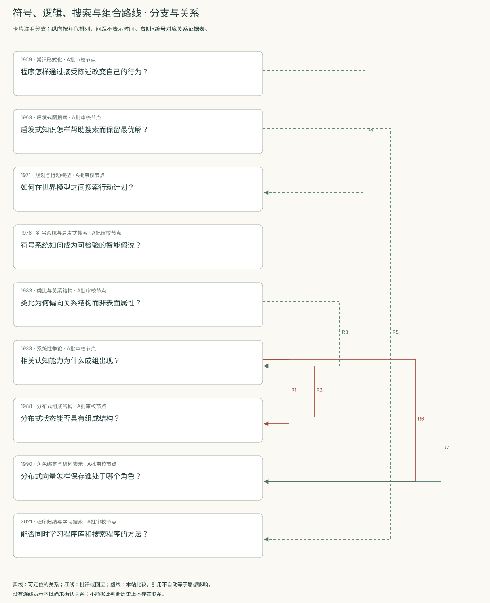
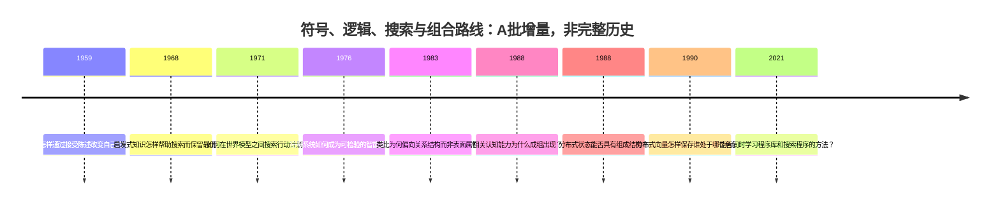
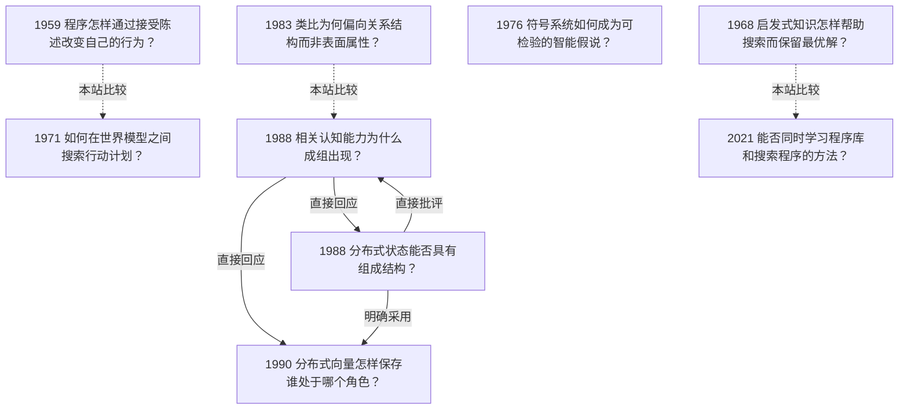

<!-- 由 research.json 生成；修改数据后重生成。A批已验收；不代表完整路线史。 -->

# 符号、逻辑、搜索与组合路线 · A批增量

**已完成本批指定范围验收，后续扩展与未覆盖材料另列。** 当前9个本批节点，图中另有0个第二轮延续节点；前两轮记录仍独立保留。

本批以九个节点覆盖常识形式化、启发式搜索、规划、符号系统假说、类比、系统性争论、张量积角色绑定及程序归纳。它们提出的解释目标不同，不能排列成一条不断取代前人的单线。

McCarthy关注可告知的知识与相关前提选择；A*在给定图上约束搜索；STRIPS引入可执行规划的模型更新。三者分别保留知识获得、建模与真实执行的缺口。

物理符号系统假说提出经验检验纲领；Gentner分析类比中的关系结构。Fodor与Smolensky围绕表征组成与机制保证形成直接争论。DreamCoder给出库学习与神经搜索协作的具体系统，但其任务先验及实验范围仍须保留。 张量积表示补入了结构编码与解绑的数学条件，仍不能单独提供学习与系统性的完整解释。

[交互阅读](../atlas.html?route=symbolic-logic) · [编辑SVG时间线](symbolic-logic-timeline.svg) · [编辑SVG关系图](symbolic-logic-relations.svg)

图中标为“第二轮延续”的节点用于呈现本批新增关系，不计入本批独立节点数。SVG关系编号与下表对应；完整原文定位见[关系台账](../relations.md)。

| 编号 | 关系 | 解释 |
| --- | --- | --- |
| R1 | 1988 → 1988 · 直接回应 | 直接点名并回应；同年往复，不推断明确先后顺序。 |
| R2 | 1988 → 1988 · 直接批评 | 直接批评咖啡例及语境近似；关系图应允许同年双向争论。 |
| R3 | 1983 → 1988 · 本站比较 | 比较同名术语的不同解释目标，不将词语相同当作思想继承。 |
| R4 | 1959 → 1971 · 本站比较 | 比较相关前提选择与模型间搜索的不同处理；本条不宣称直接历史继承。 |
| R5 | 1968 → 2021 · 本站比较 | 比较手工启发式下界与学习得到的搜索分布；DreamCoder结果不能继承A*的路径最优性保证。 |
| R6 | 1988 → 1990 · 直接回应 | 作者明确说明这项工作始于回应Fodor与Pylyshyn的表征挑战；1990是期刊节点，不表示研究直到该年才开始。 |
| R7 | 1988 → 1990 · 明确采用 | 1990文章明确沿用BBS论文的理论立场并形式化结构表示问题；本边不宣称BBS是张量积方法的首次提出。 |

[编辑时间线](symbolic-logic-timeline.mmd) · [编辑关系图](symbolic-logic-relations.mmd)

- [程序怎样通过接受陈述改变自己的行为？](../notes/e-mccarthy-1959.md)：怎样把知识和启发式表达为系统可以推理的对象？
- [启发式知识怎样帮助搜索而保留最优解？](../notes/e-hart-nilsson-raphael-1968.md)：怎样同时利用领域知识并约束搜索结果的路径代价？
- [如何在世界模型之间搜索行动计划？](../notes/e-strips-1971.md)：怎样减少把整个行动序列都交给定理证明器造成的搜索困难？
- [符号系统如何成为可检验的智能假说？](../notes/e-newell-simon-1976.md)：哪些结构和过程可能支持一般智能行动，又应怎样检验？
- [类比为何偏向关系结构而非表面属性？](../notes/e-gentner-1983.md)：当两个领域的对象不同，哪些知识仍可迁移？
- [相关认知能力为什么成组出现？](../notes/e-fodor-pylyshyn-1988.md)：理解某种关系为什么通常伴随理解相关的角色交换，而不是互不相关的能力清单？
- [分布式状态能否具有组成结构？](../notes/e-smolensky-1988-bbs.md)：连接主义是否只能把一个完整思想当成没有结构的原子？
- [分布式向量怎样保存谁处于哪个角色？](../notes/e-smolensky-1990.md)：把多个对象的特征叠加以后，怎样保留对象与角色的绑定并取回它们？
- [能否同时学习程序库和搜索程序的方法？](../notes/e-ellis-2021.md)：预先设计专用语言限制了程序合成，怎样从已解任务中学出可复用抽象？

## 未覆盖范围与后续研究

- Logic Theorist、GPS、框架问题的独立原文及其他规划分支仍可继续拓展；本批不声称穷尽。
- A*扩展节点最优性及后续更正未复核；STRIPS期刊版尚未与会议版逐项对照。

[返回A批](../README.md)
