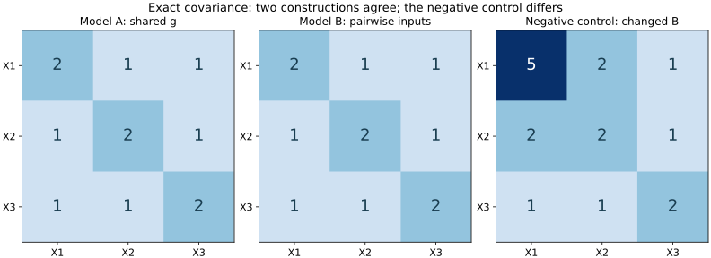

# 方法核验：观察相同，潜在构造仍可不同

2026-10-27完成。**五项预设核验全部通过。** 本项是本站构造的精确数学例子，不是论文经验结果复现、真实人群研究或POT模型模拟。

[预先协议](protocol.md) · [程序](../../../../scripts/check-intelligence-evaluation.py) · [机器结果](results.json) · [返回B批](../README.md)

## 问题与构造

模型A为 `X1=g+e1, X2=g+e2, X3=g+e3`，所有基础变量独立、均值0、方差1且服从高斯分布。

模型B为 `X1=z12+z13, X2=z12+z23, X3=z13+z23`，基础变量同样独立标准高斯。B中每个基础成分只直接参与两个表现变量，A中则有一个直接参与全部变量的g。

两者的系数矩阵分别为：

```text
A = [[1,1,0,0],       B = [[1,1,0],
     [1,0,1,0],            [1,0,1],
     [1,0,0,1]]            [0,1,1]]
```

## 结果



三个面板使用相同颜色范围0–5，数字为精确协方差；右侧为故意改变系数后的负对照。[可编辑SVG](covariance.svg)。

| 预设检查 | 结果 |
| --- | --- |
| AAᵀ与BBᵀ精确一致 | 均为对角线2、非对角线1 |
| 独立标量方法复核 | 按共享基础变量逐项计算，与矩阵结果完全一致 |
| 特征值与相关 | 三个线性独立特征向量对应4、1、1；非对角相关1/2 |
| 负对照 | B首行首系数从1改为2后，首方差变5、X1–X2协方差变2；成功拒绝相等 |
| 均值解释 | 截距统一增加1/2，或潜在均值增加1/2且载荷全为1，均给出三个观察均值各增加1/2 |

在线性高斯假设下，观察均值和协方差相同意味着完整观察联合分布相同。这里使用解析条件与精确有理数，不是通过有限随机样本的曲线近似判断等价。

## 可以与不可以推断的内容

在这个模型类中，即使知道完整观察分布，也不能只凭它唯一选择两种基础成分解释。A与B都能描述同一个结构；这一点不否定因素描述的用途，也不证明B比A更正确。数学变换还可能重新表达潜变量，因此“没有一个基础成分参与全部任务”只针对本例指定的构造，不能被夸大为“共同因子表达不存在”。

均值例说明：量尺与原点的约束是解释条件。它不表明任何真实测验必然有偏差，也不涉及任何人群的实际差异。

与[Spearman笔记](../notes/e-spearman-1904.md)、[过程重叠笔记](../notes/e-kovacs-conway-2016.md)、[不变性笔记](../notes/e-jak-jorgensen-2017.md)的关系是方法比较。Spearman原文保留了功能或功能群的措辞，本例不能作为推翻其全部理论的证据。POT的具体多维项目模型与本例不同。

若要区分机制，需要进一步定义可干预的过程、独立测量或跨条件预测；[问题卡](../questions/q-factor-mechanism.md)提出的实验尚未执行。

## 重建

运行 `python3 scripts/check-intelligence-evaluation.py --check` 重新核对全部代数判据和保存结果。结果包含预先协议和实现的SHA-256。加 `--plot` 可重建图，需要Matplotlib和NumPy；精确核验本身只使用标准库。协议在实现前保存，未根据结果改变判据。
