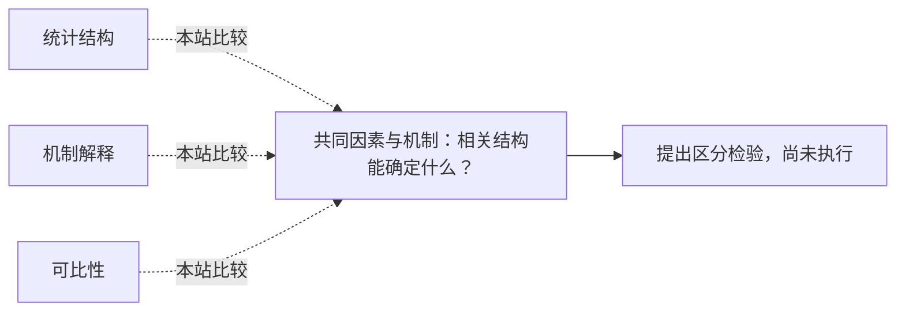

<!-- 由 research.json 生成；修改数据后重生成。B批已验收；不代表完整路线史。 -->

# 共同因素与机制：相关结构能确定什么？

**问题：** 共同变化是否足以识别一个共同心理原因？

这是基于所列阅读范围的本站比较；下述实验为待执行构想，不计入正式复现。

## 定义与比较对象

### 统计结构

通过相关、载荷与层级概括测验关系。

[测验相关怎样被解释为共同功能？](../notes/e-spearman-1904.md) · [多因子描述与坐标选择](../notes/e-thurstone-1934.md) · [将广窄能力放入三层结构](../notes/e-carroll-1993.md)

### 机制解释

说明哪些过程参与任务以及怎样生成相关。

[由重叠过程解释共同结构](../notes/e-kovacs-conway-2016.md)

### 可比性

不同条件的量尺和原点是否仍可解释为同一属性。

[比较均值前先检查测量关系](../notes/e-jak-jorgensen-2017.md)

## 比较结论

稳定共同结构不必对应唯一生成机制；反过来，这也不使结构描述失效。Spearman原文已保留“功能或功能群”的措辞。本批精确合成核验给出一个观测等价例子，但没有运行POT或真实人群实验。均值比较还另需载荷、截距等约束。

[编辑比较图](q-factor-mechanism.mmd)

## 原文定位

- [测验相关怎样被解释为共同功能？](../notes/e-spearman-1904.md)：273页已查看像素；不要把原文缩成单一神经过程定论。
- [将广窄能力放入三层结构](../notes/e-carroll-1993.md)：第16章631–639；层级结构不等于机制已识别。
- [由重叠过程解释共同结构](../notes/e-kovacs-conway-2016.md)：162–164；过程重叠是竞争生成解释。
- [比较均值前先检查测量关系](../notes/e-jak-jorgensen-2017.md)：定义与Discussion；跨群体与跨层不变性不同。

## 可区分的检验（未执行）

- 操纵：在独立过程指标可测且可操纵的前提下，改变特定任务过程需求。
- 测量：预测的跨任务变化、反应时、错误类型与模型外推。
- 控制：事前固定过程映射，核验测量关系；不能直接把旋转后的因素当可干预实体。
- 解释边界：只有明确结构方程和干预语义，模型差异才给出可检验后果。

合成核验已执行，问题卡中的过程干预未执行；二者状态不能混记。

下一问：哪些新增观测或干预能打破当前模型的观察等价？

[返回B批](../README.md)
