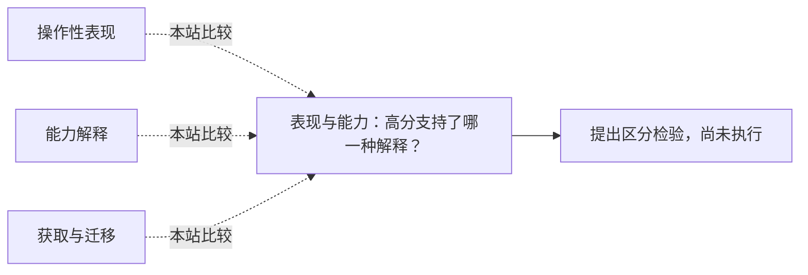

<!-- 由 research.json 生成；修改数据后重生成。B批已验收；不代表完整路线史。 -->

# 表现与能力：高分支持了哪一种解释？

**问题：** 如何从一次成功走到跨任务的能力判断？

这是基于所列阅读范围的本站比较；下述实验为待执行构想，不计入正式复现。

## 定义与比较对象

### 操作性表现

在固定角色、任务与协议下观察成功。

[以模仿游戏重述机器思考问题](../notes/e-turing-1950.md) · [HELM：场景与多指标共同构成评价](../notes/e-helm-2022.md)

### 能力解释

为跨观察的性质提出构念，并承担额外验证责任。

[构念效度：分数支持什么解释？](../notes/e-cronbach-meehl-1955.md) · [把儿童的当前表现放进分级量表](../notes/e-binet-simon-1905.md)

### 获取与迁移

分开已有技能、先验、经验及获得新技能的效率。

[把技能成绩与技能获取效率分开](../notes/e-chollet-2019.md)

## 比较结论

分数是起点。至少要说明评价对象、任务分布、经验与资源、统计不确定性，以及想将结论推广到哪里。同样输出可以支持操作性成功，却不足以唯一说明内部过程；统一提示也不能消除训练经历差异。

[编辑比较图](q-performance-capability.mmd)

## 原文定位

- [以模仿游戏重述机器思考问题](../notes/e-turing-1950.md)：§1、§7；对话判定与教育经历分别讨论。
- [构念效度：分数支持什么解释？](../notes/e-cronbach-meehl-1955.md)：281–292选读；分数解释需要构念网络。
- [把技能成绩与技能获取效率分开](../notes/e-chollet-2019.md)：PDF 27–28、46–48；获取效率与固定任务技能有别。
- [HELM：场景与多指标共同构成评价](../notes/e-helm-2022.md)：v1 §1–2、§11.3开头；相同协议与未知训练暴露共存。

## 可区分的检验（未执行）

- 操纵：固定任务族，分别操纵预先暴露、训练示例数与新组合难度。
- 测量：学习曲线、未见任务成功率与重复运行区间；保留分任务结果。
- 控制：模型版本、提示、预算、任务生成器、停止规则与泄漏检查预先固定。
- 解释边界：改善只出现于已见题时不足以支持迁移；该设计仍不能证明理解或唯一机制。

这是下一步实验设计，本批未运行；现代模型历史训练不可完全回溯时必须把比较限定在可控制部分。

下一问：新增文献是否提供了超出最终分数的过程或迁移证据？

[返回B批](../README.md)
