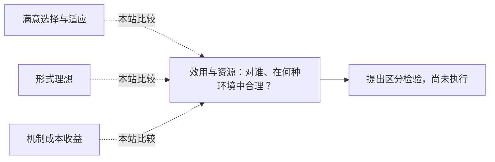

<!-- 由 research.json 生成；修改数据后重生成。B批已验收；不代表完整路线史。 -->

# 效用与资源：对谁、在何种环境中合理？

**问题：** 不同理性路线是否在优化同一个对象？

这是基于所列阅读范围的本站比较；下述实验为待执行构想，不计入正式复现。

## 定义与比较对象

### 满意选择与适应

关注资源不足时可执行的搜索、响应和修正。

[把计算与信息限制纳入理性选择](../notes/e-simon-1955.md) · [把知识与资源不足作为常态](../notes/e-wang-1995.md) · [快速节俭启发式的生态检验](../notes/e-gigerenzer-goldstein-1996.md)

### 形式理想

指定环境类、目标与先验后定义收益及策略。

[AIXI与有条件的资源有界近似](../notes/e-hutter-2000.md) · [跨环境的通用智能度量](../notes/e-legg-hutter-2007.md)

### 机制成本收益

在有约束的策略类中建模结果价值与计算机会成本。

[把认知策略的收益与成本共同建模](../notes/e-lieder-griffiths-2020.md) · [谁来约束资源理性的约束？](../notes/e-resource-debate-2020.md)

## 比较结论

需要对齐目标函数、环境分布、先验、时间尺度和可执行操作，才能比较“最优”“满意”和“适应”。快速规则不天然合理，复杂策略也不天然浪费；一个不计内部成本的理想指标不能直接用来裁决资源敏感的过程模型。

[编辑比较图](q-utility-resources.mmd)

## 原文定位

- [快速节俭启发式的生态检验](../notes/e-gigerenzer-goldstein-1996.md)：658与脚注4；比赛协议和目标变量影响排序。
- [AIXI与有条件的资源有界近似](../notes/e-hutter-2000.md)：54–56；资源保证受证明类与开销限制。
- [跨环境的通用智能度量](../notes/e-legg-hutter-2007.md)：19–23、42；环境权重和内部效率的取舍。
- [把认知策略的收益与成本共同建模](../notes/e-lieder-griffiths-2020.md)：5、14–15；成本与约束需独立证据。
- [谁来约束资源理性的约束？](../notes/e-resource-debate-2020.md)：评论e7/e8、回应R1/R3；避免把所有行为事后合理化。

## 可区分的检验（未执行）

- 操纵：固定任务分布与奖励，改变计算预算、信息代价和任务切换频率。
- 测量：效用—延迟曲线、资源使用、停止规则及任务间分配。
- 控制：训练、参数选择和测试信息一致；单列设置／学习／推理成本。
- 解释边界：有界优势只对所测试环境和预算成立；成本拟合不能使用待预测结果。

尚未运行此比较；不将AIXI不可计算理想与现实算法做虚假的同预算赛跑。

下一问：能否先独立测量成本，再预测策略何时应发生切换？

[返回B批](../README.md)
