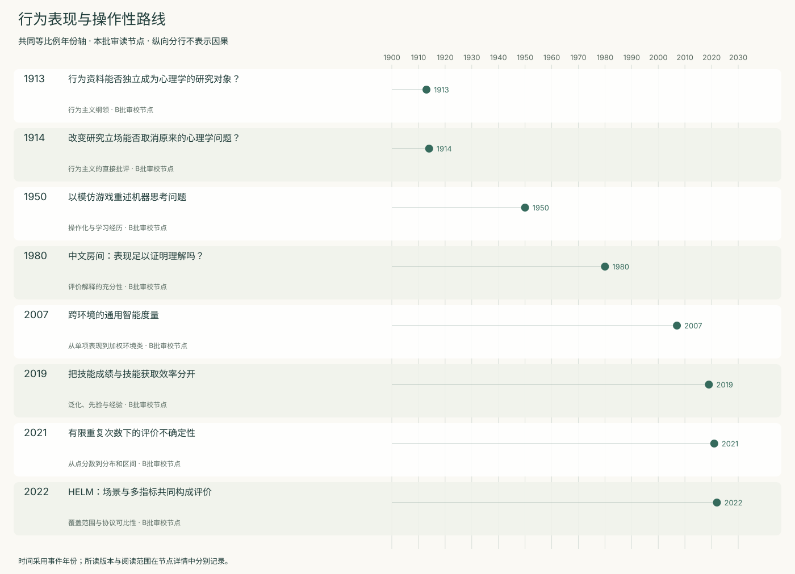
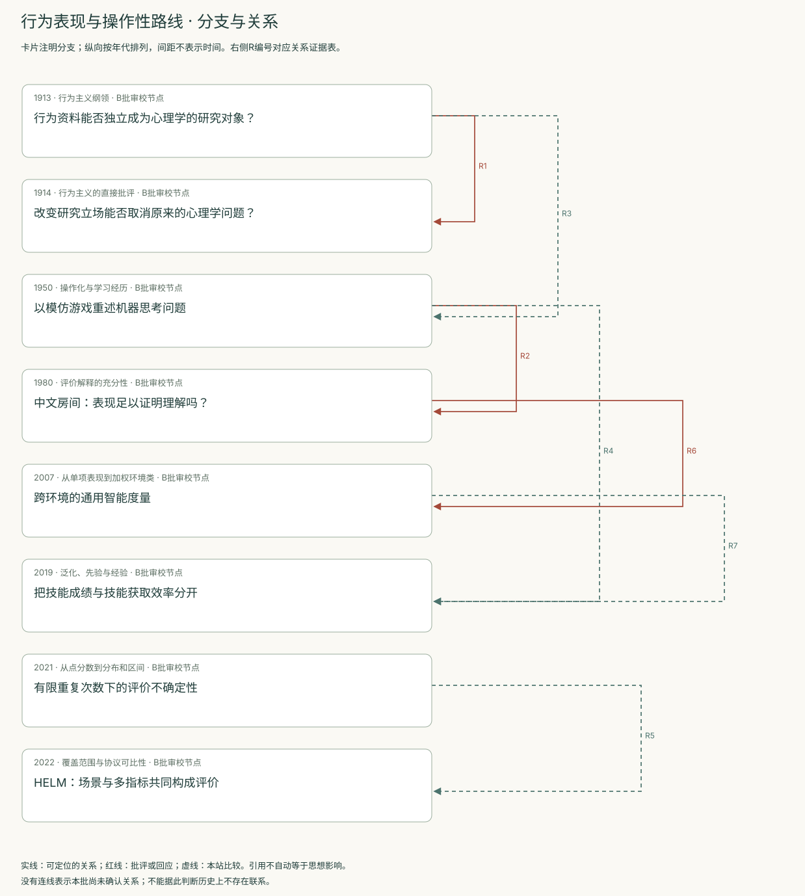
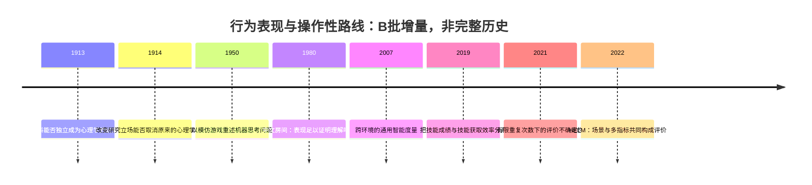
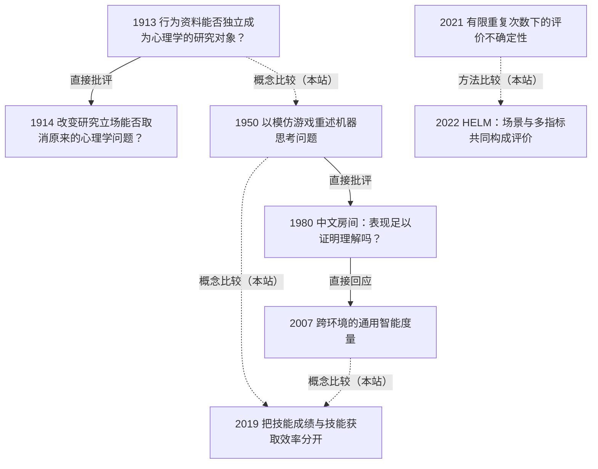

<!-- 由 research.json 生成；修改数据后重生成。B批已验收；不代表完整路线史。 -->

# 行为表现与操作性路线 · B批增量

**已完成本批指定范围验收，后续扩展与未覆盖材料另列。** 当前8个本批节点，图中另有0个第二轮延续节点；前两轮记录仍独立保留。

这条路线持续改变评价对象：Watson提出观察行为的研究方法；Turing设计对话判定；Searle及直接评论追问行为判定能否承担理解解释。它们不是一个逐步被证实的同一理论。

后续评价把环境范围、技能获取、统计不确定性和多指标协议放到台前。Legg–Hutter给出形式环境加权；Chollet区分既有技能与获取效率；Agarwal和HELM分别提醒运行抽样与评测覆盖的边界。

[交互阅读](../atlas.html?route=behavioral) · [编辑SVG时间线](behavioral-timeline.svg) · [编辑SVG关系图](behavioral-relations.svg)

图中标为“第二轮延续”的节点用于呈现本批新增关系，不计入本批独立节点数。SVG关系编号与下表对应；完整原文定位见[关系台账](../relations.md)。

| 编号 | 关系 | 解释 |
| --- | --- | --- |
| R1 | 1913 → 1914 · 直接批评 | Titchener直接讨论Watson的行为主义纲领；同时回应另一篇Image and Affection in Behavior，因此节点记录区分两篇的指涉。 |
| R2 | 1950 → 1980 · 直接批评 | Searle直接质疑测试表现对理解的充分性；不是证明图灵整套研究计划无效。 |
| R3 | 1913 → 1950 · 概念比较（本站） | 两者都重视公开可观察的表现，但对象、目的和协议不同；此边仅为本站比较，不主张思想继承。 |
| R4 | 1950 → 2019 · 概念比较（本站） | 比较教育经历与技能获取问题；此边不主张两种形式化等同或直接继承。 |
| R5 | 2021 → 2022 · 方法比较（本站） | 两者共同提示样本、运行和协议条件；任务与评测对象不同，不直接合并分数。 |
| R6 | 1980 → 2007 · 直接回应 | 明确回应Searle；以功能表现为指标，未据此证明或否定理解。 |
| R7 | 2007 → 2019 · 概念比较（本站） | 对照跨环境成绩与技能获取效率；这是本站问题比较。 |

[编辑时间线](behavioral-timeline.mmd) · [编辑关系图](behavioral-relations.mmd)

- [行为资料能否独立成为心理学的研究对象？](../notes/e-watson-1913.md)：研究行为的价值是否必须先由意识解释来证明？
- [改变研究立场能否取消原来的心理学问题？](../notes/e-titchener-1914.md)：行为研究完成后，经验与意识问题是否因此被解决？
- [以模仿游戏重述机器思考问题](../notes/e-turing-1950.md)：怎样把“机器能否思考”改写为可讨论、可实施的比较？
- [中文房间：表现足以证明理解吗？](../notes/e-searle-1980.md)：回答与母语者无法区分，是否足以推出系统理解了内容？
- [跨环境的通用智能度量](../notes/e-legg-hutter-2007.md)：怎样将不同环境的目标达成汇总成一个形式指标？
- [把技能成绩与技能获取效率分开](../notes/e-chollet-2019.md)：高分来自获取新技能的能力，还是已注入的知识与经验？
- [有限重复次数下的评价不确定性](../notes/e-agarwal-2021.md)：少量随机运行得到的领先分数，能否稳定支持算法优劣判断？
- [HELM：场景与多指标共同构成评价](../notes/e-helm-2022.md)：如何展示不同用途下的表现取舍，并明确没有测到什么？

## 未覆盖范围与后续研究

- 未读取Block 1981全文及Hernández-Orallo–Dowe 2010交互测验正文；本批跨任务问题由ARC与HELM覆盖。
- 不追踪2022之后的排行榜与最新协议；HELM只按2022 v1，ARC只按2019 v2记录。

[返回B批](../README.md)
