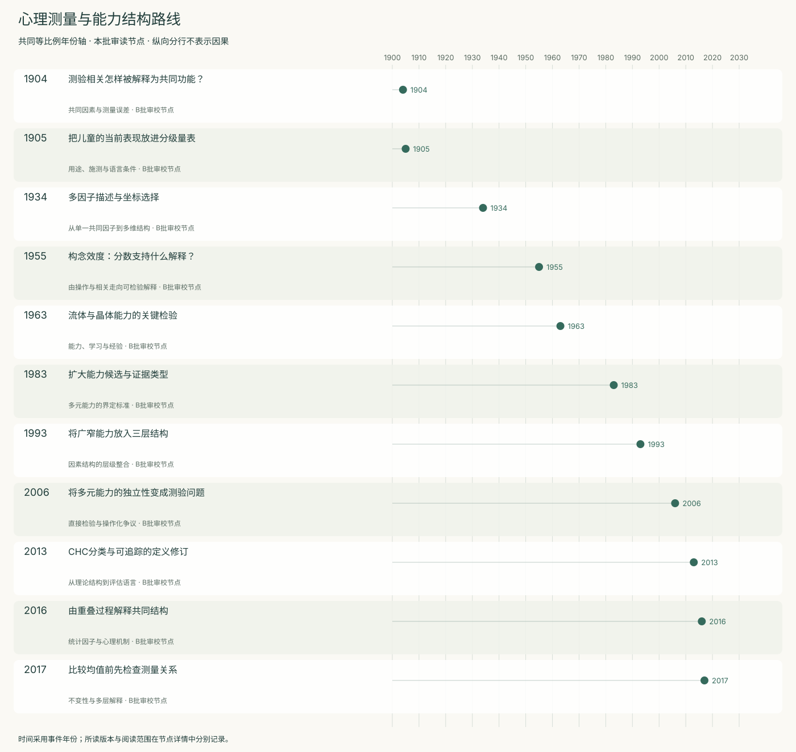
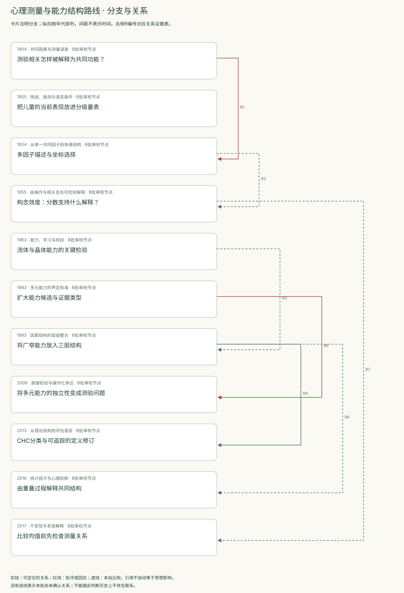
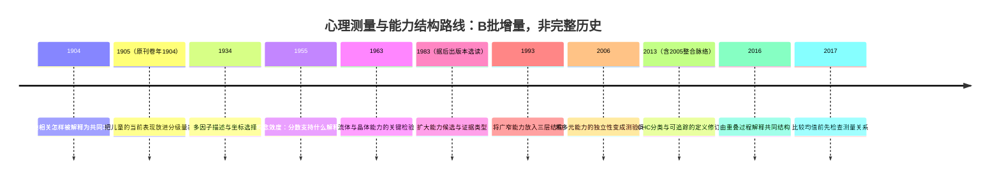
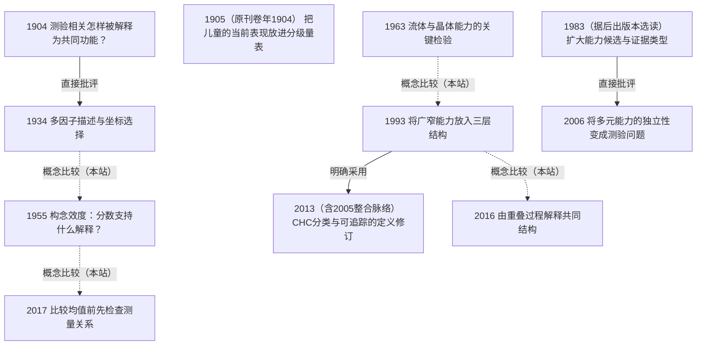

<!-- 由 research.json 生成；修改数据后重生成。B批已验收；不代表完整路线史。 -->

# 心理测量与能力结构路线 · B批增量

**已完成本批指定范围验收，后续扩展与未覆盖材料另列。** 当前11个本批节点，图中另有0个第二轮延续节点；前两轮记录仍独立保留。

Binet–Simon强调当下用途与施测条件，Spearman研究共同变化；Thurstone将单因子方法与一般能力假说分开。Gf／Gc与Carroll层级结构进一步改变能力描述的粒度，CHC把这些语言连接到测验覆盖。

Gardner、直接测验检验与过程重叠理论，让“有什么结构”和“由什么过程产生”分开。构念效度和不变性要求解释接触额外证据，不能仅凭稳定相关或高信度宣告机制与跨群体可比性。

[交互阅读](../atlas.html?route=psychometric) · [编辑SVG时间线](psychometric-timeline.svg) · [编辑SVG关系图](psychometric-relations.svg)

图中标为“第二轮延续”的节点用于呈现本批新增关系，不计入本批独立节点数。SVG关系编号与下表对应；完整原文定位见[关系台账](../relations.md)。

| 编号 | 关系 | 解释 |
| --- | --- | --- |
| R1 | 1904 → 1934 · 直接批评 | 直接讨论Spearman研究传统；不是声称1934只针对1904论文逐句回应。 |
| R2 | 1934 → 1955 · 概念比较（本站） | 结构描述的不唯一性与构念解释的证据责任形成可比较问题；不把1955对Thurstone其他著作的引用误指向1934。 |
| R3 | 1963 → 1993 · 概念比较（本站） | 比较两种结构粒度；不声称1993只继承这一篇1963论文。 |
| R4 | 1993 → 2013 · 明确采用 | 作者明确将Carroll三层结构纳入CHC整合。 |
| R5 | 1983 → 2006 · 直接批评 | 直接检验MI的后期八域操作化；不是对1983首版的逐字复现。 |
| R6 | 1993 → 2016 · 概念比较（本站） | 结构层级与过程生成提出不同层次的问题；本站比较。 |
| R7 | 1955 → 2017 · 概念比较（本站） | 从解释证据到跨样本比较条件；不推定直接影响。 |

[编辑时间线](psychometric-timeline.mmd) · [编辑关系图](psychometric-relations.mmd)

- [测验相关怎样被解释为共同功能？](../notes/e-spearman-1904.md)：不同感官、学校任务和生活判断的表现是否共享某种成分？
- [把儿童的当前表现放进分级量表](../notes/e-binet-simon-1905.md)：怎样对儿童当前的智力表现作有依据的分级判断？
- [多因子描述与坐标选择](../notes/e-thurstone-1934.md)：一个共同因子不够拟合时，应否据此否定一般能力？
- [构念效度：分数支持什么解释？](../notes/e-cronbach-meehl-1955.md)：当没有一个公认的最终标准时，如何验证分数代表的能力？
- [流体与晶体能力的关键检验](../notes/e-cattell-1963.md)：不同测验中的共同变化是否需要区分新问题处理与已有学习成果？
- [扩大能力候选与证据类型](../notes/e-gardner-1983.md)：学校测验之外哪些活动也应进入智能解释？
- [将广窄能力放入三层结构](../notes/e-carroll-1993.md)：不同粒度的能力因素怎样共同描述测验相关？
- [将多元能力的独立性变成测验问题](../notes/e-visser-2006.md)：候选能力域在具体测验中能否表现为相对独立结构？
- [CHC分类与可追踪的定义修订](../notes/e-chc-2013.md)：多种能力理论如何用于组织测验，修订后怎样保留定义边界？
- [由重叠过程解释共同结构](../notes/e-kovacs-conway-2016.md)：无需一个过程参与所有测验，能否仍产生一般因素？
- [比较均值前先检查测量关系](../notes/e-jak-jorgensen-2017.md)：跨群体或层级的分数能否解释为同一属性的差异？

## 未覆盖范围与后续研究

- Meredith 1993原文正文未取得；不变性的方法证据使用Jak–Jorgensen 2017，不能冒称补齐1993原文。
- Thurstone 1938、Horn的关键扩展原作、2012完整CHC书章尚待阅读；1963和1993的公开OCR需用原版扫描复核图表。
- Gardner首版与后出版本未校勘，2006回应未读；不根据单一大学样本裁决全部多元智能理论。

[返回B批](../README.md)
