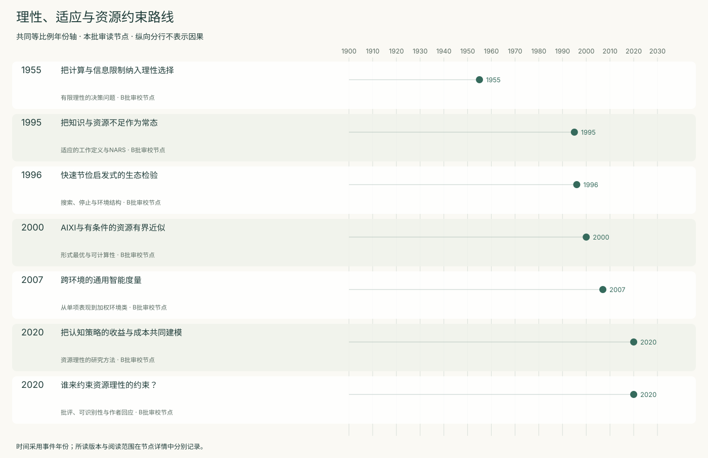
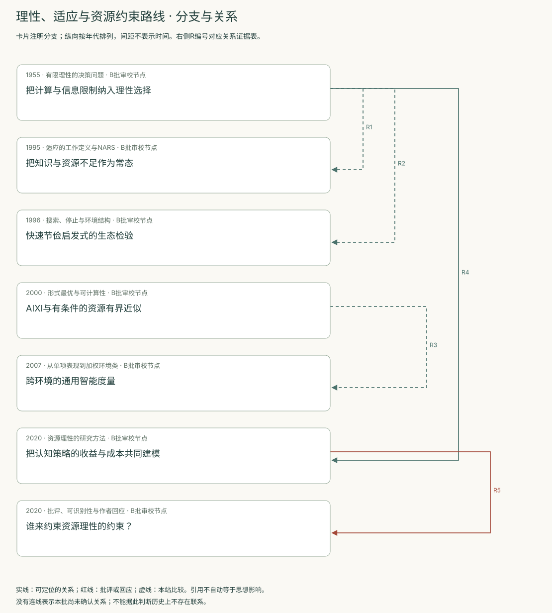
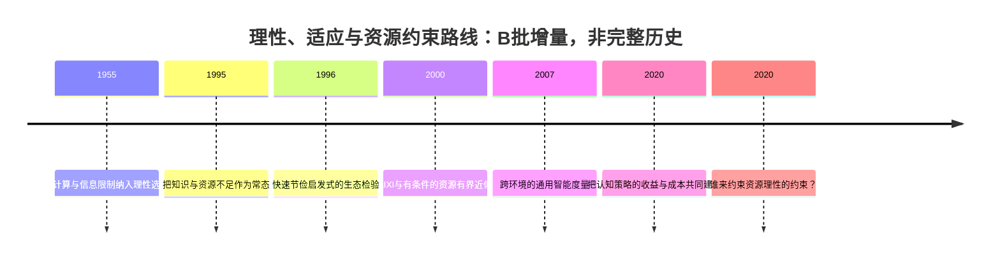
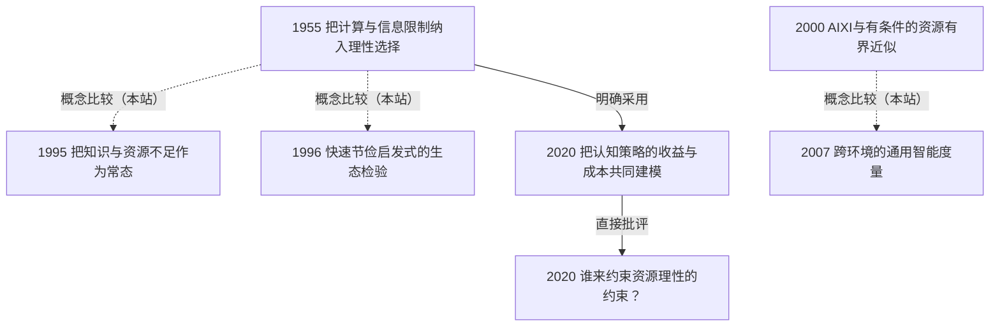

<!-- 由 research.json 生成；修改数据后重生成。B批已验收；不代表完整路线史。 -->

# 理性、适应与资源约束路线 · B批增量

**已完成本批指定范围验收，后续扩展与未覆盖材料另列。** 当前7个本批节点，图中另有0个第二轮延续节点；前两轮记录仍独立保留。

Simon使计算容量和搜索次序进入合理选择；NARS把持续面对知识与资源不足写入系统前提；快速节俭启发式把策略好坏放回具体环境、信息权限和停止规则。

AIXI与通用智能度量提供形式理想，也留下不可计算性和先验选择；资源理性转向机制的成本收益建模。直接评论与作者回应将争论推进到约束如何独立测量、模型何时可被拒绝。

[交互阅读](../atlas.html?route=rational-resource) · [编辑SVG时间线](rational-resource-timeline.svg) · [编辑SVG关系图](rational-resource-relations.svg)

图中标为“第二轮延续”的节点用于呈现本批新增关系，不计入本批独立节点数。SVG关系编号与下表对应；完整原文定位见[关系台账](../relations.md)。

| 编号 | 关系 | 解释 |
| --- | --- | --- |
| R1 | 1955 → 1995 · 概念比较（本站） | 均把主体限制纳入问题；Wang此处引用的是Simon其他年份文本，不误标1955直接继承。 |
| R2 | 1955 → 1996 · 概念比较（本站） | 比较满意停止原则；1996所引Simon版本主要为1956等，保留精确文献区别。 |
| R3 | 2000 → 2007 · 概念比较（本站） | 决策构造与评价度量相关；2007直接引用的AIXI证明多为后续版本，不能混同2000稿。 |
| R4 | 1955 → 2020 · 明确采用 | 作者明确引入主体内的资源约束。 |
| R5 | 2020 → 2020 · 直接批评 | 同一期目标文章、直接评论与作者回应。 |

[编辑时间线](rational-resource-timeline.mmd) · [编辑关系图](rational-resource-relations.mmd)

- [把计算与信息限制纳入理性选择](../notes/e-simon-1955.md)：在无法枚举所有结果时，如何定义可实行的合理选择？
- [把知识与资源不足作为常态](../notes/e-wang-1995.md)：新任务、冲突知识和资源不足持续出现时，系统应如何工作？
- [快速节俭启发式的生态检验](../notes/e-gigerenzer-goldstein-1996.md)：少用信息的决策规则在什么环境下能保持准确？
- [AIXI与有条件的资源有界近似](../notes/e-hutter-2000.md)：未知环境中怎样形式化选择，以及能否在有限时间实现？
- [跨环境的通用智能度量](../notes/e-legg-hutter-2007.md)：怎样将不同环境的目标达成汇总成一个形式指标？
- [把认知策略的收益与成本共同建模](../notes/e-lieder-griffiths-2020.md)：怎样由任务功能和认知约束推导可检验的过程模型？
- [谁来约束资源理性的约束？](../notes/e-resource-debate-2020.md)：怎样防止事后挑选限制把任意行为都解释为合理？

## 未覆盖范围与后续研究

- 未通读Hutter 2005专著或后续AIXI证明；2000稿的保证只按所读条件表述。
- Chater等1997直接批评获取失败；本批启发式边界由1996原文的协议和作者自限支持。
- NARS限1995论文中的3.0；资源理性仅覆盖指定目标文章、两篇评论与部分回应，不代表当前全部研究。

[返回B批](../README.md)
