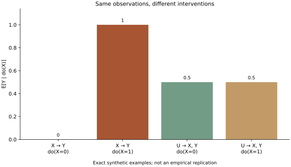

# 同样的观察，为何不能唯一确定机制

按预先保存的协议完成精确合成核验。令U为等概率0／1，比较两个结构模型：M1中X=U、Y=X；M2中X=U、Y=U。两模型观察分布完全相同：P(0,0)=P(1,1)=1/2。

干预用替换X的结构方程实现；U的分布保持不变，Y仍按各自机制生成。

| 模型 | E[Y｜do(X=0)] | E[Y｜do(X=1)] |
| --- | ---: | ---: |
| X→Y | 0 | 1 |
| U共同导致X、Y | 1/2 | 1/2 |

枚举分布与独立写下的解析表一致；共同原因模型在do(X=1)下仍可出现Y=0，作为“观察相关必然等于干预作用”推断的反例。共4项检查通过。

这验证一个可识别性边界：同一观察分布可兼容不同干预后果。它没有复现P-FIT、病损研究、LTP或处理器论文，也不保证现实神经干预无副作用、无混杂或满足此二变量结构。

关联：[神经证据与机制解释](../questions/q-neural-mechanism.md)。

## 可复核材料

- [预先协议](protocol.md)：在实现前保存，验收时未改写。
- [精确结果](results.json)：有理数结果与协议／实现SHA-256。
- [计算程序](../../../../scripts/check-intelligence-cde.py)：Python标准库即可核验，`--plot`另需Matplotlib。
- [可编辑SVG](check.svg)：图为数值结果的辅助呈现，精确值以JSON为准。

运行：`python3 scripts/check-intelligence-cde.py c --check`。

协议指纹：`cc3f0afa0e033d854b8a10d30e92dcfb6406434b3a8815dc16ab336f1f794cbf`。

实现指纹：`9b455fbd8882727fea399e022171f8714c7167b5df39baf1c508f176b01365ff`。
