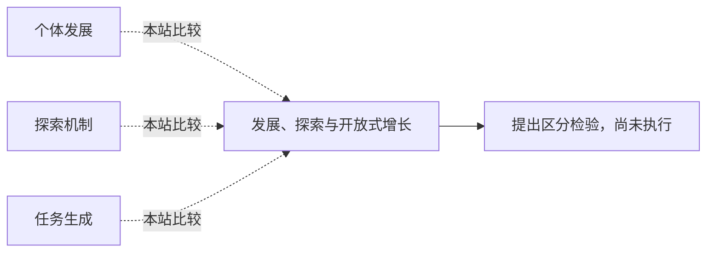

<!-- 由 research.json 生成；修改数据后重生成。C批已验收；不代表完整路线史。 -->

# 发展、探索与开放式增长

**问题：** 系统的能力增长发生在哪个层次？

这是基于所列阅读范围的本站比较；下述实验为待执行构想，不计入正式复现。

## 定义与比较对象

### 个体发展

经验与身体变化重组个体的行动和概念。

[适应为何需要同化与顺应？](../notes/e-piaget-1936.md) · [动作模式怎样从身体与情境中形成？](../notes/e-thelen-smith-1994.md) · [早期能力是否具有特定结构？](../notes/e-spelke-2007.md)

### 探索机制

设计内部信号，选择能产生进展或新颖性的经验。

[学习者怎样挑选值得探索的经验？](../notes/e-oudeyer-2007.md) · [目标分数会不会遮住有用路径？](../notes/e-lehman-stanley-2011.md)

### 任务生成

环境和解法共同搜索，任务空间仍由编码限制。

[环境和解法能否共同扩展？](../notes/e-wang-poet-2019.md)

## 比较结论

个体学习、种群搜索、任务生成各有状态变量与时间尺度。“越来越多”必须说明增加的是任务数、行为差异、难度还是保持后的迁移能力。

[编辑比较图](q-development-openended.mmd)

## 原文定位

- [适应为何需要同化与顺应？](../notes/e-piaget-1936.md)：Introduction5–7页；区分适应状态与过程。
- [学习者怎样挑选值得探索的经验？](../notes/e-oudeyer-2007.md)：271页公式1–2；进展依赖预测误差的定义。
- [环境和解法能否共同扩展？](../notes/e-wang-poet-2019.md)：§5；原文明确承认编码与身体边界。

## 可区分的检验（未执行）

- 操纵：在固定资源下比较进展奖励、新颖性与任务共同生成，并改变任务编码。
- 测量：独立保留集迁移、遗忘、任务多样性和累计资源。
- 控制：固定初始知识、预算与外部评价；不让生成器兼任唯一裁判。
- 解释边界：有限结果不能证明无界增长，也不能直接对应儿童发展阶段。

三类学习的统一定义尚未建立；本卡只提供比较条件。

下一问：哪些开放性度量对编码变化仍稳定？

[返回C批](../README.md)
