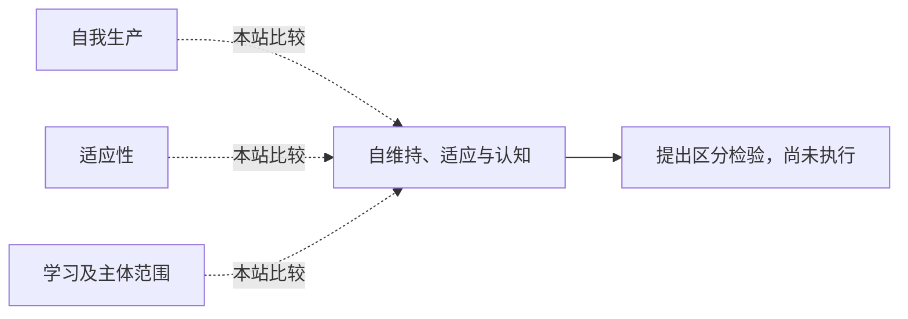

<!-- 由 research.json 生成；修改数据后重生成。C批已验收；不代表完整路线史。 -->

# 自维持、适应与认知

**问题：** 生命组织能解释到哪一级认知？

这是基于所列阅读范围的本站比较；下述实验为待执行构想，不计入正式复现。

## 定义与比较对象

### 自我生产

单位和边界由自身过程持续实现。

[生命单位怎样持续产生自身？](../notes/e-varela-maturana-uribe-1974.md)

### 适应性

调节朝向或远离可生存边界的趋势。

[稳健存活与主动适应有何不同？](../notes/e-dipaolo-2005.md)

### 学习及主体范围

行为随经验改变，与可影响的时空范围是不同判准。

[没有神经元也能出现习惯化吗？](../notes/e-boisseau-2016.md) · [主体能否跨多个生物尺度？](../notes/e-levin-2019.md)

## 比较结论

组织闭合、主动调节、学习和主体范围不是同义词。应逐项问哪个过程被操作、哪个输出被测量，以及是否仍存在仅生理变化的替代解释。

[编辑比较图](q-life-cognition.mmd)

## 原文定位

- [生命单位怎样持续产生自身？](../notes/e-varela-maturana-uribe-1974.md)：§1、§3、§5；组织与演化分开。
- [稳健存活与主动适应有何不同？](../notes/e-dipaolo-2005.md)：438–439页；适应性是额外条件。
- [没有神经元也能出现习惯化吗？](../notes/e-boisseau-2016.md)：第5页恢复与Discussion；行为证据及机制未知。

## 可区分的检验（未执行）

- 操纵：在保持基础存活的条件下，改变反馈历史或候选调节通路。
- 测量：刺激特异性、恢复、跨情境迁移和可生存范围。
- 控制：控制毒性、疲劳、增长速度、暴露时间和单位划分。
- 解释边界：识别特定调节／学习机制；不能凭此认定主观体验。

基于生命的价值定义也不等于D批要研究的伦理正当性。

下一问：如何设计不会用认知结论预先定义生命单位的判准？

[返回C批](../README.md)
