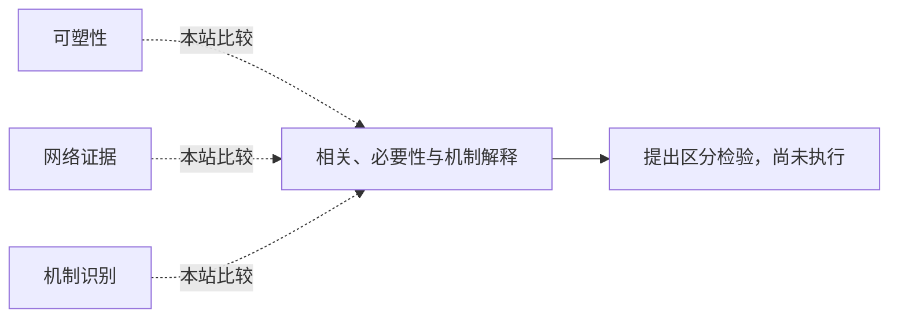

<!-- 由 research.json 生成；修改数据后重生成。C批已验收；不代表完整路线史。 -->

# 相关、必要性与机制解释

**问题：** 看到相关结构或损伤效应，距离解释智能还差什么？

这是基于所列阅读范围的本站比较；下述实验为待执行构想，不计入正式复现。

## 定义与比较对象

### 可塑性

活动后响应可持续改变；还需说明何种内容被学到。

[持久学习如何留下神经变化？](../notes/e-hebb-1949.md) · [重复刺激能否产生持久效应？](../notes/e-bliss-lomo-1973.md)

### 网络证据

成像或损伤对区域和通路提供约束。

[智力差异分布在怎样的网络中？](../notes/e-jung-haier-2007.md) · [损伤怎样约束智力网络解释？](../notes/e-barbey-2012.md)

### 机制识别

须能重建中间计算并区分替代解释。

[必要部件为何仍不是计算解释？](../notes/e-jonas-kording-2017.md) · [一个连接组的细胞类型能否跨脑复用？](../notes/e-schlegel-2024.md)

## 比较结论

这些证据可以相互约束，但不能互相替代。损伤改变量提供必要性线索；若任务同时调用多个过程，仍可能无法确定受损部件的计算角色。

[编辑比较图](q-neural-mechanism.mmd)

## 原文定位

- [损伤怎样约束智力网络解释？](../notes/e-barbey-2012.md)：Lesion analysis；Discussion；记录自然损伤、覆盖空间和测验构成。
- [必要部件为何仍不是计算解释？](../notes/e-jonas-kording-2017.md)：单晶体管损伤段；已知计算系统提供解释歧义反例。
- [一个连接组的细胞类型能否跨脑复用？](../notes/e-schlegel-2024.md)：Discussion与模型局限；结构类型与生理机制分别核验。

## 可区分的检验（未执行）

- 操纵：在同一模型系统中比较记录、局部扰动和跨任务迁移预测。
- 测量：预先指定机制预测、干预效应及未见任务预测误差。
- 控制：匹配扰动强度、输入、任务需求和恢复过程；保留替代机制。
- 解释边界：能排除指定替代模型，不证明已经穷尽全部机制。

本批只完成二元结构模型的独立数学核验；这里的生物／处理器实验未运行。

下一问：怎样选择具有真值且足够接近生物约束的中间基准？

[返回C批](../README.md)
