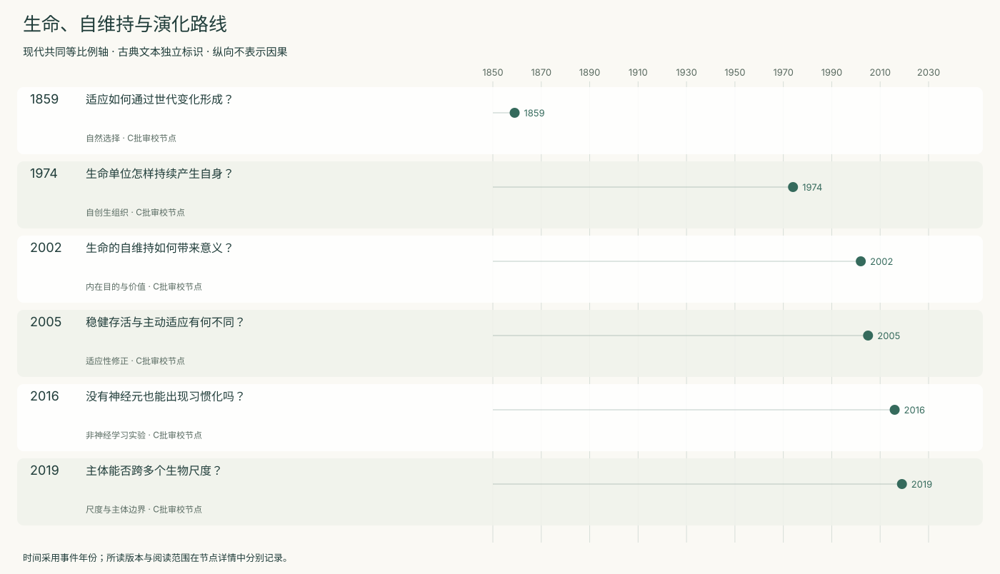
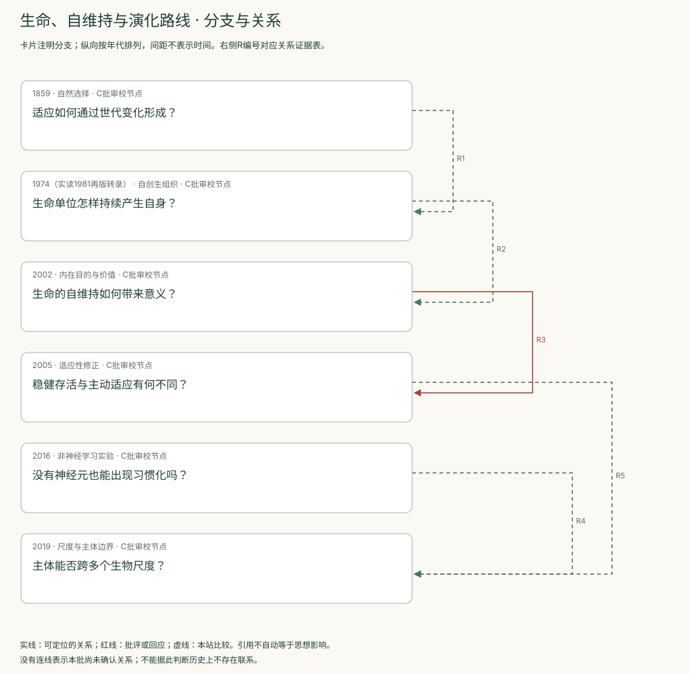
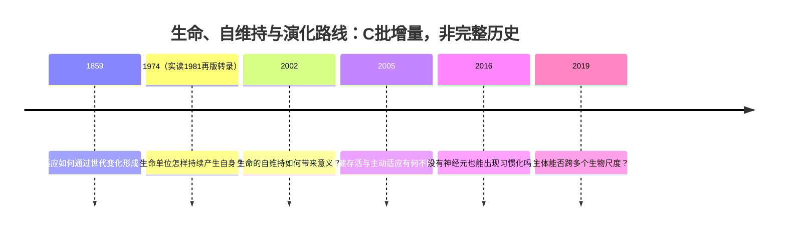
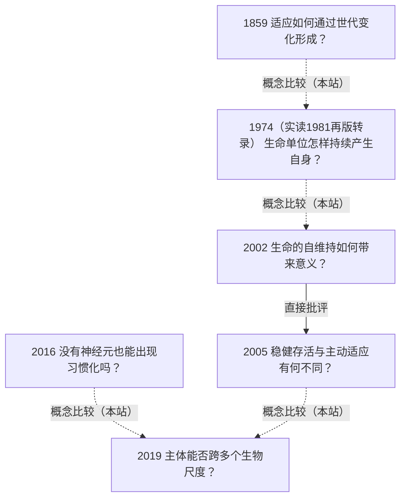

<!-- 由 research.json 生成；修改数据后重生成。C批已验收；不代表完整路线史。 -->

# 生命、自维持与演化路线 · C批增量

**已完成本批指定范围验收，后续扩展与未覆盖材料另列。** 当前6个本批节点，图中另有0个第二轮延续节点；此前各批记录独立保留。

Darwin解释跨世代变化；自创生把问题转向一个生命单位如何持续产生自身；Weber–Varela与Di Paolo进一步争论自维持是否足以推出意义和规范。

黏菌习惯化提供无神经学习的特定实验，Levin提出多尺度主体框架。前者的行为判据不直接证明后者的全部本体论或意识主张。

[交互阅读](../atlas.html?route=autopoiesis-evolution) · [编辑SVG时间线](autopoiesis-evolution-timeline.svg) · [编辑SVG关系图](autopoiesis-evolution-relations.svg)

图中标为“第二轮延续”的节点用于呈现本批新增关系，不计入本批记录数。SVG关系编号与下表对应；完整原文定位见[关系台账](../relations.md)。

| 编号 | 关系 | 解释 |
| --- | --- | --- |
| R1 | 1859 → 1974（实读1981再版转录） · 概念比较（本站） | 跨世代历史解释与当前单位组织不同，不是彼此替代的同一问题。 |
| R2 | 1974（实读1981再版转录） → 2002 · 概念比较（本站） | 把组织定义与内在目的论证分开核查，不仅凭作者相同画继承线。 |
| R3 | 2002 → 2005 · 直接批评 | Di Paolo直接讨论Weber–Varela并要求补充适应性，指出自创生不足以自行给出分级意义。 |
| R4 | 2016 → 2019 · 概念比较（本站） | 比较无神经学习的操作证据与多尺度主体框架；实验不自动验证全部理论。 |
| R5 | 2005 → 2019 · 概念比较（本站） | 比较可生存边界调节与认知边界扩展，不视为同一个已经测量的量。 |

[编辑时间线](autopoiesis-evolution-timeline.mmd) · [编辑关系图](autopoiesis-evolution-relations.mmd)

- [适应如何通过世代变化形成？](../notes/e-darwin-1859.md)：复杂的适应结构一定需要预定目的或设计吗？
- [生命单位怎样持续产生自身？](../notes/e-varela-maturana-uribe-1974.md)：繁殖是否足以定义一个正在活着的单位？
- [生命的自维持如何带来意义？](../notes/e-weber-varela-2002.md)：有机体的目的能否由其自身组织解释？
- [稳健存活与主动适应有何不同？](../notes/e-dipaolo-2005.md)：同样活着的不同状态，系统怎样辨别其趋势？
- [没有神经元也能出现习惯化吗？](../notes/e-boisseau-2016.md)：反应减弱是学习，还是疲劳／感受适应？
- [主体能否跨多个生物尺度？](../notes/e-levin-2019.md)：细胞、组织和整体的目标如何形成更大主体？

## 未覆盖范围与后续研究

- Maturana1970及1973西班牙文专著尚未读取；1974文章使用1981重排版的2017网页转录，未完整核对原刊与附录算法。
- 黏菌只核对指定实验正文；分子机制、跨实验室复现和Levin各项形态干预原始研究未全面审查。
- Levin2022 TAME、独立批评和生命定义的其他传统仍为明确后续队列。

[返回C批](../README.md)
