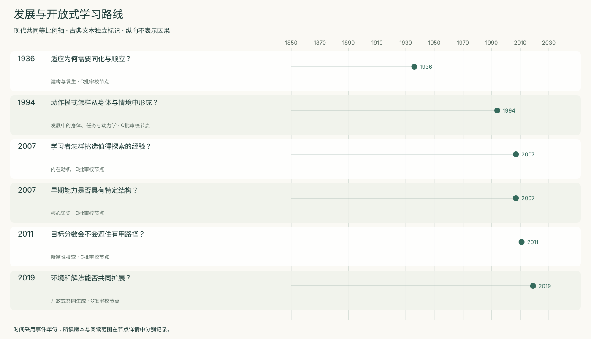
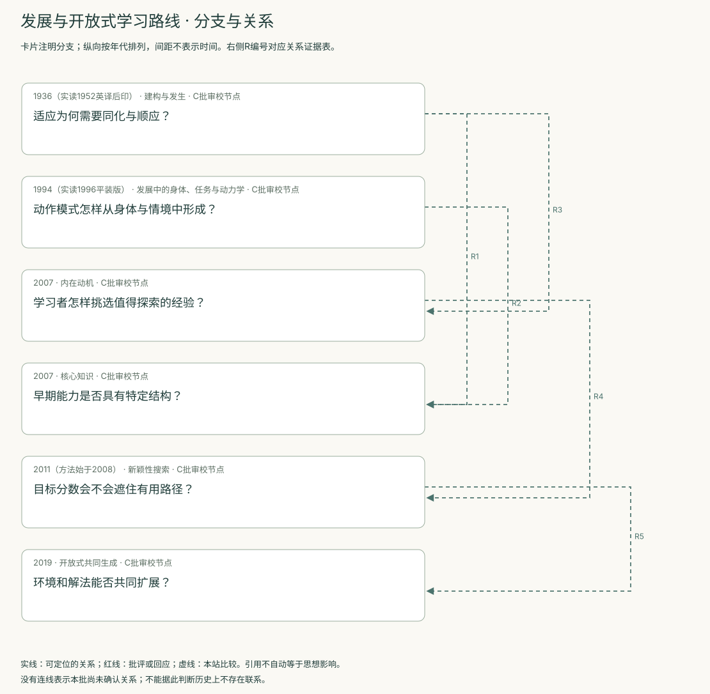
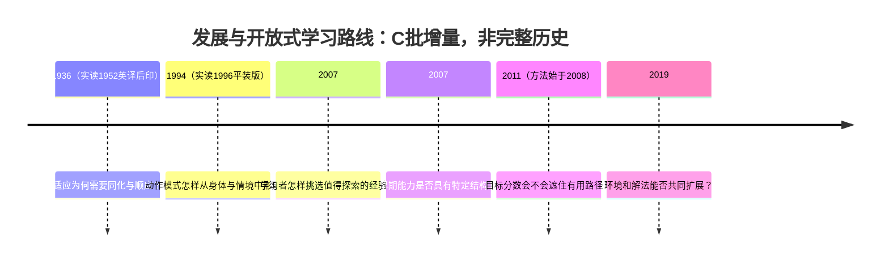
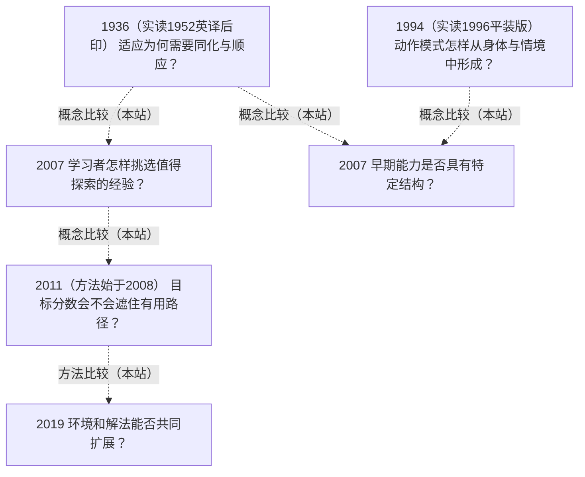

<!-- 由 research.json 生成；修改数据后重生成。C批已验收；不代表完整路线史。 -->

# 发展与开放式学习路线 · C批增量

**已完成本批指定范围验收，后续扩展与未覆盖材料另列。** 当前6个本批节点，图中另有0个第二轮延续节点；此前各批记录独立保留。

Piaget把适应展开为同化与顺应；Thelen–Smith改变发展解释的单位；核心知识理论以跨任务的特征性限制提出竞争约束。

Oudeyer把学习进展变成探索信号，Lehman–Stanley改变搜索目标，POET同时生成环境与解法。个体发展与演化搜索的类比必须标明时间尺度与人为编码。

[交互阅读](../atlas.html?route=developmental-openended) · [编辑SVG时间线](developmental-openended-timeline.svg) · [编辑SVG关系图](developmental-openended-relations.svg)

图中标为“第二轮延续”的节点用于呈现本批新增关系，不计入本批记录数。SVG关系编号与下表对应；完整原文定位见[关系台账](../relations.md)。

| 编号 | 关系 | 解释 |
| --- | --- | --- |
| R1 | 1936（实读1952英译后印） → 2007 · 概念比较（本站） | 比较图式建构与特征性限制；不虚构两篇文本的直接交锋。 |
| R2 | 1994（实读1996平装版） → 2007 · 概念比较（本站） | 发展表现的身体任务条件与核心能力推断需要兼容的操作检验。 |
| R3 | 1936（实读1952英译后印） → 2007 · 概念比较（本站） | Oudeyer讨论Piaget图式，但本边仅比较所读文本，不把其引用自动当作采用1936原版。 |
| R4 | 2007 → 2011（方法始于2008） · 概念比较（本站） | 学习进展与行为新颖性是不同探索信号；Lehman明确讨论关联，但时间尺度不同。 |
| R5 | 2011（方法始于2008） → 2019 · 方法比较（本站） | 比较行为搜索与环境—解法共同生成，各自保留编码先验。 |

[编辑时间线](developmental-openended-timeline.mmd) · [编辑关系图](developmental-openended-relations.mmd)

- [适应为何需要同化与顺应？](../notes/e-piaget-1936.md)：先有经验还是先有组织，怎样避免二选一？
- [动作模式怎样从身体与情境中形成？](../notes/e-thelen-smith-1994.md)：为什么婴儿的踏步、踢腿、姿态支持与独立行走会呈现不同的发展轨迹？
- [学习者怎样挑选值得探索的经验？](../notes/e-oudeyer-2007.md)：持续误差大的经验是否总值得探索？
- [早期能力是否具有特定结构？](../notes/e-spelke-2007.md)：早期学习依赖单一通用机制还是多个受限系统？
- [目标分数会不会遮住有用路径？](../notes/e-lehman-stanley-2011.md)：优化眼前目标时为何会错过必要的中间行为？
- [环境和解法能否共同扩展？](../notes/e-wang-poet-2019.md)：研究者是否必须事先给定全部任务序列？

## 未覆盖范围与后续研究

- Piaget1936法文初版受访问验证限制，实际采用1952英译后续印次；未逐条核对婴儿观察记录和法英异文。
- 核心知识所引每个实验和跨文化证据未单独复核；新颖性、任务生成不等于递归自我改进或无限增长。
- 长期持续学习、灾难遗忘、开放性度量及POET后续版本仍待补读。

[返回C批](../README.md)
