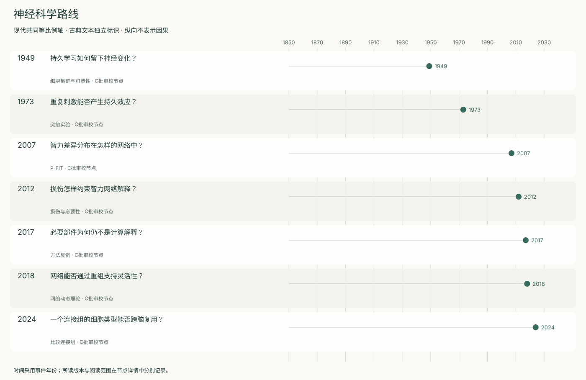
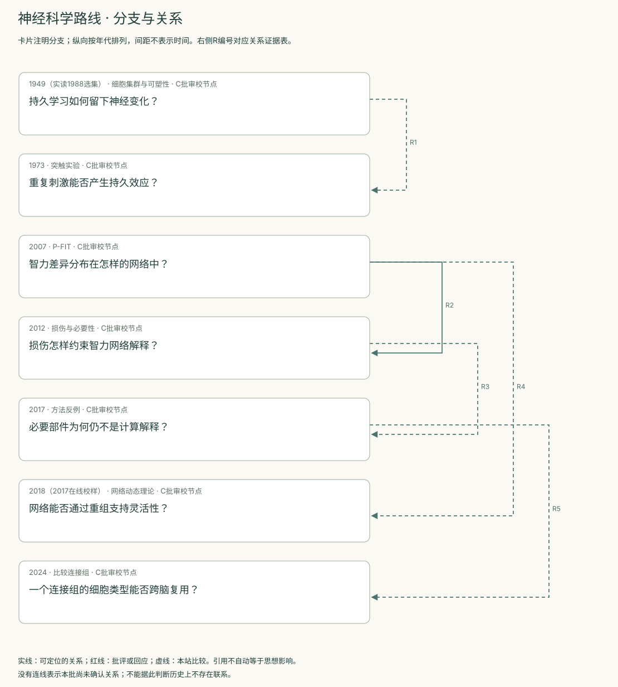
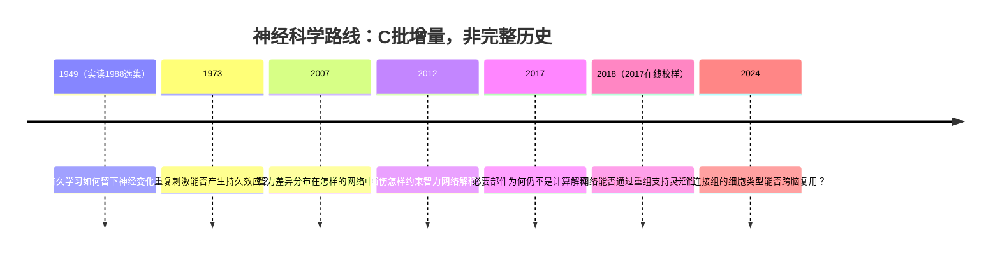
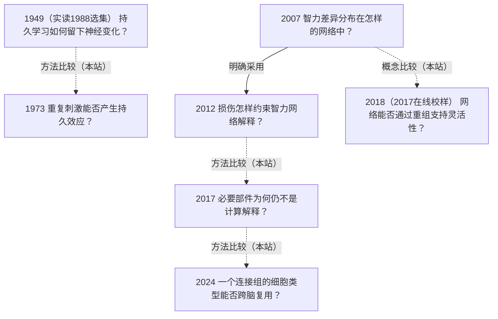

<!-- 由 research.json 生成；修改数据后重生成。C批已验收；不代表完整路线史。 -->

# 神经科学路线 · C批增量

**已完成本批指定范围验收，后续扩展与未覆盖材料另列。** 当前7个本批节点，图中另有0个第二轮延续节点；此前各批记录独立保留。

从Hebb的可塑性假设与Bliss–Lømo的实验，转向P-FIT和损伤定位，再到网络动态与连接组。各尺度提供不同约束，不能以细胞、脑区或图谱中任何一项单独定义智能。

Jonas–Kording用已知机制的处理器检验分析方法，提醒必要性、相关结构和计算解释之间仍有距离。

[交互阅读](../atlas.html?route=neuroscience) · [编辑SVG时间线](neuroscience-timeline.svg) · [编辑SVG关系图](neuroscience-relations.svg)

图中标为“第二轮延续”的节点用于呈现本批新增关系，不计入本批记录数。SVG关系编号与下表对应；完整原文定位见[关系台账](../relations.md)。

| 编号 | 关系 | 解释 |
| --- | --- | --- |
| R1 | 1949（实读1988选集） → 1973 · 方法比较（本站） | 本站比较可塑性假设与局部实验，不据此宣称已核实二者历史传承或完整记忆机制。 |
| R2 | 2007 → 2012 · 明确采用 | 损伤研究明确把P-FIT的分布网络主张列为检验背景。 |
| R3 | 2012 → 2017 · 方法比较（本站） | 比较损伤证据的解释范围；不是Jonas对这篇特定脑损伤论文的直接反驳。 |
| R4 | 2007 → 2018（2017在线校样） · 概念比较（本站） | 比较局部网络整合与系统动态重组，未将后者写成前者被推翻。 |
| R5 | 2017 → 2024 · 方法比较（本站） | 结构资料、跨脑验证与机制解释承担不同任务。 |

[编辑时间线](neuroscience-timeline.mmd) · [编辑关系图](neuroscience-relations.mmd)

- [持久学习如何留下神经变化？](../notes/e-hebb-1949.md)：瞬时神经活动怎样与持久记忆连接？
- [重复刺激能否产生持久效应？](../notes/e-bliss-lomo-1973.md)：神经通路的响应可否在刺激结束后持续变化？
- [智力差异分布在怎样的网络中？](../notes/e-jung-haier-2007.md)：能否把不同成像研究收敛到共同的信息整合框架？
- [损伤怎样约束智力网络解释？](../notes/e-barbey-2012.md)：哪些区域受损与一般能力、执行表现下降有关？
- [必要部件为何仍不是计算解释？](../notes/e-jonas-kording-2017.md)：熟悉的神经分析工具能否恢复已知系统的机制？
- [网络能否通过重组支持灵活性？](../notes/e-barbey-2018.md)：静态区域归属是否足以解释能力差异？
- [一个连接组的细胞类型能否跨脑复用？](../notes/e-schlegel-2024.md)：单个脑中定义的类型是否稳定、可检验？

## 未覆盖范围与后续研究

- Marr多层解释已在A批涉及，本批未补读整本Vision；连接组只选读Schlegel注释与跨脑类型比较，未审查全部FlyWire伴随论文。
- Hebb仅选集重印；LTP仅摘要与354页讨论图像，原始记录和完整统计未重验；缺长期学习行为与突触干预的联合证据。
- 2018网络理论为观点文章，2023/2026预测检验留后续；本批不作截至2026年的完整综述。

[返回C批](../README.md)
