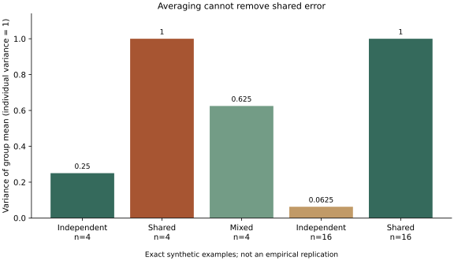

# 人数增加为什么未必消除集体误差

按预先协议，设每个成员误差为共同项aS与独立项bUᵢ之和，再除以√(a²+b²)，使个体方差始终为1。S与各Uᵢ是独立、等概率的±1变量。

群体平均误差的解析方差为a²/(a²+b²)+b²/[n(a²+b²)]。程序用整数分子枚举，再精确归一化，并用协方差矩阵求和作另一条核对路径。

| 条件 | 人数 | 个体方差 | 群体平均误差方差 |
| --- | ---: | ---: | ---: |
| 只有独立误差 | 4 | 1 | 1/4 |
| 只有共享误差 | 4 | 1 | 1 |
| 共享、独立贡献各半 | 4 | 1 | 5/8 |
| 只有独立误差 | 16 | 1 | 1/16 |
| 只有共享误差 | 16 | 1 | 1 |

四人混合条件完整枚举32种状态，16人独立条件枚举65,536种状态。三种计算路径一致；共享误差不随人数消失，独立误差则按1/n下降。共4项检查通过。

这是零均值误差的合成反例，未建模系统性均值偏差、权重、任务分工或互动学习。不能据此断言沟通必然有害，也不构成Woolley、Lorenz、Derex或Bates的实验复现。

关联：[认知的系统边界](../questions/q-system-boundary.md)；[D批回访](../revisits.md)。

## 可复核材料

- [预先协议](protocol.md)：在实现前保存，验收时未改写。
- [精确结果](results.json)：有理数结果与协议／实现SHA-256。
- [计算程序](../../../../scripts/check-intelligence-cde.py)：Python标准库即可核验，`--plot`另需Matplotlib。
- [可编辑SVG](check.svg)：图为数值结果的辅助呈现，精确值以JSON为准。

运行：`python3 scripts/check-intelligence-cde.py d --check`。

协议指纹：`5350c1451baf771669af02d41107a04f4c6d3b6baffca5481875fdcbd138ced7`。

实现指纹：`9b455fbd8882727fea399e022171f8714c7167b5df39baf1c508f176b01365ff`。
