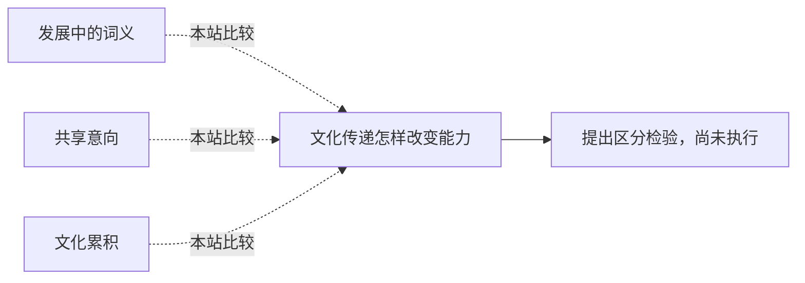

<!-- 由 research.json 生成；修改数据后重生成。D批已验收；不代表完整路线史。 -->

# 文化传递怎样改变能力

**问题：** 个体学会、群体保存与跨代累积如何区分？

这是基于所列阅读范围的本站比较；下述实验为待执行构想，不计入正式复现。

## 定义与比较对象

### 发展中的词义

思维与言语关系的形成。

[词义成为发展的分析单位](../notes/e-vygotsky-1934.md)

### 共享意向

共同目标与分享动机的机制假说。

[共同目标与分享动机](../notes/e-tomasello-2005.md)

### 文化累积

反复创新、社会传递和可定义的改善。

[为累积文化分解判据](../notes/e-mesoudi-2018.md)

## 比较结论

语言结构变化不等于一般能力上升。,群体保留概率与个体学习效应必须分开；网络规模与总人口也不同。

[编辑比较图](q-cultural-cumulation.mmd)

## 原文定位

- [新生手语的代际结构变化](../notes/e-senghas-2004.md)：p1780–1781；队列中结构变化的有限观察。。
- [同一数据如何支持相反解释](../notes/e-andersson-read-2014.md)：E1–E2；零模型与分析单位直接分歧。。
- [为累积文化分解判据](../notes/e-mesoudi-2018.md)：p2–3；固定累积的操作判据。。

## 可区分的检验（未执行）

- 操纵：同样总人数与学习时间下改变跨代传递、示范者可达性。
- 测量：个体掌握、群体保存及代际净改进分别计分。
- 控制：匹配初始技能；设无传递、独立重建和有损传递对照。
- 解释边界：只有代际收益超过匹配重建对照，才能支持该任务的累积贡献。

未实施新的人类实验；不能单凭这一设计裁决人类独特性。

下一问：先补读Derex全文与补充数据，再预先指定层级模型。

[返回D批](../README.md)
