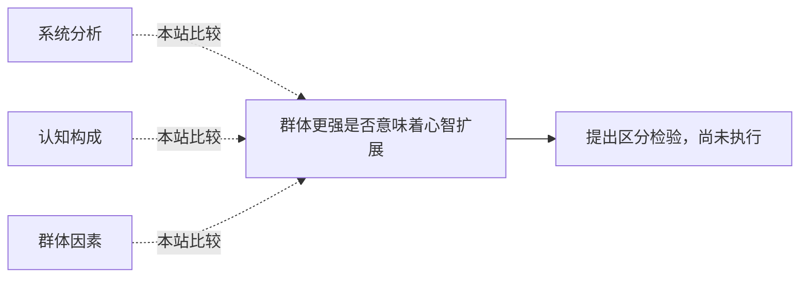

<!-- 由 research.json 生成；修改数据后重生成。D批已验收；不代表完整路线史。 -->

# 群体更强是否意味着心智扩展

**问题：** 系统性能、认知分布与心智构成之间缺少哪一步？

这是基于所列阅读范围的本站比较；下述实验为待执行构想，不计入正式复现。

## 定义与比较对象

### 系统分析

将人、工具、程序共同列入解释单位。

[驾驶舱作为认知分析单位](../notes/e-hutchins-cockpit-1995.md)

### 认知构成

外部资源在一定条件下属于认知系统。

[稳定外部资源是否构成认知](../notes/e-clark-chalmers-1998.md) · [扩大分析范围是否足够](../notes/e-adams-aizawa-2001.md) · [从工具本身转向整合条件](../notes/e-clark-reply-2010.md)

### 群体因素

多任务协变中的潜变量。

[群体表现是否有共同因素](../notes/e-woolley-2010.md) · [群体因素与个体能力的重叠](../notes/e-bates-gupta-2017.md)

## 比较结论

工具贡献可由实验识别，构成论题另需明确判据。,c因素不自动揭示互动机制；误差相关性可破坏人数优势。

[编辑比较图](q-system-boundary.mmd)

## 原文定位

- [驾驶舱作为认知分析单位](../notes/e-hutchins-cockpit-1995.md)：稿p2、20；分析单位的改变。。
- [从工具本身转向整合条件](../notes/e-clark-reply-2010.md)：2006稿p6–7；整合条件不同于部件自己思考。。
- [意见收敛可能掩盖误差](../notes/e-lorenz-2011.md)：PDF5；收敛、自信和准确性分离。。

## 可区分的检验（未执行）

- 操纵：固定个体能力与信息，改变通信网络、工具可靠性及访问成本。
- 测量：任务迁移、错误协方差、修复代价和资源依赖程度。
- 控制：匹配人数与预算；对比独立信息、共同误导和独立扰动。
- 解释边界：性能变化支持因果贡献，是否构成心智仍须接受独立理论标准。

本批已运行的共享误差数学核验只检查聚合原理，不验证人类c因素。

下一问：将前批资源预算扩展为组织协调和工具维护成本。

[返回D批](../README.md)
