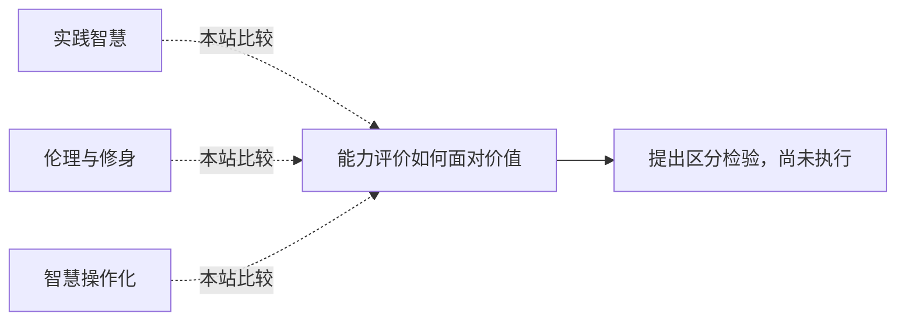

<!-- 由 research.json 生成；修改数据后重生成。D批已验收；不代表完整路线史。 -->

# 能力评价如何面对价值

**问题：** 何时评的是完成目标的能力，何时评的是目标与判断是否值得？

这是基于所列阅读范围的本站比较；下述实验为待执行构想，不计入正式复现。

## 定义与比较对象

### 实践智慧

在特定善的框架中审议行动。

[实践智慧与好的生活](../notes/e-aristotle-ethics.md)

### 伦理与修身

良知嵌于仁义关系，不是中性分数。

[知与仁义、修身的联系](../notes/e-mengzi-jinxin.md)

### 智慧操作化

用生活推理维度评分，带有规范取舍。

[把生活判断转成评分协议](../notes/e-baltes-staudinger-2000.md) · [智慧表现中的年龄与文化](../notes/e-grossmann-2012.md)

## 比较结论

保留儒、道、佛与古希腊问题语境，不把相似词汇合成一个古老IQ。,跨文化评分既要检查测量等价，也要公开共同善与权重的理由。

[编辑比较图](q-wisdom-norms.mmd)

## 原文定位

- [熟练行动仍需戒慎](../notes/e-zhuangzi-yangsheng.md)：庖丁段；熟练与戒慎并存。。
- [缘起、二谛与概念执取](../notes/e-nagarjuna-24.md)：PDF82–84；避免把哲学语汇转成物理事实。。
- [智慧把能力指向共同善](../notes/e-sternberg-1998.md)：摘要；当前作者网页Third段；共同善不是未加说明的统一目标。。
- [智慧表现中的年龄与文化](../notes/e-grossmann-2012.md)：稿p11–13；情境与文化限制。。

## 可区分的检验（未执行）

- 操纵：对同一价值冲突案例进行多语种、跨评分群体评审，提前记录规范标准。
- 测量：评分一致性、理由结构、受影响者异议及对新情境的稳定性。
- 控制：分开语言表达、事实知识和价值选择；不以多数票当终极规范证明。
- 解释边界：区分测量失配与真实规范分歧，不能用统一分数掩盖后者。

规范正当性不能由一个经验实验直接推出；设计尚未执行。

下一问：第四轮先整理不可互换的评价目标，再谈统一智能定义。

[返回D批](../README.md)
