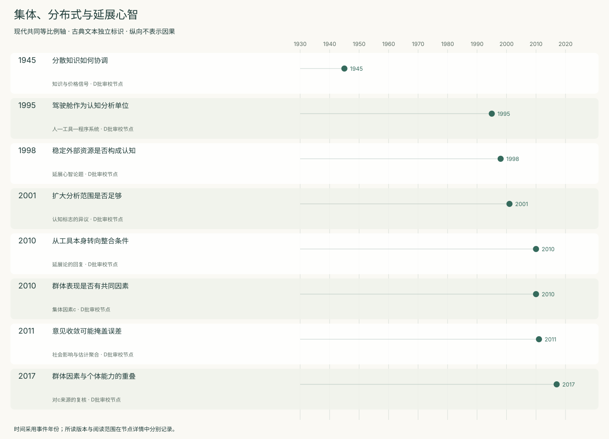
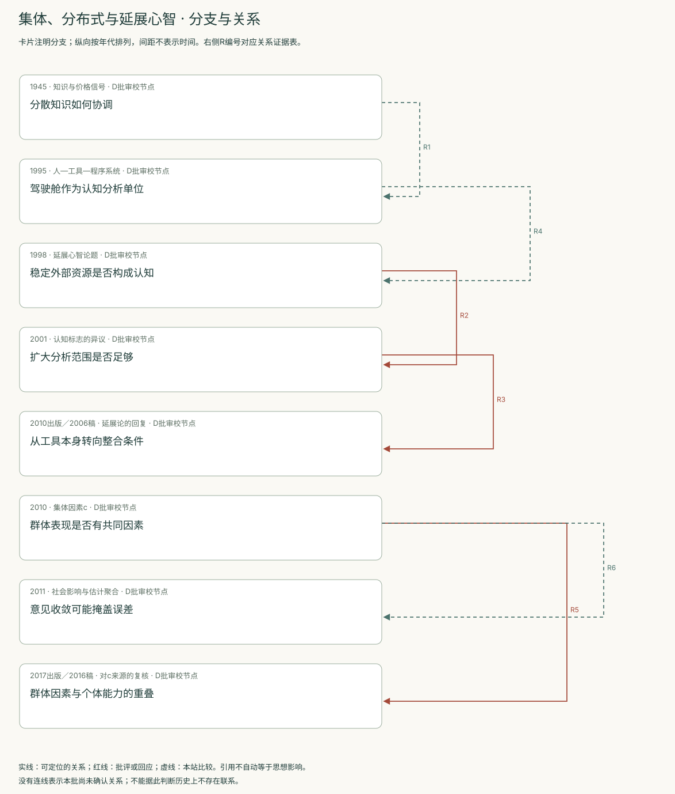
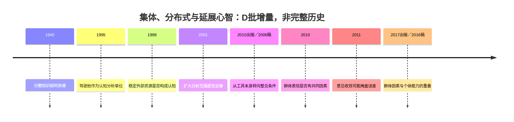
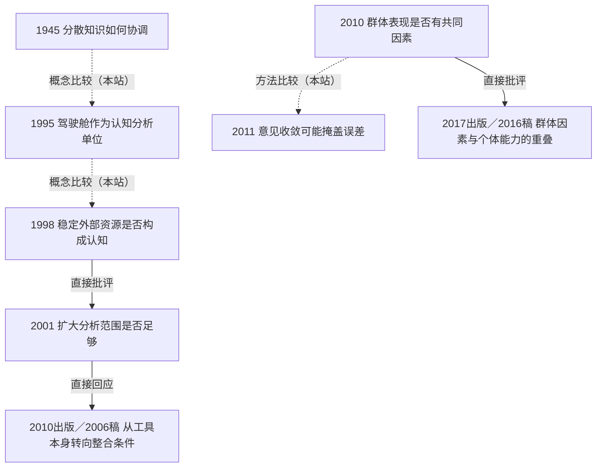

<!-- 由 research.json 生成；修改数据后重生成。D批已验收；不代表完整路线史。 -->

# 集体、分布式与延展心智 · D批增量

**已完成本批指定范围验收，后续扩展与未覆盖材料另列。** 当前8个本批节点，图中另有0个第二轮延续节点；此前各批记录独立保留。

分散知识提出协调难题；驾驶舱案例将分析单位扩展为人、工具和程序组成的系统。延展心智进一步提出构成论题，并遭遇“认知标志”的质疑。

群体因素研究与复核的分歧集中在个体能力、互动和测量模型；估计实验显示意见收敛未必改善准确性。分布式分析、延展构成与群体高分并非同一个命题。

[交互阅读](../atlas.html?route=collective-extended) · [编辑SVG时间线](collective-extended-timeline.svg) · [编辑SVG关系图](collective-extended-relations.svg)

图中标为“第二轮延续”的节点用于呈现本批新增关系，不计入本批记录数。SVG关系编号与下表对应；完整原文定位见[关系台账](../relations.md)。

| 编号 | 关系 | 解释 |
| --- | --- | --- |
| R1 | 1945 → 1995 · 概念比较（本站） | 二者都扩展个体之外的分析，任务与机制不同，未主张思想影响。 |
| R2 | 1998 → 2001 · 直接批评 | 作者明确批评延展心智对工具使用的构成解释。 |
| R3 | 2001 → 2010出版／2006稿 · 直接回应 | 回复针对Adams与Aizawa系列论文；不限定为逐条回应2001版。 |
| R4 | 1995 → 1998 · 概念比较（本站） | 系统分析单位与心智构成论题分别成立，不能相互替证。 |
| R5 | 2010 → 2017出版／2016稿 · 直接批评 | 复核对群体因素来源提出竞争模型；本批未重算。 |
| R6 | 2010 → 2011 · 方法比较（本站） | 跨任务群体因素与数值估计聚合是不同对象。 |

[编辑时间线](collective-extended-timeline.mmd) · [编辑关系图](collective-extended-relations.mmd)

- [分散知识如何协调](../notes/e-hayek-1945.md)：没有人掌握全部局部知识，如何协调行动？
- [驾驶舱作为认知分析单位](../notes/e-hutchins-cockpit-1995.md)：进近速度的记忆究竟保存在哪里？
- [稳定外部资源是否构成认知](../notes/e-clark-chalmers-1998.md)：外部存储只是帮助思考，还是属于思考系统？
- [扩大分析范围是否足够](../notes/e-adams-aizawa-2001.md)：同一行为结果是否足以证明同一种认知过程？
- [从工具本身转向整合条件](../notes/e-clark-reply-2010.md)：争议是否把“部件自身有认知”误当成论题？
- [群体表现是否有共同因素](../notes/e-woolley-2010.md)：一组人在多种任务上的表现能否由共同维度概括？
- [意见收敛可能掩盖误差](../notes/e-lorenz-2011.md)：共享他人估计一定让群体更准吗？
- [群体因素与个体能力的重叠](../notes/e-bates-gupta-2017.md)：c是否代表独立于成员能力的群体属性？

## 未覆盖范围与后续研究

- Hayek的机制论证不覆盖制度比较的全部实证；不把价格协调当成市场完美定理。
- Hutchins 1995专著未读；本批新增的是驾驶舱论文作者稿。Clark回复为2006仓储稿，未逐字对照2010书章。
- 尚未重算Woolley与Bates数据，未系统纳入后续元分析；动物集群与长期组织协作仍待补读。

[返回D批](../README.md)
