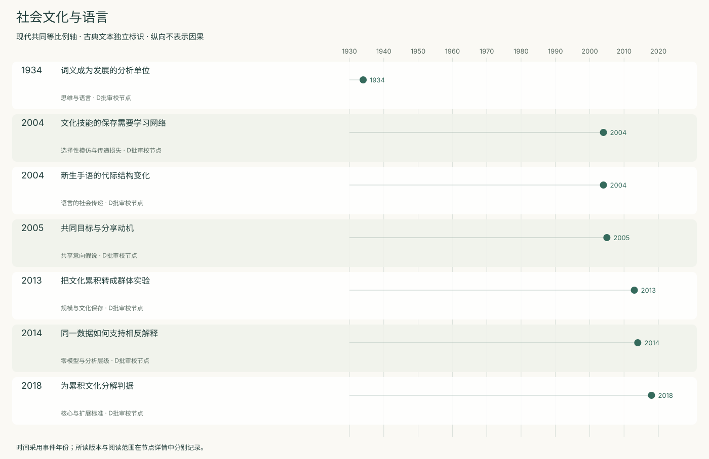
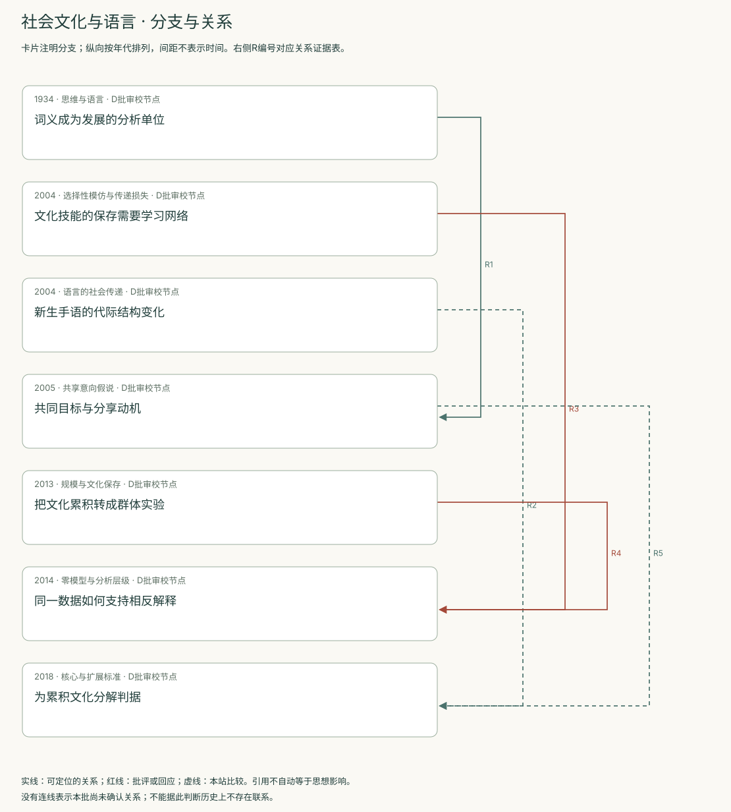
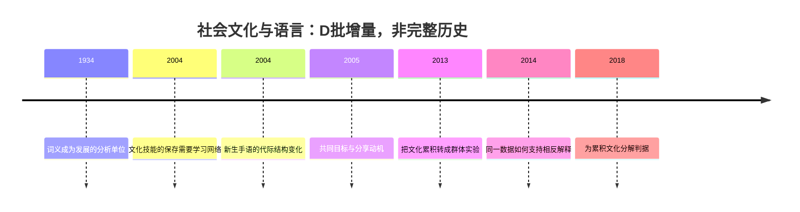
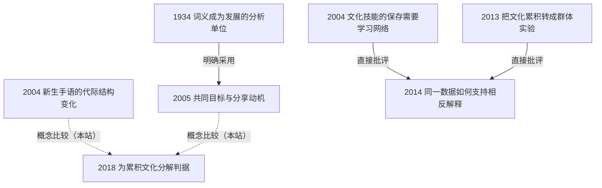

<!-- 由 research.json 生成；修改数据后重生成。D批已验收；不代表完整路线史。 -->

# 社会文化与语言 · D批增量

**已完成本批指定范围验收，后续扩展与未覆盖材料另列。** 当前7个本批节点，图中另有0个第二轮延续节点；此前各批记录独立保留。

词义与思维共同发展，使语言成为需要解释的机制，而非现成输入。共享意向理论提出合作动机与理解意图的组合；新生手语提供代际结构变化的观察。

文化传递模型把学习者、示范者与群体规模连接起来。群体实验及其争论提醒我们区分个体学习改善与群体保存概率。累积文化的判据需要明确，不能只凭“文化”一词跨物种概括。

[交互阅读](../atlas.html?route=sociocultural-language) · [编辑SVG时间线](sociocultural-language-timeline.svg) · [编辑SVG关系图](sociocultural-language-relations.svg)

图中标为“第二轮延续”的节点用于呈现本批新增关系，不计入本批记录数。SVG关系编号与下表对应；完整原文定位见[关系台账](../relations.md)。

| 编号 | 关系 | 解释 |
| --- | --- | --- |
| R1 | 1934 → 2005 · 明确采用 | Tomasello明确使用Vygotskian内化解释的措辞，同时承认具体机制未明。 |
| R2 | 2004 → 2018 · 概念比较（本站） | 本站比较结构重组与累积判据，不宣称后文继承此实验。 |
| R3 | 2004 → 2014 · 直接批评 | 往来争论明确追溯人口规模假说，但主要实证靶标是Derex实验。 |
| R4 | 2013 → 2014 · 直接批评 | 同一节点记录原论文遭批评及作者回复，保留分析单位争议。 |
| R5 | 2005 → 2018 · 概念比较（本站） | 共享意向的机制假说不能代替累积文化的结果判据。 |

[编辑时间线](sociocultural-language-timeline.mmd) · [编辑关系图](sociocultural-language-relations.mmd)

- [词义成为发展的分析单位](../notes/e-vygotsky-1934.md)：如何研究思想与言语的内部关系？
- [文化技能的保存需要学习网络](../notes/e-henrich-2004.md)：个体善于择优学习，为何群体仍可能丢失复杂技能？
- [新生手语的代际结构变化](../notes/e-senghas-2004.md)：儿童只是复制输入，还是重组表达结构？
- [共同目标与分享动机](../notes/e-tomasello-2005.md)：理解他人目标为何还不够解释人类文化协作？
- [把文化累积转成群体实验](../notes/e-derex-2013.md)：群体规模能否影响技能保留与改进？
- [同一数据如何支持相反解释](../notes/e-andersson-read-2014.md)：“规模效应”究竟指群体保存，还是个体学习改善？
- [为累积文化分解判据](../notes/e-mesoudi-2018.md)：不同研究是否在测量同一种“累积”？

## 未覆盖范围与后续研究

- Boyd与Richerson 1985专著、Tomasello 1999及Henrich 2015专著未选读。
- Vygotsky网页混合译本未与俄文校勘；Derex 2013本次仅读摘要，方法依2014争论不得反充原文全文。
- 非人类累积文化的原始实验、文化吸引理论与语言多样性仍需补读。

[返回D批](../README.md)
