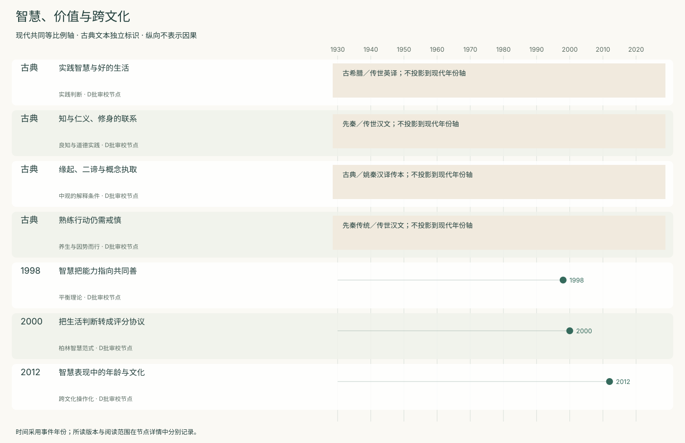
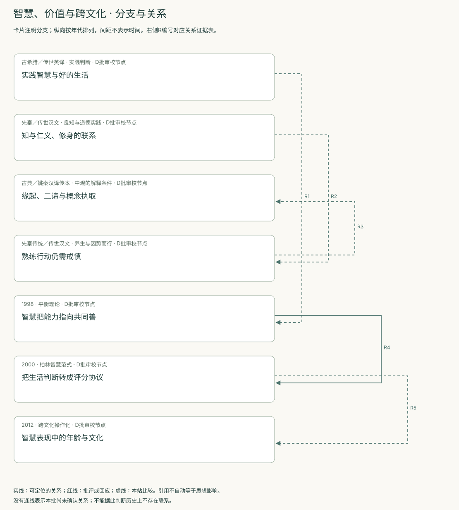
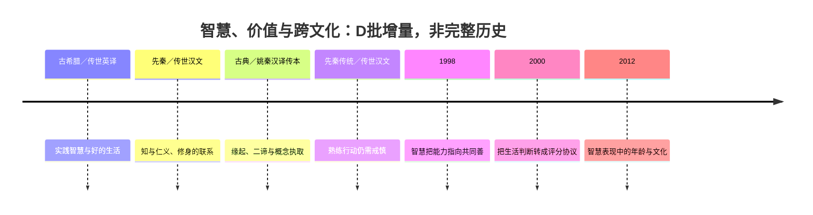
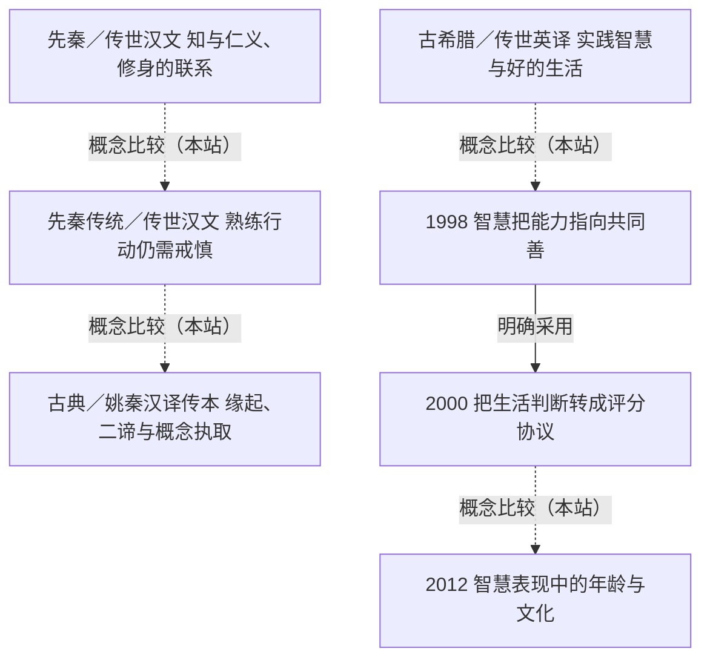

<!-- 由 research.json 生成；修改数据后重生成。D批已验收；不代表完整路线史。 -->

# 智慧、价值与跨文化 · D批增量

**已完成本批指定范围验收，后续扩展与未覆盖材料另列。** 当前7个本批节点，图中另有0个第二轮延续节点；此前各批记录独立保留。

实践智慧、良知、养生与缘起分别嵌在不同的伦理及解脱问题中，不能统一翻译成现代能力分数。

现代智慧研究将生活判断转成评分维度，也暴露“共同善”与跨文化可比性的困难。测量结果需要与规范承诺分开。

[交互阅读](../atlas.html?route=wisdom-values) · [编辑SVG时间线](wisdom-values-timeline.svg) · [编辑SVG关系图](wisdom-values-relations.svg)

图中标为“第二轮延续”的节点用于呈现本批新增关系，不计入本批记录数。SVG关系编号与下表对应；完整原文定位见[关系台账](../relations.md)。

| 编号 | 关系 | 解释 |
| --- | --- | --- |
| R1 | 古希腊／传世英译 → 1998 · 概念比较（本站） | 仅比较目的审议与共同善，不推断直接传承。 |
| R2 | 先秦／传世汉文 → 先秦传统／传世汉文 · 概念比较（本站） | 伦理知与养生寓言保留语境，非同一量表维度。 |
| R3 | 先秦传统／传世汉文 → 古典／姚秦汉译传本 · 概念比较（本站） | 本站对照行动与概念执取，不建立历史影响或科学等价。 |
| R4 | 1998 → 2000 · 明确采用 | 作者明确将Sternberg平衡利益的研究列为相关贡献，同时保留自身框架。 |
| R5 | 2000 → 2012 · 概念比较（本站） | 比较两种评分协议和文化边界；不把两套维度当完全相同。 |

[编辑时间线](wisdom-values-timeline.mmd) · [编辑关系图](wisdom-values-relations.mmd)

- [实践智慧与好的生活](../notes/e-aristotle-ethics.md)：善于制作或推理，是否就善于决定如何生活？
- [知与仁义、修身的联系](../notes/e-mengzi-jinxin.md)：知道什么与应如何对待人有何关系？
- [缘起、二谛与概念执取](../notes/e-nagarjuna-24.md)：无自性是否会破坏因果与实践？
- [熟练行动仍需戒慎](../notes/e-zhuangzi-yangsheng.md)：娴熟行动如何避免强行消耗与僵化规则？
- [智慧把能力指向共同善](../notes/e-sternberg-1998.md)：追求个人成功的能力如何与智慧区别？
- [把生活判断转成评分协议](../notes/e-baltes-staudinger-2000.md)：如何观察智慧相关知识而不只依赖声望？
- [智慧表现中的年龄与文化](../notes/e-grossmann-2012.md)：智慧是否随年龄按同一路径增长？

## 未覆盖范围与后续研究

- 古典文本均为选读；未做希腊、梵文及汉籍写本校勘，也不代表传统全貌。
- Sternberg 1998仅摘要已读，正文获取未成功；当前作者网站另列，不能倒填1998版措辞。
- 跨文化证据限所读日本与美国样本；儒道佛之外的伊斯兰、非洲及原住民传统待补。

[返回D批](../README.md)
