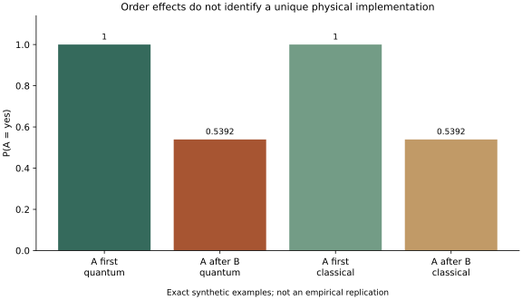

# 顺序效应可以有不同实现

按预先协议，在二维实向量空间取初态(1,0)，A基为(1,0)、(0,1)，B基为(3/5,4/5)、(-4/5,3/5)。先后投影并取平方范数得到联合概率。

另写经典有限状态机：初次A回答“是”的概率为1，初次B为9/25；状态记录最近的问题和回答。切换问题时，保持同答案的概率为9/25、切换答案为16/25。该实现允许问题改变状态。

| 次序 | 联合矩阵：行是首次问题答案，列是第二次问题答案；均按是／否排序 |
| --- | --- |
| A→B | [[9/25, 16/25], [0, 0]] |
| B→A | [[81/625, 144/625], [256/625, 144/625]] |

两种实现逐项得到相同矩阵，均归一化。A先问时P(A=是)=1，B之后问A时P(A=是)=337/625。令两组基相同的负控制没有顺序效应。共4项检查通过。

结论仅为：这个两次测量例中的顺序效应，不能唯一识别量子物理实现。经典比较模型是允许上下文和状态更新的动态模型；它不是固定、非上下文的静态联合分布。本例没有检验Bell不等式，没有证明任何经典模型都能复现全部量子预测，也没有复现Wang等2014的调查、QQ等式检验或微管实验。

关联：[量子概率与物理实现](../questions/q-quantum-implementation.md)。

## 可复核材料

- [预先协议](protocol.md)：在实现前保存，验收时未改写。
- [精确结果](results.json)：有理数结果与协议／实现SHA-256。
- [计算程序](../../../../scripts/check-intelligence-cde.py)：Python标准库即可核验，`--plot`另需Matplotlib。
- [可编辑SVG](check.svg)：图为数值结果的辅助呈现，精确值以JSON为准。

运行：`python3 scripts/check-intelligence-cde.py e --check`。

协议指纹：`d3a4dd6ae181bf6305218fd66be1f0b4e98f0060d84777cc245d733e92d5f084`。

实现指纹：`9b455fbd8882727fea399e022171f8714c7167b5df39baf1c508f176b01365ff`。
