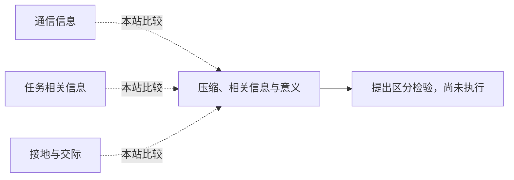

<!-- 由 research.json 生成；修改数据后重生成。E批已验收；不代表完整路线史。 -->

# 压缩、相关信息与意义

**问题：** 预测或压缩成功，究竟支持哪一种“理解”？

这是基于所列阅读范围的本站比较；下述实验为待执行构想，不计入正式复现。

## 定义与比较对象

### 通信信息

消息选择的不确定性，工程问题暂不处理语义。

[通信的不确定性：明确排除语义问题](../notes/e-shannon-1948.md)

### 任务相关信息

对预定Y保留的统计信息，取决于目标与分布。

[信息瓶颈：先指定相关变量](../notes/e-tishby-1999.md)

### 接地与交际

符号与对象、行动或交际意图的关系。

[符号接地：名称如何关联非符号能力？](../notes/e-harnad-1990.md) · [形式与意义：训练信号限制能学到的关系](../notes/e-bender-koller-2020.md)

## 比较结论

压缩可改善预测，但需要先说明保留何种信息及其用途。语义论证还要求外部关系；仅用同一个“信息”词不能证明三个解释层已接通。

[编辑比较图](q-compression-semantics.mmd)

## 原文定位

- [通信的不确定性：明确排除语义问题](../notes/e-shannon-1948.md)：导论；原文划定通信工程问题。
- [信息瓶颈：先指定相关变量](../notes/e-tishby-1999.md)：§3，式15；相关性依赖Y。
- [符号接地：名称如何关联非符号能力？](../notes/e-harnad-1990.md)：§5；接地行为检验仍不保证主观意义。
- [形式与意义：训练信号限制能学到的关系](../notes/e-bender-koller-2020.md)：§9；加入接地数据改变前提。

## 可区分的检验（未执行）

- 操纵：控制形式语料量，分别加入感知、行动反馈与交际纠错；再改变对象和任务。
- 测量：新指称识别、因果干预成功、跨任务纠错，以及压缩／预测分数。
- 控制：计算预算、训练泄漏、额外标签量和动作接口；不把额外数据优势当唯一机制证据。
- 解释边界：结果只能支持测得的能力与信息来源；不能直接推断主观意义。

这是待执行的区分设计；本批没有训练模型或构建语言理解实测集。

下一问：哪些最小外部反馈改变可迁移的语义能力？

[返回E批](../README.md)
