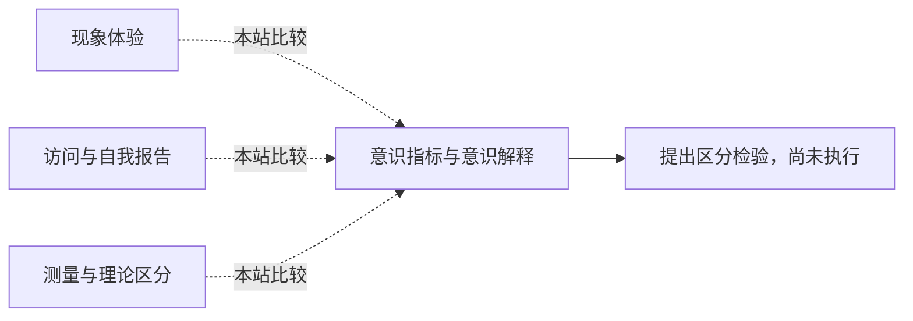

<!-- 由 research.json 生成；修改数据后重生成。E批已验收；不代表完整路线史。 -->

# 意识指标与意识解释

**问题：** 一项神经或行为指标到底测到了体验、访问还是报告条件？

这是基于所列阅读范围的本站比较；下述实验为待执行构想，不计入正式复现。

## 定义与比较对象

### 现象体验

为什么加工伴随主观感受。

[困难问题：功能解释是否穷尽体验？](../notes/e-chalmers-1995.md)

### 访问与自我报告

信息全局可用，或系统具有注意图式。

[全局工作空间：意识可访问性与点燃](../notes/e-dehaene-changeux-2011.md) · [注意图式：系统如何表征自己的注意](../notes/e-webb-graziano-2015.md)

### 测量与理论区分

知识探测、神经指标及预注册预测决定证据能排除什么。

[知识问法改变对无意识决策的判断](../notes/e-maia-mcclelland-2004.md) · [对抗协作：用预注册预测同时挑战两种理论](../notes/e-cogitate-2025.md)

## 比较结论

同一报告可以来自不同机制；“没有报告”也可能只是测量不敏感。应先写清解释对象，再锁定理论版本、核心预测及辅助假设，记录哪些证据支持或挑战了哪一层。

[编辑比较图](q-consciousness-explanation.mmd)

## 原文定位

- [困难问题：功能解释是否穷尽体验？](../notes/e-chalmers-1995.md)：§2；体验与功能区分。
- [知识问法改变对无意识决策的判断](../notes/e-maia-mcclelland-2004.md)：PDF 1、5；探测方式影响“无意识”推断。
- [对抗协作：用预注册预测同时挑战两种理论](../notes/e-cogitate-2025.md)：Abstract／Discussion；共同预测检验仍留下双方解释与限制。

## 可区分的检验（未执行）

- 操纵：在伦理与可行性审查后的新研究中，分别改变报告要求、注意负荷与目标可见度；预先登记各理论的定量预测。
- 测量：知觉辨别、知识探测、报告、候选神经指标及置信区间。
- 控制：任务相关性、被试选择、测量灵敏度、跨方法一致性；先做功效设计。
- 解释边界：支持或挑战特定预测，不把单一结果升级为理论全胜或体验问题彻底解决。

仅为研究构想，没有开展人类实验。2025检验与2004／2011文本版本差异仍是显式缺口。

下一问：同一指标在不同任务中是否仍能排除同一竞争解释？

[返回E批](../README.md)
