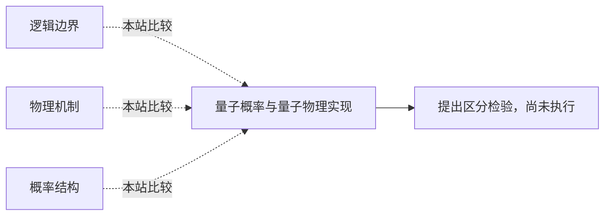

<!-- 由 research.json 生成；修改数据后重生成。E批已验收；不代表完整路线史。 -->

# 量子概率与量子物理实现

**问题：** 顺序效应或量子概率拟合，是否识别了大脑的物理机制？

这是基于所列阅读范围的本站比较；下述实验为待执行构想，不计入正式复现。

## 定义与比较对象

### 逻辑边界

形式系统限制及人能识别什么的额外前提。

[哥德尔论证：从系统限制到心智超越？](../notes/e-lucas-1961.md)

### 物理机制

指定自由度、相干与退相干环境、还原机制。

[Orch OR：微管相干与客观还原假说](../notes/e-hameroff-penrose-1996.md) · [退相干时间：把物理主张变为数量级约束](../notes/e-tegmark-2000.md) · [回应退相干批评：先对齐模型与参数](../notes/e-hagan-2002.md)

### 概率结构

不对易提问与状态更新可刻画顺序效应。

[量子认知：顺序效应的概率结构](../notes/e-wang-quantum-2014.md)

## 比较结论

形式系统论证、物理可行性与行为概率模型需要不同证据。本批精确合成核验给出同一两次测量分布的经典有限状态实现，说明该例顺序效应不足以识别量子物理机制；没有声称经典模型可复制所有量子预测。

[编辑比较图](q-quantum-implementation.mmd)

## 原文定位

- [哥德尔论证：从系统限制到心智超越？](../notes/e-lucas-1961.md)：120–121；识别一致性是额外前提。
- [回应退相干批评：先对齐模型与参数](../notes/e-hagan-2002.md)：摘要；改参数的计算主张不等于测量。
- [量子认知：顺序效应的概率结构](../notes/e-wang-quantum-2014.md)：PDF 6 Discussion；作者区分经典神经实现与量子概率描述。

## 可区分的检验（未执行）

- 操纵：预先限定模型自由度和状态记忆预算，比较新问题顺序／重复测量；物理机制另需对指定自由度直接测量与干预。
- 测量：样本外分布、模型复杂度与误差；物理部分另测相干时间及行为因果效应。
- 控制：相同信息与拟合预算；不能把静态联合分布的失败偷换为所有经典动态模型失败。
- 解释边界：行为数据区分受约束模型；物理实现需独立证据。合成例不构成Bell／非上下文性检验。

问题卡设计未实施；已执行的是另页预先协议限定的两次测量有理数例与同基负控制。

下一问：什么新增实验能让两类受约束模型给出确实不同的预测？

[返回E批](../README.md)
