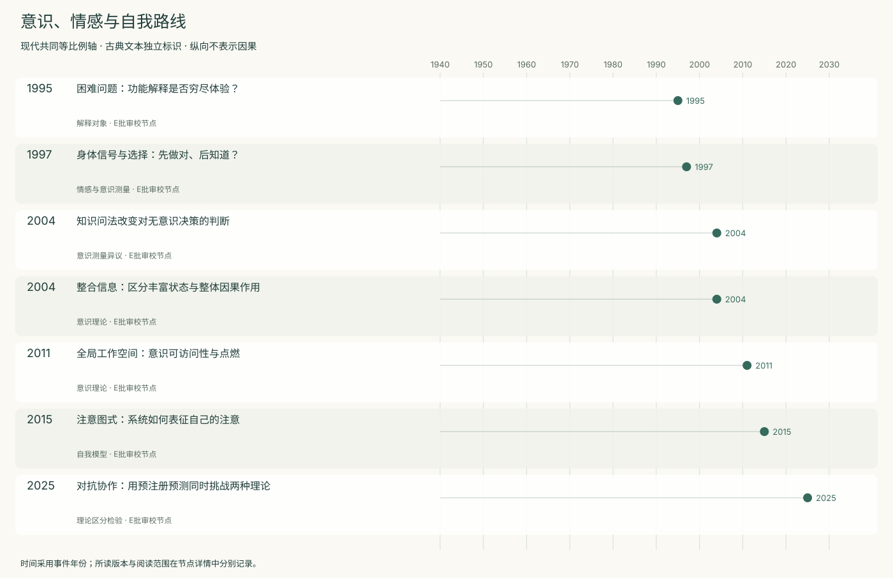
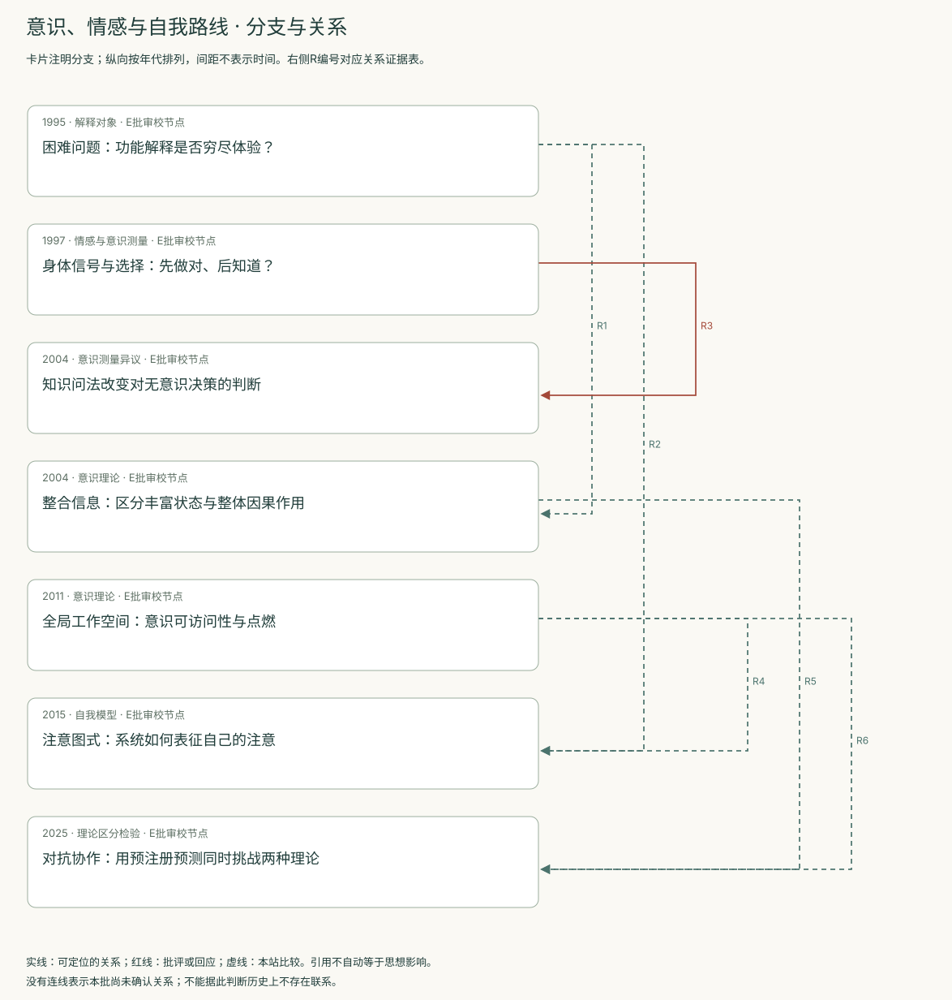
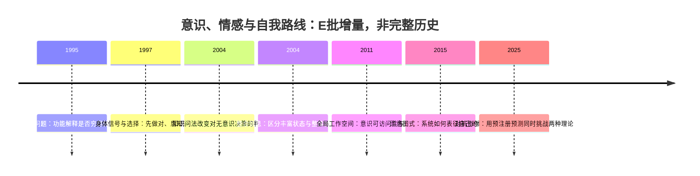
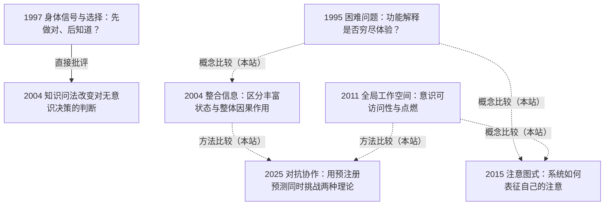

<!-- 由 research.json 生成；修改数据后重生成。E批已验收；不代表完整路线史。 -->

# 意识、情感与自我路线 · E批增量

**已完成本批指定范围验收，后续扩展与未覆盖材料另列。** 当前7个本批节点，图中另有0个第二轮延续节点；此前各批记录独立保留。

先区分主观体验、信息可报告性、注意控制和身体信号，再比较解释方案。

从IIT、GNW与注意图式到预注册对抗检验，理论必须交代哪些观察真正可区分竞争解释。

[交互阅读](../atlas.html?route=consciousness-self) · [编辑SVG时间线](consciousness-self-timeline.svg) · [编辑SVG关系图](consciousness-self-relations.svg)

图中标为“第二轮延续”的节点用于呈现本批新增关系，不计入本批记录数。SVG关系编号与下表对应；完整原文定位见[关系台账](../relations.md)。

| 编号 | 关系 | 解释 |
| --- | --- | --- |
| R1 | 1995 → 2004 · 概念比较（本站） | 体验解释要求与因果整合的理论对应关系需分别论证，不因共同谈意识而同义。 |
| R2 | 1995 → 2015 · 概念比较（本站） | 比较“为什么有体验”与“系统为什么归因自己有觉知”，保留解释目标的分歧。 |
| R3 | 1997 → 2004 · 直接批评 | 后者直接质疑原知识探测方法，并限制其“意识之前”解释；不否认一切无意识或情感影响。 |
| R4 | 2011 → 2015 · 概念比较（本站） | 比较全局可用信息与关于注意的内部模型；两者不能仅靠一项报告指标混同。 |
| R5 | 2004 → 2025 · 方法比较（本站） | 由早期理论问题导航到后续理论家族检验。未做IIT版本逐项对照，不能视为对2004所有命题的直接检验。 |
| R6 | 2011 → 2025 · 方法比较（本站） | 对照可反驳机制与预注册分歧预测；具体采用版本及辅助假设需进一步对齐。 |

[编辑时间线](consciousness-self-timeline.mmd) · [编辑关系图](consciousness-self-relations.mmd)

- [困难问题：功能解释是否穷尽体验？](../notes/e-chalmers-1995.md)：解释辨别、报告和注意之后，是否已经解释主观体验？
- [身体信号与选择：先做对、后知道？](../notes/e-bechara-1997.md)：显性知道之前，身体信号是否已引导有利决策？
- [知识问法改变对无意识决策的判断](../notes/e-maia-mcclelland-2004.md)：较宽泛提问是否低估了参与者知道多少？
- [整合信息：区分丰富状态与整体因果作用](../notes/e-tononi-2004.md)：为何大量可区分状态还不足以说明意识？
- [全局工作空间：意识可访问性与点燃](../notes/e-dehaene-changeux-2011.md)：局部加工如何成为可报告、可灵活利用的信息？
- [注意图式：系统如何表征自己的注意](../notes/e-webb-graziano-2015.md)：大脑为何报告拥有主观觉知，以及它有什么控制用途？
- [对抗协作：用预注册预测同时挑战两种理论](../notes/e-cogitate-2025.md)：共同设计的实验能否区分IIT与GNWT的若干关键预测？

## 未覆盖范围与后续研究

- Baars 1988、Damasio 1994书、情感与自我的其他路线未系统选读。
- IIT 2004与2.0／3.0／4.0版本变迁仍缺逐项对照，不能把2025实验倒算成对2004所有命题的检验。
- COGITATE补充材料、理论提出者的完整回应、后续独立研究未纳入本批。

[返回E批](../README.md)
