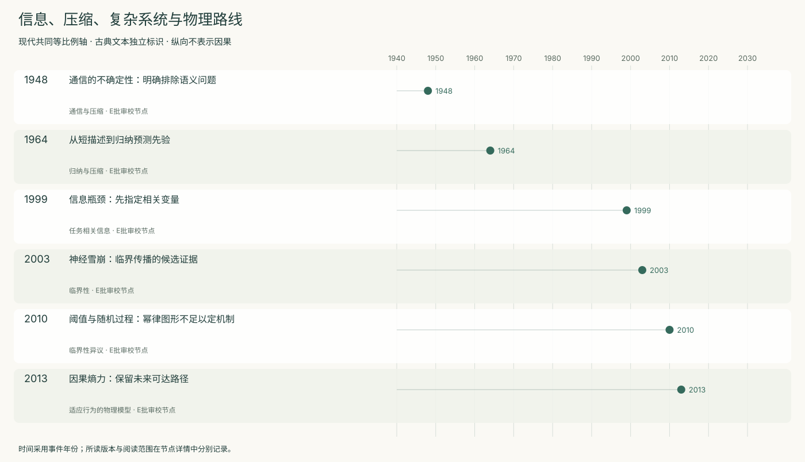
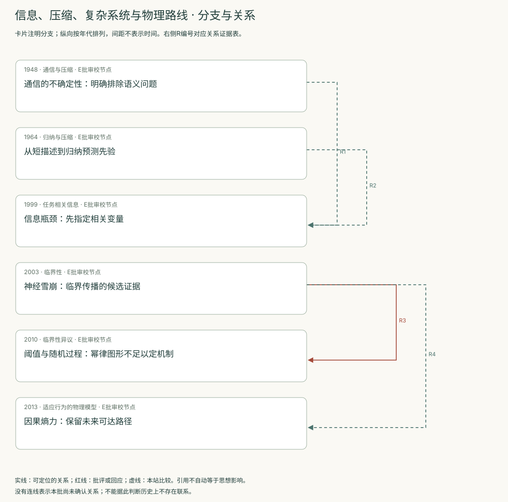
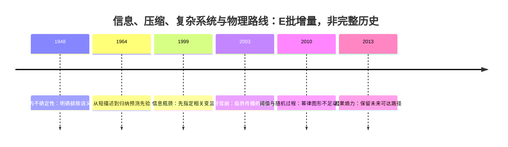
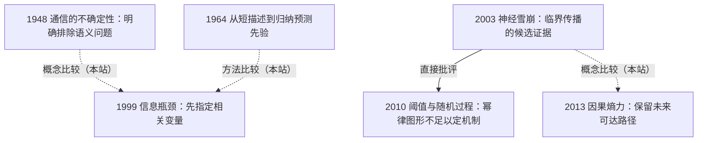

<!-- 由 research.json 生成；修改数据后重生成。E批已验收；不代表完整路线史。 -->

# 信息、压缩、复杂系统与物理路线 · E批增量

**已完成本批指定范围验收，后续扩展与未覆盖材料另列。** 当前6个本批节点，图中另有0个第二轮延续节点；此前各批记录独立保留。

从通信不确定性到归纳先验，问题由“能传多少”变为“怎样预测”；信息瓶颈又要求明确对什么变量有用。

临界性与因果熵提供物理模型，但从统计图形到生成机制、从简化行为到智能定义，都有需要额外检验的步骤。

[交互阅读](../atlas.html?route=information-physics) · [编辑SVG时间线](information-physics-timeline.svg) · [编辑SVG关系图](information-physics-relations.svg)

图中标为“第二轮延续”的节点用于呈现本批新增关系，不计入本批记录数。SVG关系编号与下表对应；完整原文定位见[关系台账](../relations.md)。

| 编号 | 关系 | 解释 |
| --- | --- | --- |
| R1 | 1948 → 1999 · 概念比较（本站） | 通信不确定性与相对Y的任务相关性分开；不是同一“信息”定义自然升级。 |
| R2 | 1964 → 1999 · 方法比较（本站） | 比较描述先验与给定Y的压缩目标，不宣称直接继承。 |
| R3 | 2003 → 2010 · 直接批评 | 后者挑战幂律足以支持临界性的推断；其猫记录与前者切片不同，不能称原样重复。 |
| R4 | 2003 → 2013 · 概念比较（本站） | 比较统计动力学与适应行为生成；两者都不直接给出通用智能定义。 |

[编辑时间线](information-physics-timeline.mmd) · [编辑关系图](information-physics-relations.mmd)

- [通信的不确定性：明确排除语义问题](../notes/e-shannon-1948.md)：怎样量化消息选择并设计可靠通信？
- [从短描述到归纳预测先验](../notes/e-solomonoff-1964.md)：如何从有限序列为后续事件分配概率？
- [信息瓶颈：先指定相关变量](../notes/e-tishby-1999.md)：压缩时应保留什么，而非把一切信息同等保留？
- [神经雪崩：临界传播的候选证据](../notes/e-beggs-plenz-2003.md)：局部神经活动如何兼顾传播与稳定？
- [阈值与随机过程：幂律图形不足以定机制](../notes/e-touboul-destexhe-2010.md)：看似幂律的雪崩分布是否充分证明自组织临界？
- [因果熵力：保留未来可达路径](../notes/e-wissner-gross-2013.md)：一种统一驱动力能否生成若干适应行为？

## 未覆盖范围与后续研究

- Rissanen 1978最小描述长度、Landauer 1961物理耗散尚未纳入正文选读。
- Solomonoff Part II及后来的收敛定理未读；信息瓶颈的现代深度学习争议不由1999稿代替。
- 临界性后续统计与跨尺度干预、因果熵补充材料及独立复现待补。

[返回E批](../README.md)
