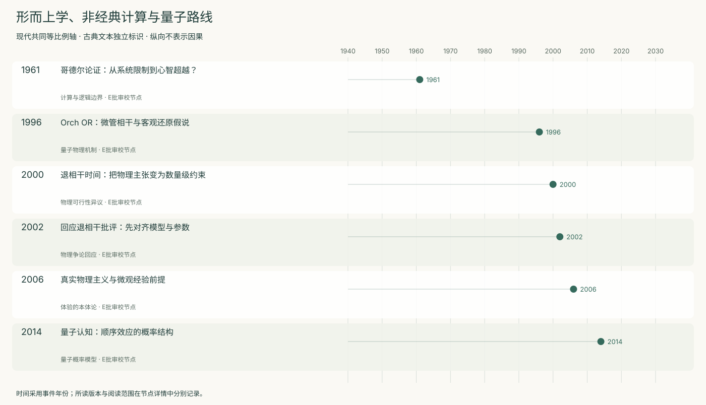
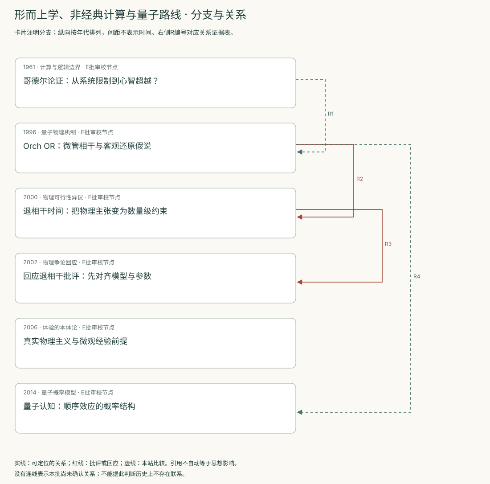
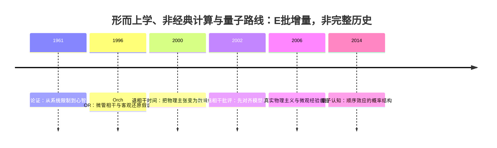
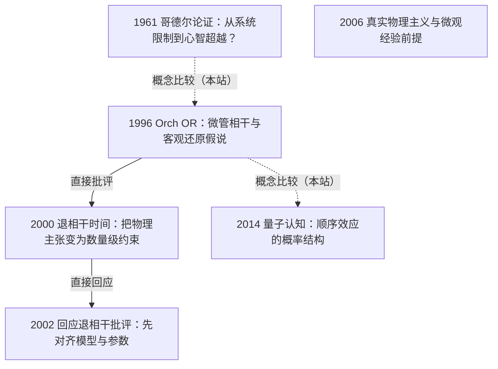

<!-- 由 research.json 生成；修改数据后重生成。E批已验收；不代表完整路线史。 -->

# 形而上学、非经典计算与量子路线 · E批增量

**已完成本批指定范围验收，后续扩展与未覆盖材料另列。** 当前6个本批节点，图中另有0个第二轮延续节点；此前各批记录独立保留。

哥德尔论证检验形式系统与心智能力之间的推论；泛心论处理经验存在的形而上学前提。

Orch OR及退相干争论属于物理机制假说；量子认知属于概率建模，二者的成立条件不可互换。

[交互阅读](../atlas.html?route=metaphysics-quantum) · [编辑SVG时间线](metaphysics-quantum-timeline.svg) · [编辑SVG关系图](metaphysics-quantum-relations.svg)

图中标为“第二轮延续”的节点用于呈现本批新增关系，不计入本批记录数。SVG关系编号与下表对应；完整原文定位见[关系台账](../relations.md)。

| 编号 | 关系 | 解释 |
| --- | --- | --- |
| R1 | 1961 → 1996 · 概念比较（本站） | 逻辑限制与物理机制是两层论证；前者不能单独推出特定微管机制。 |
| R2 | 1996 → 2000 · 直接批评 | 退相干计算针对脑内认知尺度相干假说；是否对齐原模型又受到下一节点质疑。 |
| R3 | 2000 → 2002 · 直接回应 | 回应认为模型自由度与参数需修订，提出更长时间估计；没有完成独立生理验证。 |
| R4 | 1996 → 2014 · 概念比较（本站） | 具体量子物理机制与量子概率描述分开；后者明说经典脑也可能呈现相关行为结构。 |

[编辑时间线](metaphysics-quantum-timeline.mmd) · [编辑关系图](metaphysics-quantum-relations.mmd)

- [哥德尔论证：从系统限制到心智超越？](../notes/e-lucas-1961.md)：形式系统的不完备能否推出人类心智不是机器？
- [Orch OR：微管相干与客观还原假说](../notes/e-hameroff-penrose-1996.md)：非计算解释和体验是否需要特定量子物理过程？
- [退相干时间：把物理主张变为数量级约束](../notes/e-tegmark-2000.md)：假定的脑内量子态能否保持足够久以参与认知？
- [回应退相干批评：先对齐模型与参数](../notes/e-hagan-2002.md)：Tegmark估计是否对应Orch OR的实际假设？
- [真实物理主义与微观经验前提](../notes/e-strawson-2006.md)：承认体验真实，又拒绝从全无体验到体验的强涌现，会得到什么？
- [量子认知：顺序效应的概率结构](../notes/e-wang-quantum-2014.md)：提问顺序如何系统性改变判断分布？

## 未覆盖范围与后续研究

- Penrose 1989著作与2014 Orch OR修订未全文选读；现代微管实验及其独立检验留待补读。
- Hagan按2002发表年锚定，实际阅读2000 v1，未与期刊版逐字校对。
- 泛心论组合问题的反驳文献与非经典计算其他分支尚未系统纳入。

[返回E批](../README.md)
