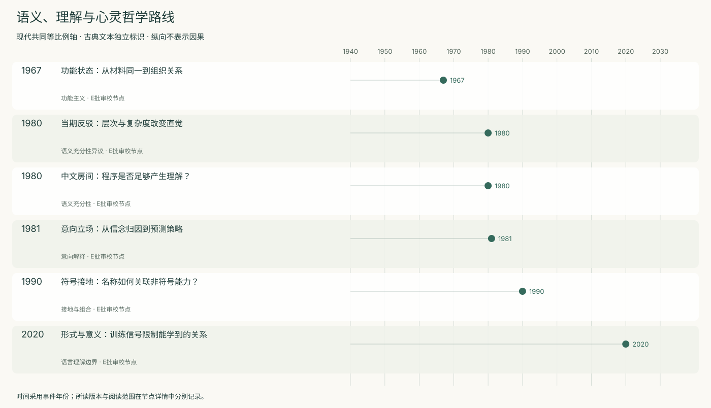
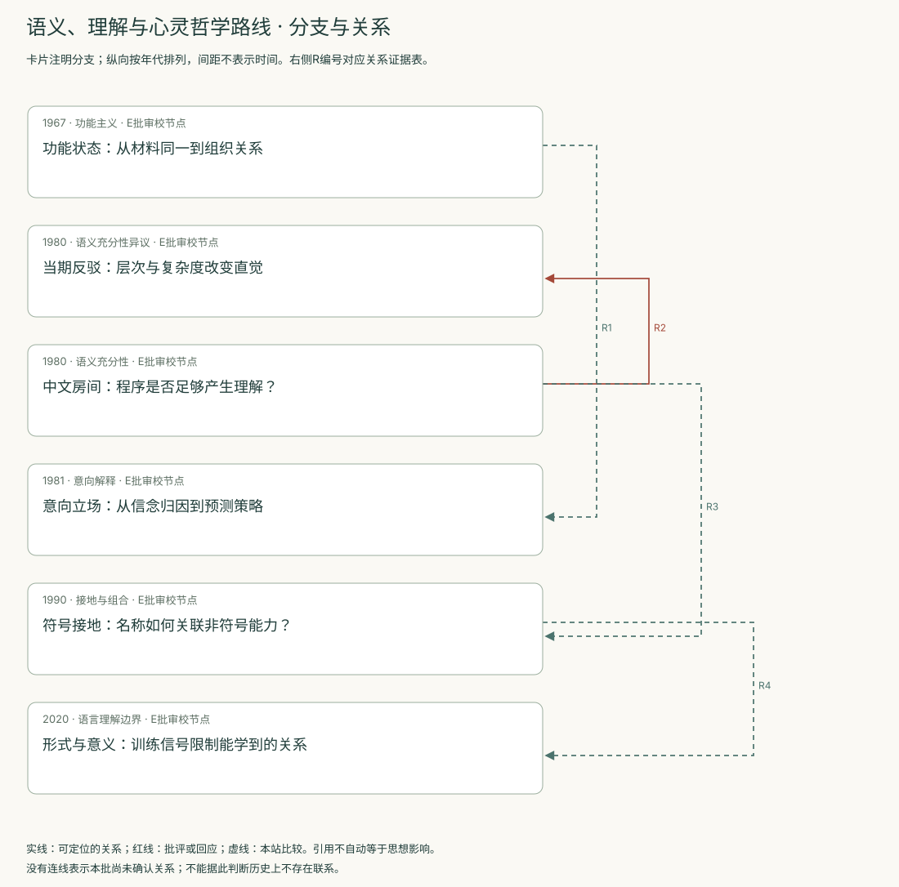
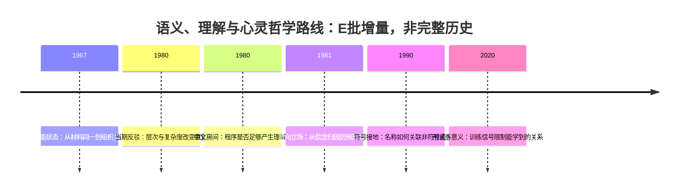
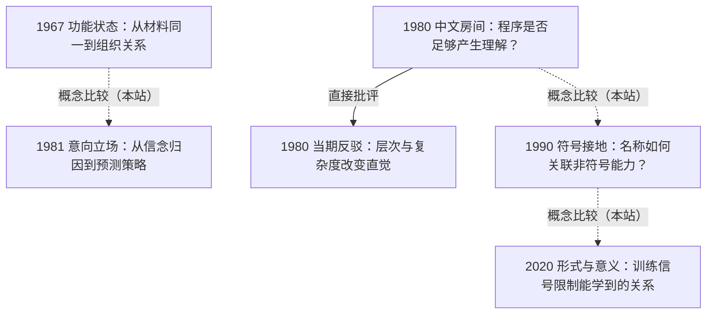

<!-- 由 research.json 生成；修改数据后重生成。E批已验收；不代表完整路线史。 -->

# 语义、理解与心灵哲学路线 · E批增量

**已完成本批指定范围验收，后续扩展与未覆盖材料另列。** 当前6个本批节点，图中另有0个第二轮延续节点；此前各批记录独立保留。

功能组织、意向预测、符号接地回答不同问题：状态是什么、怎样预测、符号怎样关联对象。

中文房间及当期评论保留相互挑战；2020形式与意义论证进一步明确训练输入和意义定义的限制。

[交互阅读](../atlas.html?route=philosophy-of-mind) · [编辑SVG时间线](philosophy-of-mind-timeline.svg) · [编辑SVG关系图](philosophy-of-mind-relations.svg)

图中标为“第二轮延续”的节点用于呈现本批新增关系，不计入本批记录数。SVG关系编号与下表对应；完整原文定位见[关系台账](../relations.md)。

| 编号 | 关系 | 解释 |
| --- | --- | --- |
| R1 | 1967 → 1981 · 概念比较（本站） | 功能组织说明与意向预测立场的对象不同，不能用术语相近代替思想继承证据。 |
| R2 | 1980 → 1980 · 直接批评 | 同时期评论直接批评中文房间的尺度、复杂度与系统层次直觉；箭头表示被批评对象到评论。 |
| R3 | 1980 → 1990 · 概念比较（本站） | 接地要求增加行为与世界约束，但Harnad明说仍不保证主观意义；不是宣布中文房间已被解决。 |
| R4 | 1990 → 2020 · 概念比较（本站） | 比较感知类别接地与交际意图关系；外部关系的含义并不完全相同。 |

[编辑时间线](philosophy-of-mind-timeline.mmd) · [编辑关系图](philosophy-of-mind-relations.mmd)

- [功能状态：从材料同一到组织关系](../notes/e-putnam-1967.md)：疼痛是否必须等同于跨物种相同的物理化学状态？
- [当期反驳：层次与复杂度改变直觉](../notes/e-hofstadter-1980.md)：低层执行者不理解，能否推出整体不理解？
- [中文房间：程序是否足够产生理解？](../notes/e-searle-1980.md)：合适的形式程序是否本身就足以产生意向性？
- [意向立场：从信念归因到预测策略](../notes/e-dennett-1981.md)：何种情况下把信念和欲望归给一个系统有解释力？
- [符号接地：名称如何关联非符号能力？](../notes/e-harnad-1990.md)：符号意义如何不只依赖解释者头脑中的其他符号？
- [形式与意义：训练信号限制能学到的关系](../notes/e-bender-koller-2020.md)：仅凭语言形式能否学到形式与交际意图的关系？

## 未覆盖范围与后续研究

- Dennett 1987书未整本读；本批改以已核对的1981论文为时间节点。
- Putnam后期功能主义修正、Searle作者答复以及其他语义理论待系统比较。
- 现代多模态、行动和社会互动系统须另行实测；这里不裁决任何在用模型是否理解。

[返回E批](../README.md)
