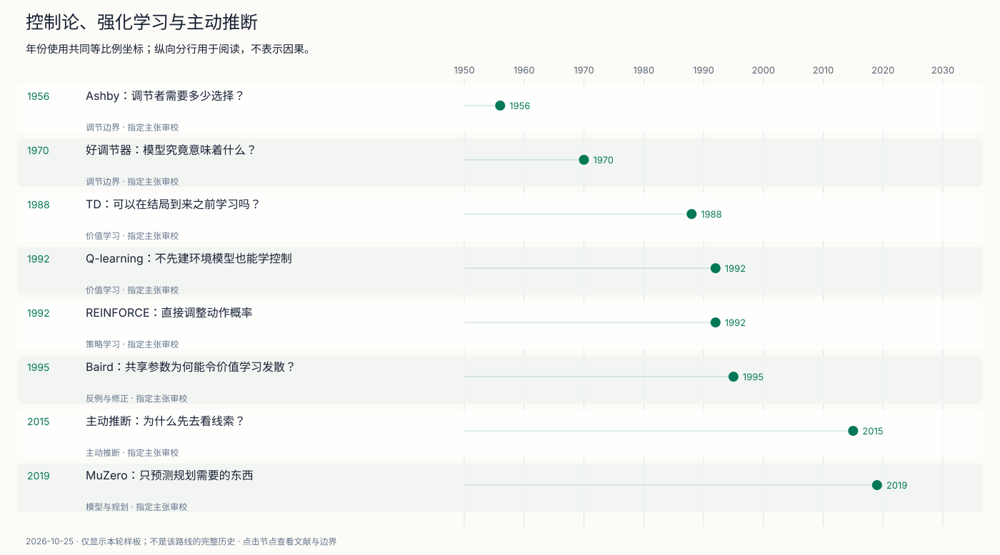
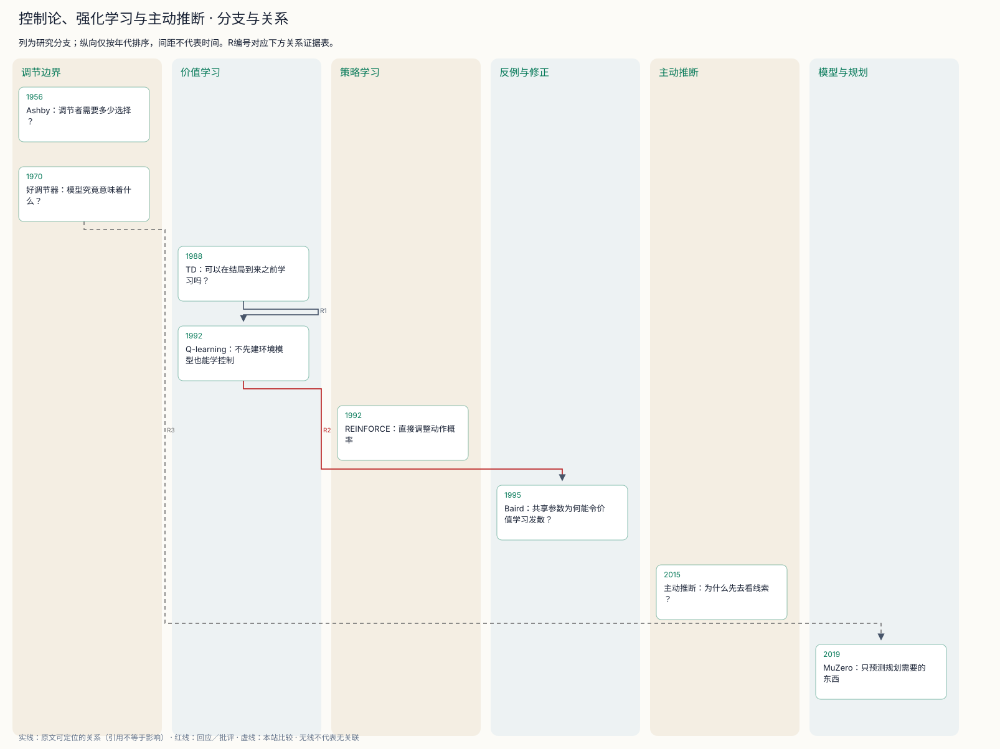

# 控制论、强化学习与主动推断

系统怎样维持目标、从反馈学习，并主动减少不确定性？

Ashby关注可用调节选择的容量，Conant与Ashby讨论最简单最优调节器的映射结构。两者提供约束视角，但不是现成学习算法。模型一词也不能未经解释就等同现代神经世界模型。

TD、Q-learning和REINFORCE分别把序列预测、动作价值和随机策略变成可学习对象。保证来自各自条件；Baird的共享参数反例阻止我们把表格结果直接推广为一般函数逼近定理。

主动推断把偏好与信息获取放进策略评价；MuZero通过任务相关潜在模型支持搜索。这是不同问题设定下的分支，不能画成一个依次替代前者的阶梯。

## 时间线

[编辑时间线](figures/cybernetics-rl-timeline.mmd) · [交互工作台](atlas.html)

## 分支图

[编辑分支图](figures/cybernetics-rl-branches.mmd)

## 节点与文献夹

- [1956 · Ashby：调节者需要多少选择？](notes/e-ashby-1956.md)：面对扰动，要把结果限制在可接受范围内，需要怎样的调节能力？
- [1970 · 好调节器：模型究竟意味着什么？](notes/e-conant-ashby-1970.md)：最简单的最优调节行为与被调节系统之间有何结构关系？
- [1988 · TD：可以在结局到来之前学习吗？](notes/e-sutton-1988.md)：序列预测能否用相邻预测变化，逐步分配信用？
- [1992 · Q-learning：不先建环境模型也能学控制](notes/e-watkins-dayan-1992.md)：未知转移概率和奖励时，怎样估计最优动作价值？
- [1992 · REINFORCE：直接调整动作概率](notes/e-williams-1992.md)：怎样在没有可微环境模型时沿期望奖励梯度学习？
- [1995 · Baird：共享参数为何能令价值学习发散？](notes/e-baird-1995.md)：表格收敛能否直接推广到函数逼近？
- [2015 · 主动推断：为什么先去看线索？](notes/e-friston-2015.md)：怎样把获取信息与达到偏好结果放进同一决策准则？
- [2019 · MuZero：只预测规划需要的东西](notes/e-schrittwieser-2019.md)：规划是否必须重建每个像素或真实状态？

## 图中关系证据

| 编号 | 两端 | 关系 | 依据与限制 |
| --- | --- | --- | --- |
| R1 | [1988 · TD：可以在结局到来之前学习吗？](notes/e-sutton-1988.md) → [1992 · Q-learning：不先建环境模型也能学控制](notes/e-watkins-dayan-1992.md) | 明确的方法联系 | Watkins与Dayan1992 §1，PDF1；后文明确说明更新方式与TD相近；不称TD直接推出其收敛证明。 |
| R2 | [1992 · Q-learning：不先建环境模型也能学控制](notes/e-watkins-dayan-1992.md) → [1995 · Baird：共享参数为何能令价值学习发散？](notes/e-baird-1995.md) | 回应／批评 | Baird1995 §2–4；明确针对从表格收敛到一般函数逼近的推广提出反例。 |
| R3 | [1970 · 好调节器：模型究竟意味着什么？](notes/e-conant-ashby-1970.md) → [2019 · MuZero：只预测规划需要的东西](notes/e-schrittwieser-2019.md) | 本站比较 | 本站比较：Conant1970 §4；MuZero2019 §1–3；两者都可用于提问任务相关信息保留，但模型定义、目标和证明对象不同；未发现直接历史影响证据。 |

## 仍需补齐

- Wiener与Bellman的原始工作、赋能度分支仍需补读，第一轮入口保留。
- 未执行原论文训练或SPM模拟；尚未系统比较主动推断与信念状态RL的等价条件及差异。
