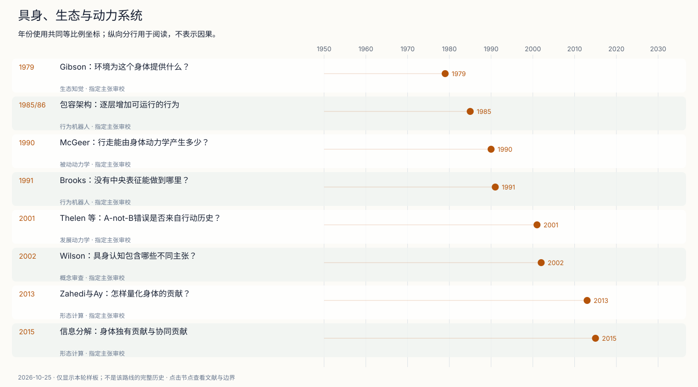
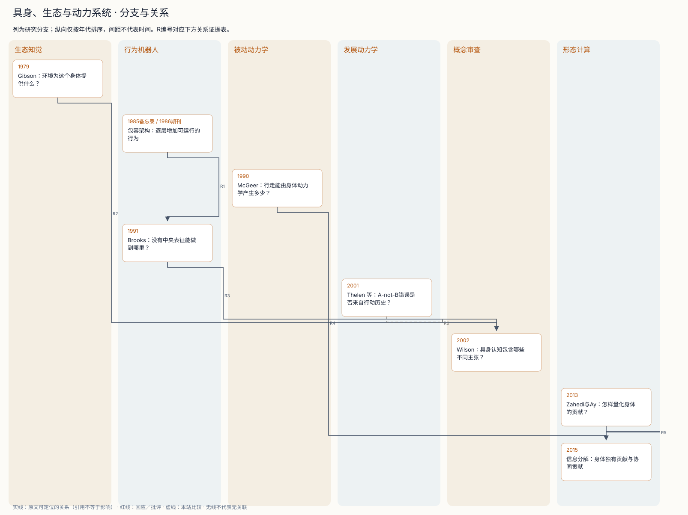

# 具身、生态与动力系统

智能行为应在大脑、身体与环境的哪一层解释？

Gibson从动物—环境关系界定供给性，Brooks从可运行的行为层构造机器人。前者是知觉理论，后者是架构与工程方法，两者不因都谈环境就成为同一种机制。

McGeer展示机械结构可贡献步态；Thelen等把行动历史引入婴儿错误模型。行为成功、动态描述、认知解释与神经实现需要不同证据，姿态实验的注意混杂也必须保留。

Wilson拆分具身认知命题，形态计算研究尝试量化身体与控制器的贡献。2013与2015指标的差异说明，系统边界、协同信息和因果性仍是核心问题。

## 时间线

[编辑时间线](figures/embodied-dynamical-timeline.mmd) · [交互工作台](atlas.html)

## 分支图

[编辑分支图](figures/embodied-dynamical-branches.mmd)

## 节点与文献夹

- [1979 · Gibson：环境为这个身体提供什么？](notes/e-gibson-1979.md)：知觉是否能直接发现相对于行动者的行动可能性？
- [1985 · 包容架构：逐层增加可运行的行为](notes/e-brooks-1986.md)：怎样增加机器人能力，同时保留已能运行的底层行为？
- [1990 · McGeer：行走能由身体动力学产生多少？](notes/e-mcgeer-1990.md)：步态的哪些部分可以交给机械结构与重力？
- [1991 · Brooks：没有中央表征能做到哪里？](notes/e-brooks-1991.md)：是否必须先建立统一世界表征，才能产生有效行为？
- [2001 · Thelen 等：A-not-B错误是否来自行动历史？](notes/e-thelen-2001.md)：婴儿反复伸向旧位置的错误，怎样随情境与历史变化？
- [2002 · Wilson：具身认知包含哪些不同主张？](notes/e-wilson-2002.md)：“身体重要”究竟支持哪些具体解释？
- [2013 · Zahedi与Ay：怎样量化身体的贡献？](notes/e-zahedi-ay-2013.md)：能否区分动作与身体—环境对下一状态的贡献？
- [2015 · 信息分解：身体独有贡献与协同贡献](notes/e-ghazi-zahedi-rauh-2015.md)：先前指标是否把身体贡献与身体—动作协同混在一起？

## 图中关系证据

| 编号 | 两端 | 关系 | 依据与限制 |
| --- | --- | --- | --- |
| R1 | [1985 · 包容架构：逐层增加可运行的行为](notes/e-brooks-1986.md) → [1991 · Brooks：没有中央表征能做到哪里？](notes/e-brooks-1991.md) | 方法扩展 | Brooks1991 §6.2与参考文献3，PDF7、12；后文明确沿用包容架构并指向1986实现；本轮早期节点实读版本为1985备忘录。 |
| R2 | [1979 · Gibson：环境为这个身体提供什么？](notes/e-gibson-1979.md) → [2002 · Wilson：具身认知包含哪些不同主张？](notes/e-wilson-2002.md) | 明确引用 | Wilson2002引言，PDF1；引用Gibson的生态知觉作为思想来源之一；引用不等于验证其全部命题。 |
| R3 | [1991 · Brooks：没有中央表征能做到哪里？](notes/e-brooks-1991.md) → [2002 · Wilson：具身认知包含哪些不同主张？](notes/e-wilson-2002.md) | 明确引用 | Wilson2002 Claim3，PDF5；讨论利用世界降低内部存储负担时直接引用Brooks1991。 |
| R4 | [1990 · McGeer：行走能由身体动力学产生多少？](notes/e-mcgeer-1990.md) → [2015 · 信息分解：身体独有贡献与协同贡献](notes/e-ghazi-zahedi-rauh-2015.md) | 明确引用 | Ghazi-Zahedi与Rauh2015引言，PDF1；明确用被动行走作为形态贡献实例；没有声称论文复现该机器人。 |
| R5 | [2013 · Zahedi与Ay：怎样量化身体的贡献？](notes/e-zahedi-ay-2013.md) → [2015 · 信息分解：身体独有贡献与协同贡献](notes/e-ghazi-zahedi-rauh-2015.md) | 方法扩展 | Ghazi-Zahedi与Rauh2015引言及§6，PDF2、7；后文明确以信息分解处理前文两种量化的差异。 |
| R6 | [2001 · Thelen 等：A-not-B错误是否来自行动历史？](notes/e-thelen-2001.md) → [2002 · Wilson：具身认知包含哪些不同主张？](notes/e-wilson-2002.md) | 本站比较 | 本站比较：Thelen2001 §4.2；Wilson2002 Claim4；将动态耦合机制与认知系统边界区分；不声称Wilson在此直接批评2001目标文。 |

## 仍需补齐

- Varela1991、Thelen与Smith1994专著及Beer动力系统框架未在本轮完成；行动生成论分支仍是明确缺口。
- 未开展机器人或婴儿实验复现；二元信息算例只能检查指标含义，不能替代真实身体证据。
