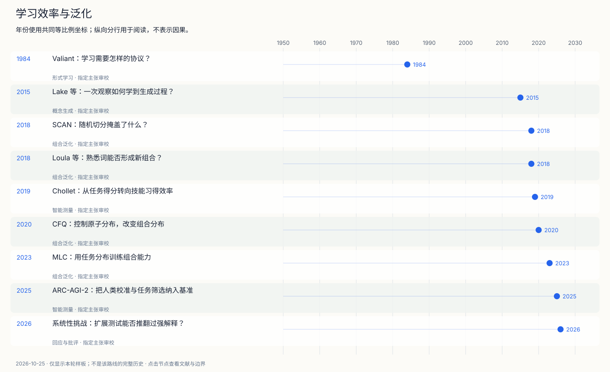
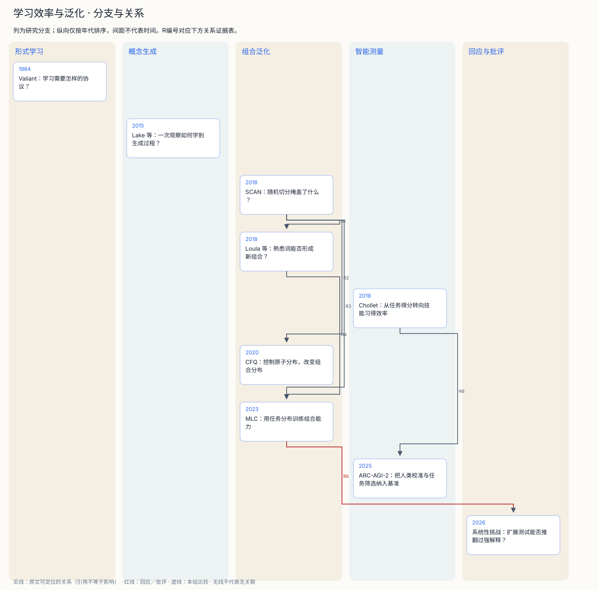

# 学习效率与泛化

学会一道题，与获得可迁移的学习能力，有何不同？

形式学习把问题变为可检验的协议：给什么经验、允许什么查询、能表示哪些概念、以什么概率和代价成功。Valiant 的原协议提醒我们，比较前先对齐这些条件。

概念生成与组合泛化提出另一层要求：新例子是否能通过已有部件重组得到？BPL让生成过程参与推断；SCAN及其后续工作把随机切分中看不出来的缺口显露出来，CFQ则尝试量化组合分布差异。

MLC说明训练任务分布可以显著改变某些组合泛化结果，但2023原文的结构外推失败和2026后续反例都限制了强解释。ARC线则追问怎样衡量技能习得效率；人类校准改善了基准设计，却仍留下外部效度问题。

## 时间线

[编辑时间线](figures/learning-efficiency-timeline.mmd) · [交互工作台](atlas.html)

## 分支图

[编辑分支图](figures/learning-efficiency-branches.mmd)

## 节点与文献夹

- [1984 · Valiant：学习需要怎样的协议？](notes/e-valiant-1984.md)：什么样的概念能以可控制的样本与计算代价学会？
- [2015 · Lake 等：一次观察如何学到生成过程？](notes/e-lake-2015.md)：为何人能从单个字符例子辨认并生成新实例？
- [2018 · SCAN：随机切分掩盖了什么？](notes/e-lake-baroni-2018.md)：学会单个动作和组合规则后，能否执行新组合？
- [2018 · Loula 等：熟悉词能否形成新组合？](notes/e-loula-2018.md)：SCAN失败是否仅因新词的表示没有训练好？
- [2019 · Chollet：从任务得分转向技能习得效率](notes/e-chollet-2019.md)：高任务得分能否区分知识积累、先验和适应能力？
- [2020 · CFQ：控制原子分布，改变组合分布](notes/e-keysers-2020.md)：怎样超越直觉切分，量化组合分布偏移？
- [2023 · MLC：用任务分布训练组合能力](notes/e-lake-baroni-2023.md)：训练方式能否让标准网络获得更强组合泛化并预测人的偏差？
- [2025 · ARC-AGI-2：把人类校准与任务筛选纳入基准](notes/e-arc-agi-2-2025.md)：怎样改善难度分布、旧任务泄漏风险和缺少统一人类基线的问题？
- [2026 · 系统性挑战：扩展测试能否推翻过强解释？](notes/e-goodale-mascarenhas-2026.md)：MLC的优秀行为是否足以解释系统性？

## 图中关系证据

| 编号 | 两端 | 关系 | 依据与限制 |
| --- | --- | --- | --- |
| R1 | [2018 · SCAN：随机切分掩盖了什么？](notes/e-lake-baroni-2018.md) → [2018 · Loula 等：熟悉词能否形成新组合？](notes/e-loula-2018.md) | 方法扩展 | Loula2018 §1，PDF1；后文明确说扩展SCAN框架，控制熟悉词组合；这是方法扩展证据。 |
| R2 | [2018 · SCAN：随机切分掩盖了什么？](notes/e-lake-baroni-2018.md) → [2020 · CFQ：控制原子分布，改变组合分布](notes/e-keysers-2020.md) | 复用评测 | Keysers2020 §4–5，PDF6–8；DBCA在SCAN及CFQ上构造和比较切分；不推断全部思想来源。 |
| R3 | [2018 · SCAN：随机切分掩盖了什么？](notes/e-lake-baroni-2018.md) → [2023 · MLC：用任务分布训练组合能力](notes/e-lake-baroni-2023.md) | 复用评测 | Lake与Baroni2023正文PDF4–5；MLC重测SCAN词汇切分，另报告长度失败。 |
| R4 | [2018 · Loula 等：熟悉词能否形成新组合？](notes/e-loula-2018.md) → [2023 · MLC：用任务分布训练组合能力](notes/e-lake-baroni-2023.md) | 复用评测 | Lake与Baroni2023表2，PDF5；重测around right等组合切分；训练协议改变，数字不可当纯架构对照。 |
| R5 | [2023 · MLC：用任务分布训练组合能力](notes/e-lake-baroni-2023.md) → [2026 · 系统性挑战：扩展测试能否推翻过强解释？](notes/e-goodale-mascarenhas-2026.md) | 回应／批评 | Goodale与Mascarenhas2026 §2–3，PDF4–9；明确重用原作者最佳代数模型，提出行为反例及解释标准批评。 |
| R6 | [2019 · Chollet：从任务得分转向技能习得效率](notes/e-chollet-2019.md) → [2025 · ARC-AGI-2：把人类校准与任务筛选纳入基准](notes/e-arc-agi-2-2025.md) | 方法扩展 | ARC-AGI-2 v1 §1、§4–5；后文明确沿用原ARC框架并增加人类校准和筛选。 |

## 仍需补齐

- Fodor与Pylyshyn1988原文的完整论证仍需单独深读；本轮只通过后续研究对其论证的讨论了解争论入口。
- 缺少现实任务、跨文化人类测试、最新模型与长期污染控制的系统检索；没有穷尽到2026年。
